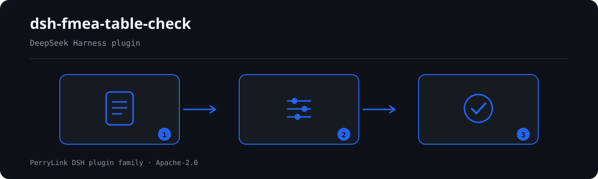

# dsh-fmea-table-check — Verificação da completude dos elementos da folha de FMEA e da consistência do número de prioridade de risco

[English](README.md) · [简体中文](README-zh.md) · [Español](README-es.md) · [Português](README-pt.md) · [हिन्दी](README-hi.md)

[](https://dsh.market/)
[](https://dshfind.com/en/plugins/PerryLink/dsh-fmea-table-check?ref=badge)

`dsh-fmea-table-check` lê uma folha de FMEA —linhas indexadas pelos próprios nomes de coluna da folha, em chinês ou em inglês— e verifica nela o que a uma folha se pode exigir mecanicamente: que a cadeia de análise esteja registada, que as pontuações de severidade, ocorrência e deteção sejam números operáveis, que o número de prioridade de risco seja igual ao seu produto, que uma linha de risco elevado traga uma ação com responsável e prazo, que os estados das ações venham do seu próprio vocabulário e que não sobreviva nenhum marcador de modelo no modo de falha.

## Install

```sh
dsh plugin --profile <name> add dsh-fmea-table-check
dsh --profile <name> --dump-config | grep 'dsh-fmea-table-check'
```

## Como é a saída



*Visão geral do fluxo: documento → regras → achados. Os exemplos abaixo usam a superfície real de comandos.*


Saída real deste plugin sobre o seu próprio fixture de teste `FM-002` — não é uma simulação. O pacote de regras não inventa citações, por isso cada achado nomeia a cláusula aplicada e avisa que o seu texto não foi obtido.

## O que ele responde

### Exemplos

A tabela abaixo é o conjunto de exemplos: a primeira linha é o caso detalhado e as demais são casos curtos.


| Você pergunta | O que ele responde |
|---|---|
| A célula do RPN não coincide com severidade × ocorrência × deteção — isso é detetado? | Sim. `FM-003` recalcula `rpn` como severidade × ocorrência × deteção com tolerância `0` e assinala a linha cujo valor registado difere. Só é executada quando as quatro células têm números analisáveis; se a pontuação de ocorrência não for um número, a regra reporta `skipped` em vez de passar. Uma folha pontuada pelo manual AIAG-VDA usa AP em vez de RPN: reaponte `resultField` e `factorFields`, ou desative a regra. |
| A célula da severidade traz `高` em vez de uma pontuação. O que acontece? | `FM-002` exige que a severidade seja um número positivo operável e reporta a linha quando não é. A sua verificação aponta apenas ao campo `severity`, pelo que ocorrência e deteção exigem a mesma regra acrescentada com outro `field`; não fixa intervalo de valores, portanto não impõe uma escala de 1 a 10 nem julga se a pontuação é adequada. Uma pontuação que não consegue analisar também envia `FM-003` para `skipped`, porque o produto não pode ser recalculado. |
| Uma linha propõe uma ação, mas o responsável e o prazo estão em branco. | `FM-005` é executada em todas as linhas cuja célula de ação recomendada esteja preenchida e exige `owner` (responsável) e `dueAt` (prazo); reporta a linha à qual falta um deles. São os nomes canónicos após a resolução de alias, pelo que uma folha com outros cabeçalhos precisa do alias no mapeamento de colunas ou de `requiredFields` ajustado. Verifica que as duas células estão preenchidas — não que o prazo seja realista nem que o responsável o tenha aceitado. As linhas sem ação são da competência de `FM-004`. |
| A nossa folha nunca diz que produto ou processo analisa. | `FM-007` lê o `item` do cabeçalho e reporta-o quando falta o objeto de análise: um FMEA é realizado para um produto ou processo específico e sem isso as conclusões não se podem rastrear nem associar a uma tabela de pontuação. É uma verificação de presença: um objeto preenchido mas errado não é reportado. Se as suas folhas tiverem de indicar também o método usado, acrescente `method` aos seus `fields`. |
| Algumas linhas ainda dizem `待填` ou `XXX` na coluna do modo de falha, e outras não têm nada. | `FM-008` reporta a linha cujo modo de falha ainda contém um dos termos marcadores do pacote (`【`, `】`, `{{`, `}}`, `XXX`, `xxx`, `待填`, `待补充`, `TBD`, `todo`, `示例`), porque uma folha copiada de um modelo lê-se como análise concluída; lê apenas a coluna do modo de falha, e `terms` ajusta-se ao seu modelo. `FM-001` reporta a linha em que modo de falha, efeito e causa estão os três vazios, mas exige apenas um dos três: uma célula com `待填` satisfaz `FM-001` e é apanhada por `FM-008`. Nenhuma das duas julga se os modos de falha estão completos ou se os efeitos foram analisados o suficiente. |
| O relatório mostra `FM-004` e `FM-006` como `skipped`. Há algum problema? | Não. Ambas vêm por configurar e o pacote reporta isso em vez de passar em silêncio. O `threshold` de `FM-004` é `0`, lido como não configurado, pelo que nenhuma linha conta como risco elevado até definir o seu critério de risco: por exemplo `triggerField: severity` com `threshold: 9`, ou `triggerField: rpn` com `threshold: 100`. A lista `values` de `FM-006` está vazia, pelo que o vocabulário de estados não é verificado até enumerar os seus próprios valores. Depois de configuradas, `FM-004` verifica apenas que a célula de ação de uma linha de risco elevado está preenchida — não que a ação seja eficaz ou viável — e `FM-006` verifica apenas que o estado consta da lista configurada, não que a ação tenha sido executada. |

## Normas que segue

| Documento | Número | Regras que o citam |
|---|---|---|
| 《系统可靠性分析技术 失效模式和影响分析（FMEA）程序》 | GB/T 7826（现行版本号与条号本次未核实） | FM-001, FM-002, FM-003, FM-004, FM-005, FM-006, FM-007, FM-008 |

**Boundary:** this plugin checks an **FMEA worksheet** for what a sheet can be held to mechanically — that
the analysis chain is recorded, that the severity / occurrence / detection scores are operable numbers,
that the risk priority number equals their product, that a high-risk row carries an action with an owner and
a due date, that action statuses come from your vocabulary, and that no template placeholder survives. It
does **not** judge whether the failure modes are complete, whether the consequences are analysed far enough,
whether the scores are right, or whether the risk is acceptable. **Those are the study team's judgements,
and they are where FMEA's value lies.**

> ### ⚠️ Read this before trusting a citation in the report
>
> **Every `excerpt` in this plugin's rule pack says, in so many words, that the clause text was not
> obtained.** The method's homes are **GB/T 7826《系统可靠性分析技术 失效模式和影响分析（FMEA）程序》**,
> IEC 60812, and the automotive AIAG-VDA handbook. The verification pass could not retrieve verbatim clause
> text from them, so rather than paraphrase a quotation the pack states the gap in the `excerpt` field
> itself and puts the honest reasoning in `note`. Every rule is therefore `warn` or `info`, and a test
> asserts that no rule claims a quotation it does not have. **When the texts are in hand, two things must be
> done: replace each `excerpt` with the real clause, and raise `kind` to `direct`.**
>
> Two settings are yours. **FM-003's RPN arithmetic assumes the S×O×D method**; a worksheet built on the
> AIAG-VDA handbook uses **AP (action priority)** instead, so repoint `resultField` and `factorFields` — or
> disable the rule. And **FM-004's threshold ships as `0`, meaning "not configured"**: what counts as high
> risk is your risk criterion, and the rule reports that it could not run rather than inventing a number.

## Compatibility

| Superfície | Estado |
|---|---|
| Harness | Faixa de peers `>=0.1.2-rc.1 <0.2.0 \|\| >=0.2.0-0 <0.3.0` — verificada para aceitar tanto `0.2.0-rc.2` quanto `0.2.1-rc.2`. **`engines.dsh` é declarado como `>=0.2.1-0 <0.3.0`** e o host o aplica desde 0.2.1 |
| Node | `^22.19.0 || >=24.0.0` |
| Plataformas | Todas (ESM puro; sem código nativo, sem rede, sem chamada ao modelo) |
| Modo de ferramenta | Funciona em `native` e `ptc`; para um diretório inteiro use `ptc` |

## What it does

A tabela de regras, os campos e o comportamento detalhado estão em [README.md](README.md#what-it-does) (versão principal em inglês). O plugin apenas lista divergências literais frente às cláusulas citadas e indica em `skipped` cada verificação que não pôde ser executada.

## Configuration

Todos os parâmetros ajustáveis ficam no esquema Schemastery de `src/config.ts`, portanto mudam pelo `cordis.yml` sem editar código; os limites por regra ficam no pacote de regras sob `rules/`.

| Chave | Tipo | Padrão | Descrição |
|---|---|---|---|
| `rulesFile` | string | `rules/fmea-table-check.yaml` | Caminho do pacote de regras, relativo à raiz do pacote |
| `disabledRules` | string[] | `[]` | Ids de regras a desativar; cada uma aparece em `skipped` |
| `onlyRules` | string[] | `[]` | Executar apenas estas regras; vazio executa todas |
| `skipNotes` | string | `""` | Nota acrescentada a cada motivo de `skipped` |
| `timeoutMs` | number | `120000` | Orçamento de tempo limite cooperativo da ferramenta |

## Material format

Aceita JSON ou YAML. O exemplo completo de campos está em [README.md](README.md#material-format) (versão principal em inglês). Os campos são opcionais na camada de leitura e validados pelo motor, de modo que uma exportação parcial gera achados sobre o que falta em vez de falhar.

## Rule sources

Os dados das regras ficam separados do código: cada regra traz documento, número, cláusula na numeração própria da fonte, trecho literal e URL de origem. O carregador impõe que o trecho seja citação real de pelo menos oito caracteres e que uma verificação baseada apenas em princípio geral (`kind: derived-from-principle`, teto `warn`) ou em política local (`kind: institutional-configuration`, teto `info`) nunca seja declarada `error`.

Os limites verificados e as conclusões deliberadamente **não** afirmadas estão em [README.md](README.md#rule-sources) (versão principal em inglês) e em `rules/evidence/`.

## Troubleshooting

- **O plugin instala mas a ferramenta não aparece**: confirme que `main` resolve para `lib/index.mjs` e que `pnpm run build` o gerou.
- **`dsh plugin add` recusa o pacote**: a faixa de peers cobre `0.1.x` e `0.2.x`; fora dela, conceda isenção explícita com `dsh plugin --profile <name> allow-version <pkg@ver> --dsh-version <runtime> --accept-risk`.
- **Uma regra não executou**: leia o arranjo `skipped`.
- **`check` informa `manifest-peers` como falha**: problema conhecido do `dsh-plugin-dev`; o runtime aplica a compatibilidade na instalação.
- **Os horários parecem deslocados**: toda a aritmética é de hora local sobre as cadeias fornecidas.

## Development

```sh
pnpm install
pnpm run typecheck
pnpm test
pnpm run build
node ../scripts/sync-shared.mjs dsh-fmea-table-check
```

O último comando copia o kit compartilhado de `../_shared` para `src/shared/`; execute-o novamente após cada alteração compartilhada.

## PerryLink DSH Plugin Family

Este projeto faz parte da família de plugins do DeepSeek Harness da [PerryLink](https://github.com/PerryLink). O registro fica recolhido abaixo para que cada README mantenha uma primeira tela curta; expanda para ver cada linha e seu status.

<details>
<summary>Expandir todos os plugins</summary>

| Plugin | Status |
|---|---|
| **[dsh-aqua-input-check](https://github.com/PerryLink/dsh-aqua-input-check)** |  |
| **[dsh-archive-check](https://github.com/PerryLink/dsh-archive-check)** |  |
| **[dsh-auto-review](https://github.com/PerryLink/dsh-auto-review)** |  |
| **[dsh-autotier](https://github.com/PerryLink/dsh-autotier)** |  |
| **[dsh-bid-ca-precheck](https://github.com/PerryLink/dsh-bid-ca-precheck)** |  |
| **[dsh-bid-qual-check](https://github.com/PerryLink/dsh-bid-qual-check)** |  |
| **[dsh-cert-mcp](https://github.com/PerryLink/dsh-cert-mcp)** |  |
| **[dsh-checkpoint-rewind](https://github.com/PerryLink/dsh-checkpoint-rewind)** |  |
| **[dsh-click](https://github.com/PerryLink/dsh-click)** |  |
| **[dsh-composer-history](https://github.com/PerryLink/dsh-composer-history)** |  |
| **[dsh-contract-stance](https://github.com/PerryLink/dsh-contract-stance)** |  |
| **[dsh-customs-doc-check](https://github.com/PerryLink/dsh-customs-doc-check)** |  |
| **[dsh-data-quality](https://github.com/PerryLink/dsh-data-quality)** |  |
| **[dsh-demurrage-ledger](https://github.com/PerryLink/dsh-demurrage-ledger)** |  |
| **[dsh-doublecheck](https://github.com/PerryLink/dsh-doublecheck)** |  |
| **[dsh-drill-script-check](https://github.com/PerryLink/dsh-drill-script-check)** |  |
| **[dsh-eia-guide-check](https://github.com/PerryLink/dsh-eia-guide-check)** |  |
| **[dsh-emergency-plan](https://github.com/PerryLink/dsh-emergency-plan)** |  |
| **[dsh-essay-rubric-check](https://github.com/PerryLink/dsh-essay-rubric-check)** |  |
| **[dsh-evidence-check](https://github.com/PerryLink/dsh-evidence-check)** |  |
| **[dsh-export-ctl-check](https://github.com/PerryLink/dsh-export-ctl-check)** |  |
| **[dsh-fast](https://github.com/PerryLink/dsh-fast)** |  |
| **[dsh-fmea-table-check](https://github.com/PerryLink/dsh-fmea-table-check)** |  |
| **[dsh-forecast-penalty](https://github.com/PerryLink/dsh-forecast-penalty)** |  |
| **[dsh-fund-research](https://github.com/PerryLink/dsh-fund-research)** |  |
| **[dsh-github](https://github.com/PerryLink/dsh-github)** |  |
| **[dsh-gongwen-flow-check](https://github.com/PerryLink/dsh-gongwen-flow-check)** |  |
| **[dsh-gongwen-word-check](https://github.com/PerryLink/dsh-gongwen-word-check)** |  |
| **[dsh-guard-plan-qc](https://github.com/PerryLink/dsh-guard-plan-qc)** |  |
| **[dsh-hazchem-check](https://github.com/PerryLink/dsh-hazchem-check)** |  |
| **[dsh-hazplan-check](https://github.com/PerryLink/dsh-hazplan-check)** |  |
| **[dsh-hidden-risk-map](https://github.com/PerryLink/dsh-hidden-risk-map)** |  |
| **[dsh-hs-classify](https://github.com/PerryLink/dsh-hs-classify)** |  |
| **[dsh-icd-rule-check](https://github.com/PerryLink/dsh-icd-rule-check)** |  |
| **[dsh-industry-research](https://github.com/PerryLink/dsh-industry-research)** |  |
| **[dsh-lawcite-adapter](https://github.com/PerryLink/dsh-lawcite-adapter)** |  |
| **[dsh-laya](https://github.com/PerryLink/dsh-laya)** |  |
| **[dsh-lc-doc-check](https://github.com/PerryLink/dsh-lc-doc-check)** |  |
| **[dsh-learning-gap-check](https://github.com/PerryLink/dsh-learning-gap-check)** |  |
| **[dsh-library](https://github.com/PerryLink/dsh-library)** |  |
| **[dsh-local-ai](https://github.com/PerryLink/dsh-local-ai)** |  |
| **[dsh-lsp-actions](https://github.com/PerryLink/dsh-lsp-actions)** |  |
| **[dsh-mask](https://github.com/PerryLink/dsh-mask)** |  |
| **[dsh-mcp-panel](https://github.com/PerryLink/dsh-mcp-panel)** |  |
| **[dsh-medrec-qc](https://github.com/PerryLink/dsh-medrec-qc)** |  |
| **[dsh-memento](https://github.com/PerryLink/dsh-memento)** |  |
| **[dsh-nsfc-form-check](https://github.com/PerryLink/dsh-nsfc-form-check)** |  |
| **[dsh-nurse-record-check](https://github.com/PerryLink/dsh-nurse-record-check)** |  |
| **[dsh-observe](https://github.com/PerryLink/dsh-observe)** |  |
| **[dsh-origin-rvc-check](https://github.com/PerryLink/dsh-origin-rvc-check)** |  |
| **[dsh-ota-review-check](https://github.com/PerryLink/dsh-ota-review-check)** |  |
| **[dsh-output-styles](https://github.com/PerryLink/dsh-output-styles)** |  |
| **[dsh-paper-doc-adapter](https://github.com/PerryLink/dsh-paper-doc-adapter)** |  |
| **[dsh-permission-rules](https://github.com/PerryLink/dsh-permission-rules)** |  |
| **[dsh-permit-report-check](https://github.com/PerryLink/dsh-permit-report-check)** |  |
| **[dsh-pipeline-check](https://github.com/PerryLink/dsh-pipeline-check)** |  |
| **[dsh-pleading-draft](https://github.com/PerryLink/dsh-pleading-draft)** |  |
| **[dsh-plugin-doctor](https://github.com/PerryLink/dsh-plugin-doctor)** |  |
| **[dsh-plugin-guide](https://github.com/PerryLink/dsh-plugin-guide)** |  |
| **[dsh-plugin-kit](https://github.com/PerryLink/dsh-plugin-kit)** |  |
| **[dsh-plugin-upgrade](https://github.com/PerryLink/dsh-plugin-upgrade)** |  |
| **[dsh-policy-brief-draft](https://github.com/PerryLink/dsh-policy-brief-draft)** |  |
| **[dsh-power-loss-split](https://github.com/PerryLink/dsh-power-loss-split)** |  |
| **[dsh-power-ticket-check](https://github.com/PerryLink/dsh-power-ticket-check)** |  |
| **[dsh-ppap-check](https://github.com/PerryLink/dsh-ppap-check)** |  |
| **[dsh-protest-deadline](https://github.com/PerryLink/dsh-protest-deadline)** |  |
| **[dsh-railway-window](https://github.com/PerryLink/dsh-railway-window)** |  |
| **[dsh-repair-order-qc](https://github.com/PerryLink/dsh-repair-order-qc)** |  |
| **[dsh-research-report](https://github.com/PerryLink/dsh-research-report)** |  |
| **[dsh-review-reply-check](https://github.com/PerryLink/dsh-review-reply-check)** |  |
| **[dsh-rulefile-check](https://github.com/PerryLink/dsh-rulefile-check)** |  |
| **[dsh-safety-brief-check](https://github.com/PerryLink/dsh-safety-brief-check)** |  |
| **[dsh-score](https://github.com/PerryLink/dsh-score)** |  |
| **[dsh-session-sync](https://github.com/PerryLink/dsh-session-sync)** |  |
| **[dsh-site-log-check](https://github.com/PerryLink/dsh-site-log-check)** |  |
| **[dsh-skill-pack-security](https://github.com/PerryLink/dsh-skill-pack-security)** |  |
| **[dsh-soe-decision-check](https://github.com/PerryLink/dsh-soe-decision-check)** |  |
| **[dsh-soilwater-check](https://github.com/PerryLink/dsh-soilwater-check)** |  |
| **[dsh-sop-sync-check](https://github.com/PerryLink/dsh-sop-sync-check)** |  |
| **[dsh-spc-gbt-adapter](https://github.com/PerryLink/dsh-spc-gbt-adapter)** |  |
| **[dsh-talk](https://github.com/PerryLink/dsh-talk)** |  |
| **[dsh-tender-extract](https://github.com/PerryLink/dsh-tender-extract)** |  |
| **[dsh-tender-matrix](https://github.com/PerryLink/dsh-tender-matrix)** |  |
| **[dsh-test-drive](https://github.com/PerryLink/dsh-test-drive)** |  |
| **[dsh-ticktick](https://github.com/PerryLink/dsh-ticktick)** |  |
| **[dsh-translate](https://github.com/PerryLink/dsh-translate)** |  |
| **[dsh-warranty-calc](https://github.com/PerryLink/dsh-warranty-calc)** |  |
| **[dsh-budget](https://github.com/PerryLink/dsh-budget)** | 🧊 CONGELADO — ver o README do repositório |
| **[dsh-claude-move](https://github.com/PerryLink/dsh-claude-move)** | 🧊 CONGELADO — ver o README do repositório |
| **[dsh-defend](https://github.com/PerryLink/dsh-defend)** | 🧊 CONGELADO — ver o README do repositório |
| **[dsh-draw](https://github.com/PerryLink/dsh-draw)** | 🧊 CONGELADO — ver o README do repositório |
| **[dsh-reach](https://github.com/PerryLink/dsh-reach)** | 🧊 CONGELADO — ver o README do repositório |
| **[dsh-background-agents](https://github.com/PerryLink/dsh-background-agents)** | 🚫 RETIRADO — ver o README do repositório |
| **[dsh-session-pin](https://github.com/PerryLink/dsh-session-pin)** | 🚫 RETIRADO — ver o README do repositório |
| **[dsh-team-rooms](https://github.com/PerryLink/dsh-team-rooms)** | 🚫 RETIRADO — ver o README do repositório |

</details>

## License

[Apache License 2.0](LICENSE) © 2026 dsh-fmea-table-check contributors.
