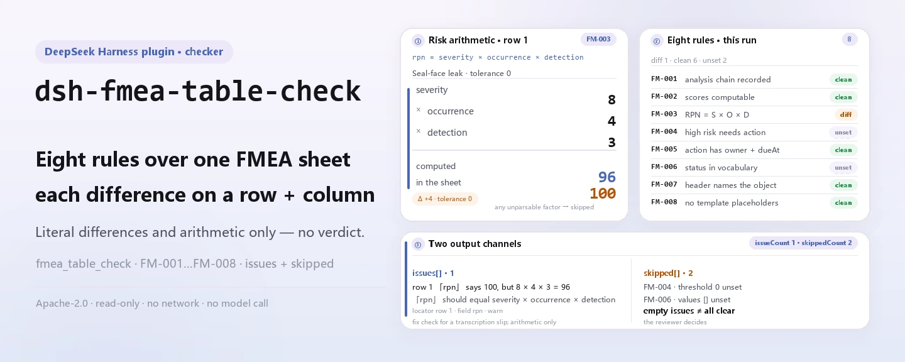

<div align="center">

<picture>
  <source media="(prefers-color-scheme: dark)" srcset="docs/assets/dsh-fmea-table-check-hero-en-dark.webp">
  
</picture>

# dsh-fmea-table-check

**Turn an FMEA worksheet into a row-by-row list of what differs and where — the original is never modified, and the conclusion stays with the reviewer.**

A DeepSeek Harness worksheet checker for quality and process engineers: it reads one FMEA sheet with Chinese or English headers, applies eight rules to the analysis chain, score operability, and RPN arithmetic, and lists only the differences it can point to in the material.

[Install](#three-step-setup) · [Configuration](#configuration) · [FAQ](#faq) · [简体中文](README.md) · [English](README.en.md) · [Español](README.es.md) · [Português](README.pt.md) · [हिन्दी](README.hi.md)

[](LICENSE)
[](#compatibility)
[](https://www.npmjs.com/package/dsh-fmea-table-check)
[](https://github.com/PerryLink/dsh-fmea-table-check/actions/workflows/ci.yml)
[](#compatibility)

[](https://github.com/PerryLink/dsh-fmea-table-check/stargazers)
[](https://www.npmjs.com/package/dsh-fmea-table-check)
[](https://dshfind.com/plugins/PerryLink/dsh-fmea-table-check?ref=badge)
[](https://securityscorecards.dev/viewer/?uri=github.com/PerryLink/dsh-fmea-table-check)
[](https://dsh.market/)
[](https://gitee.com/perrylink/dsh-fmea-table-check)

```sh
dsh plugin --profile <name> add dsh-fmea-table-check
```

</div>

<sub>Community plugin, not affiliated with DeepSeek. Canonical repository: <https://github.com/PerryLink/dsh-fmea-table-check> (Gitee is a mirror).</sub>

## What it is

`dsh-fmea-table-check` reads one FMEA worksheet — rows keyed by the sheet's own column names, in Chinese or English — and checks what a sheet can be held to mechanically: that the analysis chain is recorded, that severity, occurrence and detection are operable numbers, that the risk priority number (RPN) equals their product, that a high-risk row carries an action with an owner and a due date, that action statuses come from the vocabulary you configure, and that no template placeholder survives in the failure-mode column.

It turns those checks into a row-by-row list of what differs and where, summarised by severity; a check that cannot run is reported in `skipped` and never passes silently.

<picture>
  <source media="(prefers-color-scheme: dark)" srcset="docs/assets/dsh-fmea-table-check-flow-v5-dark.svg">
  
</picture>

It does not judge whether the failure modes are complete, whether the consequences are analysed far enough, whether the scores are right, or whether the risk is acceptable — those are the study team's judgements, and they are where FMEA's value lies.

Plain ESM throughout: no network requests, no model calls, and the original worksheet is never modified.

## Three-step setup

1. **Install** (pick one channel):

   ```sh
   # git channel (latest main)
   dsh plugin --profile web add github:PerryLink/dsh-fmea-table-check
   # npm channel (published releases)
   dsh plugin --profile web add dsh-fmea-table-check
   # tarball channel: pnpm install && pnpm run build && pnpm pack in this repo, then
   dsh plugin --profile web add ./dsh-fmea-table-check-<version>.tgz
   ```

   The shipped artifacts are `lib/index.mjs` (produced by `pnpm run build`) and the `rules/` pack; the npm package carries both.

2. **Minimal config** (sane defaults; insert one row in the profile patch):

   ```yaml
   - insert:
       - id: dsh-fmea-table-check
         name: dsh-fmea-table-check
   ```

   Without a `config` block the defaults apply; the rule-pack path, timeout and rule switches are under "Configuration".

3. **Verify it mounts**:

   ```sh
   dsh --profile web --dump-config | grep 'dsh-fmea-table-check'
   ```

   Then run the bundled quickstart sample once (inside the checkout; build first):

   ```sh
   pnpm run build
   node samples/quickstart/run.mjs
   ```

   ```
   $ node samples/quickstart/run.mjs
   fmea_table_check: 1 issue(s) — error 0, warn 1, info 0
   skipped: 2
   ```

   The sample input is in `samples/quickstart/input/` and the expected output in `samples/quickstart/expected/result.json`.

**Uninstall**: `dsh plugin --profile web remove dsh-fmea-table-check` (or remove the row from the profile patch).

<details>
<summary>Using it in WorkBuddy / Coze</summary>

Search for "Professional Document Check Suite" in WorkBuddy / Coze — the full set, of which this check is one part; availability as listed in the store, and no command line is required.

</details>

## Core capabilities

The plugin registers exactly one tool, `fmea_table_check`: it reads a worksheet, applies a versioned rule pack, and returns a report.

- **Eight rules, all data-driven.** Every check lives in `rules/fmea-table-check.yaml`; replacing the pack switches the rule set without touching TypeScript. The pack is validated on load, not trusted.
- **Reads the sheet's own column names, in Chinese or English.** Column matching is case-insensitive and ignores spaces, underscores and hyphens (`severity` and its Chinese header alias resolve to the same field); the report keeps the sheet's own column name, so a finding names the column it read. Scores may arrive as strings.
- **A check that cannot run goes to `skipped`.** When a required field is missing, unparseable, or unconfigured, the report names the rule id and the reason instead of passing silently — an empty issue list can never be read as "nothing is wrong".
- **Differences only, no verdicts.** Every finding carries a `locator` (row/field), `found`, `expected`, `fix`, and the clause it cites; the report always carries the disclaimer, and a wording guard forbids compliance, liability or correctness determinations.
- **A fixed tool surface.** Arguments are `file` / `material` (one of the two), `rulesFile` (override the pack path) and `only` (run selected rule ids); the output carries `markdown` and `reportJson`, plus `issueCount` and `skippedCount`.

### Rule table

| Rule | Check | Severity | Basis kind |
|---|---|---|---|
| `FM-001` | the failure mode, effect or cause is recorded | warn | principle |
| `FM-002` | the severity score is an operable positive number | warn | principle |
| `FM-003` | RPN equals severity × occurrence × detection | warn | principle |
| `FM-004` | a high-risk row carries a recommended action (off by default) | info | local |
| `FM-005` | a row with an action names its owner and due date | warn | principle |
| `FM-006` | the action status comes from your vocabulary (off by default) | info | local |
| `FM-007` | the sheet names its analysis subject | warn | principle |
| `FM-008` | no template placeholder survives in the failure mode | warn | principle |

### Examples

The finding below is the plugin's real output on its own `FM-003` test fixture, not an illustration. The rule pack does not invent citations, so every finding names the clause it cites and states that the clause text was not obtained this time.

**Tool** `fmea_table_check`

**Input**

```json
{"rows":[{"失效模式":"密封面泄漏","严重度":"8","频度":"4","探测度":"3","风险优先数":"100"}]}
```

**Output**

```json
{
  "id": "dsh-fmea-table-check.FM-003.de09b5a6",
  "ruleId": "FM-003",
  "severity": "warn",
  "locator": {
    "field": "rpn",
    "row": 1
  },
  "found": "第 1 行「rpn」填报 100，而 8 × 4 × 3 = 96",
  "expected": "「rpn」应等于 severity × occurrence × detection",
  "fix": "核对是否抄错或漏改；本条只做算术核对，不判断各因子是否正确"
}
```

*Observed from `tests/fixtures/FM-003/FM-003-unsafe.json (cases.json expects FM-003 count 1); run via lib/index.mjs rules/fmea-table-check.yaml`*

### Common review scenarios

| You ask | What it answers |
|---|---|
| The RPN cell does not equal severity × occurrence × detection — is that caught? | Yes. `FM-003` recomputes `rpn` from severity × occurrence × detection with a tolerance of `0` and reports the row whose stored value differs. It runs only when all four cells hold parseable numbers; if the occurrence score is not a number the rule reports `skipped` rather than a pass. A worksheet built on the AIAG-VDA handbook scores with AP instead of RPN, so repoint `resultField` and `factorFields`, or disable the rule. |
| The severity cell holds a word instead of a score. What happens? | `FM-002` requires severity to be an operable positive number and reports the row when it is not. Its check names the `severity` field only, so occurrence and detection need the same rule added with a different `field`; it sets no score range, so it does not enforce a scale from 1 to 10 and does not judge whether a score is appropriate. A score it cannot parse also sends `FM-003` to `skipped`, because the product cannot be recomputed. |
| A row recommends an action, but the owner and the due date are blank. | `FM-005` runs on every row whose recommended-action cell is filled and requires both `owner` and `dueAt`; it reports the row missing either one. Those are the canonical names after alias resolution, so a sheet with other column headers needs the alias in the column mapping or `requiredFields` adjusted. It checks that the two cells are filled — not that the date is realistic or that the owner has accepted it. Rows with an empty action cell are `FM-004`'s business. |
| Our worksheet never says which product or process it is analysing. | `FM-007` reads the sheet header's `item` and reports it when the analysis subject is missing: an FMEA is carried out for a specific product or process, and without it the conclusions cannot be traced back or matched to a scoring table. It is a presence check — an analysis subject that is filled in but wrong is not reported. If your sheets must also name the method used, add `method` to its `fields`. |
| Some rows still carry the template's placeholders in the failure-mode column, and other rows have nothing there at all. | `FM-008` reports a row whose failure-mode cell still contains one of the pack's placeholder terms (the list ships in `rules/fmea-table-check.yaml`; `terms` follows your template), because a sheet copied from a template reads as a finished analysis; it reads the failure-mode column only. `FM-001` reports a row where failure mode, effect and cause are all blank, but it only requires one of the three to be filled — a cell holding a placeholder satisfies `FM-001` and is caught by `FM-008` instead. Neither rule judges whether the failure modes are complete or the consequences analysed far enough. |
| The report lists `FM-004` and `FM-006` as `skipped`. Is something wrong? | No. Both ship unconfigured and the pack reports that instead of passing silently. `FM-004`'s `threshold` is `0`, which reads as not configured, so no row counts as high-risk until you set your own risk criterion — for example `triggerField: severity` with `threshold: 9`, or `triggerField: rpn` with `threshold: 100`. `FM-006`'s `values` list is empty, so the action-status vocabulary is not checked until you list your own values. Once configured, `FM-004` only checks that a high-risk row's action cell is filled — not that the action is effective or feasible — and `FM-006` only checks that a status is in the configured list, not that the action was carried out. |

The placeholder terms shipped with the pack:

```text
【  】  {{  }}  XXX  xxx  待填  待补充  TBD  todo  示例
```

## Standards it follows

| Document | Number | Cited by rules |
|---|---|---|
| System reliability analysis techniques — Failure mode and effects analysis (FMEA) procedures | GB/T 7826 (current edition and clause numbers not verified) | FM-001, FM-002, FM-003, FM-004, FM-005, FM-006, FM-007, FM-008 |

**Boundary:** this plugin checks an **FMEA worksheet** for what a sheet can be held to mechanically — that the analysis chain is recorded, that the severity / occurrence / detection scores are operable numbers, that the risk priority number equals their product, that a high-risk row carries an action with an owner and a due date, that action statuses come from your vocabulary, and that no template placeholder survives. It does **not** judge whether the failure modes are complete, whether the consequences are analysed far enough, whether the scores are right, or whether the risk is acceptable. **Those are the study team's judgements, and they are where FMEA's value lies.**

> ### ⚠️ Read this before trusting a citation in the report
>
> **Every `excerpt` in this plugin's rule pack says, in so many words, that the clause text was not obtained.** The method's homes are **GB/T 7826**, IEC 60812, and the automotive AIAG-VDA FMEA handbook. The verification pass could not retrieve verbatim clause text from them, so rather than paraphrase a quotation the pack states the gap in the `excerpt` field itself and puts the honest reasoning in `note`. Every rule's basis is therefore `derived-from-principle` (capped at `warn`) or `institutional-configuration` (capped at `info`), and a test asserts that no rule claims a quotation it does not have. **When the texts are in hand, two things must be done: replace each `excerpt` with the real clause, and raise `kind` to `direct`.**
>
> Two settings are yours. **FM-003's RPN arithmetic assumes the S×O×D method**; a worksheet built on the AIAG-VDA handbook uses **AP (action priority)** instead, so repoint `resultField` and `factorFields` — or disable the rule. And **FM-004's threshold ships as `0`, meaning "not configured"**: what counts as high risk is your risk criterion, and the rule reports that it could not run rather than inventing a number.

## Material format

JSON and YAML are accepted:

```yaml
item: 某型阀体加工过程
rows:
  - { 项目: 某型阀体加工过程, 功能: 在规定压力下保持密封, 失效模式: 密封面泄漏,
      失效后果: 介质外泄，影响安全, 严重度: '8', 失效原因: 密封面加工粗糙度超差,
      频度: '4', 探测度: '3', 风险优先数: '96', 建议措施: 增加密封面粗糙度在线检测,
      责任人: 张工, 完成期限: 2026-06-30, 措施状态: 进行中 }
```

Column names are matched case-insensitively and ignoring spaces, underscores and hyphens, so a Chinese header and `severity` resolve to the same field; the sheet's own column names are kept, so a finding names the column it read. Scores may arrive as strings. Fields are optional at the reader layer and validated by the check engine, so a partial export produces "missing" findings rather than a crash.

## Configuration

All tunables are Schemastery `Config` fields in `src/config.ts`, changeable from `cordis.yml` or a profile patch without touching code; per-rule thresholds live in the rule pack under `rules/`. An id-targeted override replaces the whole row — restate every key you need.

| Key | Type | Default | Description |
|---|---|---|---|
| `rulesFile` | string | `rules/fmea-table-check.yaml` | Rule-pack path, relative to the package root |
| `disabledRules` | string[] | `[]` | Rule ids to stop running; each appears in `skipped` |
| `onlyRules` | string[] | `[]` | Run only these rule ids; empty runs every rule |
| `skipNotes` | string | `""` | Note appended to every `skipped` reason |
| `timeoutMs` | number | `120000` | Cooperative tool timeout budget |

<details>
<summary>Rule-level parameters (configured in the pack, not in code)</summary>

- `FM-003` `resultField` / `factorFields` / `tolerance` — the RPN arithmetic. Repoint it at an AP column if your worksheet follows the AIAG-VDA handbook, or disable the rule.
- `FM-004` `triggerField` / `threshold` / `requiredField` — your high-risk criterion. A threshold of `0` means the rule does not run; typical settings are `severity` at `9`, or `rpn` at `100`.
- `FM-005` `conditionField` / `requiredFields` — which rows, and which fields they must carry.
- `FM-006` `values` — your action-status vocabulary.
- `FM-002` `min` / `max` — score bounds, if your scoring table fixes them. The rule sets none by default, because the tables differ between handbooks and analysis types.

</details>

Example override in your profile patch:

```yaml
- insert:
    - id: dsh-fmea-table-check
      name: dsh-fmea-table-check
      config:
        onlyRules: [FM-001, FM-002, FM-003, FM-005, FM-007, FM-008]
        timeoutMs: 60000
```

## Rule sources

Rule data lives in `rules/fmea-table-check.yaml`, separate from code: each rule carries a document, number, clause number in the source's own numbering, excerpt and source URL. The load-time guard normally enforces "an excerpt must be a real quotation of at least eight characters", but it cannot tell a quotation from a description — so this pack leans on the header, the per-rule notes, and a test asserting that every `excerpt` admits the gap. A check based only on a principle (`kind: derived-from-principle`, capped at `warn`) or on institutional configuration (`kind: institutional-configuration`, capped at `info`) may not be marked `error`; a rule pack that overstates its basis fails on load instead of producing a confident-looking report.

The boundaries confirmed during verification, and the conclusions deliberately **not** drawn, are in `rules/evidence/`, `rules/citations-baseline.json` and `scripts/check-citations.mjs`.

## FAQ

<details>
<summary>Is the worksheet content uploaded or written to disk?</summary>

No. The plugin reads only the material you pass through `file` or `material`, parses it locally, and applies the bundled rule pack; it makes no network requests, ships no telemetry or analytics, and calls no model. Apart from the tool result and the DSH host's own session/log storage, it writes nothing; that storage and its retention are the host's, and this package adds no second copy. Removing the package removes its code, not host session logs or documents you already created. The full statement is in [PRIVACY.md](PRIVACY.md).

</details>

<details>
<summary>Does a check that cannot run pass silently?</summary>

No. When a required field is missing, unparseable or unconfigured (for example `FM-004`'s `threshold: 0` or `FM-006`'s empty `values`), the report names the rule id and the reason in `skipped`; rules disabled through `disabledRules` appear there too. An empty issue list can never be read as "nothing is wrong".

</details>

<details>
<summary>Does it fight other plugins over tool names, services or slots?</summary>

No. It registers exactly one tool through `ctx.tools.register` (`fmea_table_check`), provides no service key, registers no client slot, registers no `webServer` prefix, and mutates no globals; the bundle patch only `insert`s its own row. Registration is a Cordis effect, so unloading or hot-reload removes it.

</details>

<details>
<summary>How big is the performance overhead?</summary>

Purely local: it parses JSON/YAML and scans the rows once per rule, with no network and no model call. The tool's `timeoutMs` is a cooperative timeout budget (default `120000` ms), enforced by the host when it expires; large sheets are dominated by row count.

</details>

<details>
<summary>Can it read an Excel workbook directly?</summary>

No. The material must be JSON or YAML; convert Excel to JSON/YAML first (in chat if the platform supports it), then hand it to the tool. Fields are optional at the reader layer, so a partial export produces "missing" findings rather than crashing.

</details>

## Security boundaries

- **Read-only material.** The tool reads `file` or `material`; it never modifies the original and never makes a second copy of the material.
- **No network, no model call.** Parsing and rule evaluation are local; the rule-pack path can be overridden but is only loaded from the local filesystem, never fetched remotely.
- **No fabricated citations.** Every `excerpt` says the clause text was not obtained and every basis is capped at `warn` / `info`; until the texts are in hand, a hit should be read as "this cell is blank / these three numbers do not multiply / this action has no owner", not as "the FMEA does not comply".
- **No out-of-scope verdicts.** The report lists only differences it can point to in the material; a wording guard forbids compliance, liability or correctness determinations, and the disclaimer always ships with the report.
- **Failure is visible.** The pack is validated on load, so an invalid rule fails the plugin load; a check that cannot run goes to `skipped` and never passes silently.

## Known limitations

- **In-sheet consistency and arithmetic only.** It does not judge whether the failure modes are complete, whether the consequences are analysed far enough, whether severity / occurrence / detection scores are appropriate, or whether the risk is acceptable — those are the analysis team's professional judgements and where FMEA's value lies.
- **The citations are not yet obtained.** Every `excerpt` in this pack states that the verbatim text of GB/T 7826 and the other documents was not obtained this time; `kind` is `derived-from-principle` (capped at `warn`) or `institutional-configuration` (capped at `info`). Once the texts are in hand, replace each `excerpt` and raise it to `direct`.
- **`FM-004` / `FM-006` ship unconfigured.** `threshold` is `0` and `values` is empty, so both report `skipped`; the high-risk criterion and the action-status vocabulary must come from your institution.
- **`FM-002` sets no score range.** No 1–10 scale is enforced by default and `99` passes; add `min` / `max` if your scoring table fixes the range.
- **`FM-003` assumes S×O×D.** A worksheet scored with the AIAG-VDA handbook's AP (action priority) needs `resultField` / `factorFields` repointed, or the rule disabled.
- **Material is JSON / YAML only.** Excel must be converted first; fields are optional at the reader layer, so a partial export yields "missing" findings rather than a crash.
- **No time-zone conversion.** All arithmetic is wall-clock arithmetic over the input strings.
- **No UI.** A pure host tool: it ships no interface and registers no client slot.

## Interoperability with other DSH plugins

The plugin registers exactly one tool, `fmea_table_check`; it provides no service key, registers no client slot, registers no `webServer` prefix, and mutates no globals. The bundle patch only `insert`s its own row and never overrides a built-in row's `config`. These claims are checkable directly against `package.json`'s `dsh.capabilities` (`tools:register`) and `cordis.patch.yml`.

Both the tool registration and the bundle row are Cordis effects: stopping the plugin or hot-reloading removes them, and nothing is left behind in the process.

## Compatibility

| Surface | Status |
|---|---|
| Harness | Peer range `>=0.1.2-rc.1 <0.2.0 \|\| >=0.2.0-0 <0.3.0` — verified to accept both `0.2.0-rc.2` and `0.2.1-rc.2`. `engines.dsh` is declared as `>=0.2.1-0 <0.3.0` and is enforced by the host since 0.2.1. |
| Node | `^22.19.0 \|\| >=24.0.0` |
| Platforms | All (plain ESM; no native code, no network, no model call) |
| Tool mode | Works in `native` and `ptc`; for checking several worksheets at once, `ptc` pays the schema cost only once. |

## Troubleshooting

- **`FM-004` or `FM-006` report themselves as skipped.** Their configuration is empty. Both depend on your risk criterion and your management procedure, and the plugin will not guess them.
- **`FM-003` fires on every row.** The worksheet uses AP rather than RPN; repoint `resultField` and `factorFields`, or disable the rule.
- **`FM-002` accepts a score of 99.** The rule checks that a score is an operable positive number and deliberately sets no range; add `min` and `max` if your scoring table fixes them.
- **`FM-005` fires on an action with no owner.** That is the check: an action without an owner and a due date cannot be tracked.
- **The plugin installs but the tool never appears.** Check that `main` resolves to `lib/index.mjs` and that `pnpm run build` produced it; a wrong `main` makes the loader skip the entry silently.
- **`dsh plugin add` refuses the package as incompatible.** The peer range covers `0.1.x` and `0.2.x`; if your runtime sits outside it, grant an explicit exemption: `dsh plugin --profile <name> allow-version dsh-fmea-table-check@<version> --dsh-version <runtime> --accept-risk`.
- **`check` reports `manifest-peers` as failed.** The static checker compares against a hard-coded peer range that predates the 0.2 line. The runtime enforces peer compatibility at install time, so the declared range is the correct one; this is a known upstream issue in `dsh-plugin-dev`.

More on installation, empty results, the citation gap and filing an issue is in [TROUBLESHOOTING.md](TROUBLESHOOTING.md).

## Ecosystem & quality

- [Gitee mirror](https://gitee.com/perrylink/dsh-fmea-table-check) (sync mirror; GitHub is canonical)
- [dshfind plugin page](https://dshfind.com/plugins/PerryLink/dsh-fmea-table-check) (installs and ranking)
- [OpenSSF Scorecard report](https://securityscorecards.dev/viewer/?uri=github.com/PerryLink/dsh-fmea-table-check) (driven by [.github/workflows/scorecard.yml](.github/workflows/scorecard.yml))
- [DSH Market](https://dsh.market/) (listed)
- **1024 store channel**: `npm i -g dsh1024` once, then `dsh1024 plugin --profile web add dsh-fmea-table-check` (counts toward the [deepseek1024.com](https://deepseek1024.com) install ranking)
- [Choose a checker by material](https://perrylink.github.io/zh/checkers/choose/)

## Development

```sh
pnpm install
pnpm run typecheck                 # tsc --noEmit
pnpm test                          # vitest: the shared table suite plus paired fixtures per rule
pnpm run build                     # tsdown -> lib/index.mjs + lib/index.d.mts
pnpm run verify:self-contained     # dependency specs resolve from the registry
pnpm run check:lockfile            # lockfile drift
pnpm run check:readmes             # five-language README consistency
pnpm run check:citations           # rule-citation verification
node ../scripts/sync-shared.mjs dsh-fmea-table-check   # refresh src/shared from ../_shared
pnpm pack
```

The plugin is **data-driven**: `src/model.ts` declares the table shape and supplies the reader and check core, `src/shared/` is the shared kit copied in (never imported across packages), and `rules/fmea-table-check.yaml` declares every check. Changing a rule does not touch code; after changing the shared kit, re-run the sync command.

| Path | Contents |
|---|---|
| `src/` | Plugin entry (`index.ts`), Schemastery config (`config.ts`), pure check core and reader (`model.ts`), model-facing view (`view.ts`), and the `shared/` kit |
| `rules/` | The rule pack `fmea-table-check.yaml`, the citation baseline `citations-baseline.json`, and the `evidence/` verification record |
| `tests/` | vitest; `fixtures/FM-00N/` holds a compliant / violating fixture pair per rule |
| `samples/quickstart/` | The one-minute sample (input, expected output and `run.mjs`) |
| `scripts/` | Mechanical gates (`check-citations`, `check-lockfile-drift`, `check-readme-sync`, `verify-self-contained`) and the image generator `gen-readme-assets.py` |
| `docs/assets/` | README images; `dsh-fmea-table-check-hero-{zh,en}-{light,dark}.webp` and `dsh-fmea-table-check-flow-v5-{light,dark}.svg` are generated by the asset script |

The README images are generated programmatically by [`scripts/gen-readme-assets.py`](scripts/gen-readme-assets.py) (Pillow for the localized hero, hand-written SVG for the structure diagram) and are safe to re-run: `python scripts/gen-readme-assets.py`.

Topics: `dsh`, `dsh-plugin`, `deepseek-harness`, `deepseek`, `cordis`, `fmea`, `table`

## Family & thanks

This project is part of the DeepSeek Harness plugin family from [PerryLink](https://github.com/PerryLink) (all Apache-2.0). If it is useful, **a star helps the next person find it** — nothing is gated behind it.

- [@PerryLink](https://github.com/PerryLink) — creator and maintainer: the check engine and rule pack, the GB/T 7826 citation verification record, and the five-language docs.

<details>
<summary>Expand all plugins</summary>

| Plugin | Status |
|---|---|
| **[dsh-aqua-input-check](https://github.com/PerryLink/dsh-aqua-input-check)** |  |
| **[dsh-archive-check](https://github.com/PerryLink/dsh-archive-check)** |  |
| **[dsh-auto-review](https://github.com/PerryLink/dsh-auto-review)** |  |
| **[dsh-autotier](https://github.com/PerryLink/dsh-autotier)** | 🧊 FROZEN — see the repo README |
| **[dsh-bid-ca-precheck](https://github.com/PerryLink/dsh-bid-ca-precheck)** |  |
| **[dsh-bid-qual-check](https://github.com/PerryLink/dsh-bid-qual-check)** |  |
| **[dsh-cert-mcp](https://github.com/PerryLink/dsh-cert-mcp)** | 🧊 FROZEN — see the repo README |
| **[dsh-checkpoint-rewind](https://github.com/PerryLink/dsh-checkpoint-rewind)** |  |
| **[dsh-click](https://github.com/PerryLink/dsh-click)** |  |
| **[dsh-composer-history](https://github.com/PerryLink/dsh-composer-history)** |  |
| **[dsh-contract-stance](https://github.com/PerryLink/dsh-contract-stance)** |  |
| **[dsh-customs-doc-check](https://github.com/PerryLink/dsh-customs-doc-check)** |  |
| **[dsh-data-quality](https://github.com/PerryLink/dsh-data-quality)** |  |
| **[dsh-demurrage-ledger](https://github.com/PerryLink/dsh-demurrage-ledger)** |  |
| **[dsh-doublecheck](https://github.com/PerryLink/dsh-doublecheck)** |  |
| **[dsh-drill-script-check](https://github.com/PerryLink/dsh-drill-script-check)** |  |
| **[dsh-eia-guide-check](https://github.com/PerryLink/dsh-eia-guide-check)** |  |
| **[dsh-emergency-plan](https://github.com/PerryLink/dsh-emergency-plan)** |  |
| **[dsh-essay-rubric-check](https://github.com/PerryLink/dsh-essay-rubric-check)** |  |
| **[dsh-evidence-check](https://github.com/PerryLink/dsh-evidence-check)** |  |
| **[dsh-export-ctl-check](https://github.com/PerryLink/dsh-export-ctl-check)** |  |
| **[dsh-fast](https://github.com/PerryLink/dsh-fast)** |  |
| **[dsh-fmea-table-check](https://github.com/PerryLink/dsh-fmea-table-check)** |  |
| **[dsh-forecast-penalty](https://github.com/PerryLink/dsh-forecast-penalty)** |  |
| **[dsh-fund-research](https://github.com/PerryLink/dsh-fund-research)** |  |
| **[dsh-github](https://github.com/PerryLink/dsh-github)** |  |
| **[dsh-gongwen-flow-check](https://github.com/PerryLink/dsh-gongwen-flow-check)** |  |
| **[dsh-gongwen-word-check](https://github.com/PerryLink/dsh-gongwen-word-check)** |  |
| **[dsh-guard-plan-qc](https://github.com/PerryLink/dsh-guard-plan-qc)** |  |
| **[dsh-hazchem-check](https://github.com/PerryLink/dsh-hazchem-check)** |  |
| **[dsh-hazplan-check](https://github.com/PerryLink/dsh-hazplan-check)** |  |
| **[dsh-hidden-risk-map](https://github.com/PerryLink/dsh-hidden-risk-map)** |  |
| **[dsh-hs-classify](https://github.com/PerryLink/dsh-hs-classify)** |  |
| **[dsh-icd-rule-check](https://github.com/PerryLink/dsh-icd-rule-check)** |  |
| **[dsh-industry-research](https://github.com/PerryLink/dsh-industry-research)** |  |
| **[dsh-lawcite-adapter](https://github.com/PerryLink/dsh-lawcite-adapter)** |  |
| **[dsh-laya](https://github.com/PerryLink/dsh-laya)** |  |
| **[dsh-lc-doc-check](https://github.com/PerryLink/dsh-lc-doc-check)** |  |
| **[dsh-learning-gap-check](https://github.com/PerryLink/dsh-learning-gap-check)** |  |
| **[dsh-library](https://github.com/PerryLink/dsh-library)** |  |
| **[dsh-local-ai](https://github.com/PerryLink/dsh-local-ai)** |  |
| **[dsh-lsp-actions](https://github.com/PerryLink/dsh-lsp-actions)** |  |
| **[dsh-mask](https://github.com/PerryLink/dsh-mask)** |  |
| **[dsh-mcp-panel](https://github.com/PerryLink/dsh-mcp-panel)** |  |
| **[dsh-medrec-qc](https://github.com/PerryLink/dsh-medrec-qc)** |  |
| **[dsh-memento](https://github.com/PerryLink/dsh-memento)** |  |
| **[dsh-nsfc-form-check](https://github.com/PerryLink/dsh-nsfc-form-check)** |  |
| **[dsh-nurse-record-check](https://github.com/PerryLink/dsh-nurse-record-check)** |  |
| **[dsh-observe](https://github.com/PerryLink/dsh-observe)** |  |
| **[dsh-origin-rvc-check](https://github.com/PerryLink/dsh-origin-rvc-check)** |  |
| **[dsh-ota-review-check](https://github.com/PerryLink/dsh-ota-review-check)** |  |
| **[dsh-output-styles](https://github.com/PerryLink/dsh-output-styles)** |  |
| **[dsh-paper-doc-adapter](https://github.com/PerryLink/dsh-paper-doc-adapter)** |  |
| **[dsh-permission-rules](https://github.com/PerryLink/dsh-permission-rules)** |  |
| **[dsh-permit-report-check](https://github.com/PerryLink/dsh-permit-report-check)** |  |
| **[dsh-pipeline-check](https://github.com/PerryLink/dsh-pipeline-check)** |  |
| **[dsh-pleading-draft](https://github.com/PerryLink/dsh-pleading-draft)** |  |
| **[dsh-plugin-doctor](https://github.com/PerryLink/dsh-plugin-doctor)** | 🚫 RETIRED (repo archived) |
| **[dsh-plugin-guide](https://github.com/PerryLink/dsh-plugin-guide)** |  |
| **[dsh-plugin-kit](https://github.com/PerryLink/dsh-plugin-kit)** | 🚫 RETIRED (repo archived) |
| **[dsh-plugin-upgrade](https://github.com/PerryLink/dsh-plugin-upgrade)** | 🚫 RETIRED (repo archived) |
| **[dsh-policy-brief-draft](https://github.com/PerryLink/dsh-policy-brief-draft)** |  |
| **[dsh-power-loss-split](https://github.com/PerryLink/dsh-power-loss-split)** |  |
| **[dsh-power-ticket-check](https://github.com/PerryLink/dsh-power-ticket-check)** |  |
| **[dsh-ppap-check](https://github.com/PerryLink/dsh-ppap-check)** |  |
| **[dsh-protest-deadline](https://github.com/PerryLink/dsh-protest-deadline)** |  |
| **[dsh-railway-window](https://github.com/PerryLink/dsh-railway-window)** |  |
| **[dsh-repair-order-qc](https://github.com/PerryLink/dsh-repair-order-qc)** |  |
| **[dsh-research-report](https://github.com/PerryLink/dsh-research-report)** |  |
| **[dsh-review-reply-check](https://github.com/PerryLink/dsh-review-reply-check)** |  |
| **[dsh-rulefile-check](https://github.com/PerryLink/dsh-rulefile-check)** |  |
| **[dsh-safety-brief-check](https://github.com/PerryLink/dsh-safety-brief-check)** |  |
| **[dsh-score](https://github.com/PerryLink/dsh-score)** |  |
| **[dsh-session-sync](https://github.com/PerryLink/dsh-session-sync)** |  |
| **[dsh-site-log-check](https://github.com/PerryLink/dsh-site-log-check)** |  |
| **[dsh-skill-pack-security](https://github.com/PerryLink/dsh-skill-pack-security)** |  |
| **[dsh-soe-decision-check](https://github.com/PerryLink/dsh-soe-decision-check)** |  |
| **[dsh-soilwater-check](https://github.com/PerryLink/dsh-soilwater-check)** |  |
| **[dsh-sop-sync-check](https://github.com/PerryLink/dsh-sop-sync-check)** |  |
| **[dsh-spc-gbt-adapter](https://github.com/PerryLink/dsh-spc-gbt-adapter)** |  |
| **[dsh-talk](https://github.com/PerryLink/dsh-talk)** |  |
| **[dsh-tender-extract](https://github.com/PerryLink/dsh-tender-extract)** |  |
| **[dsh-tender-matrix](https://github.com/PerryLink/dsh-tender-matrix)** |  |
| **[dsh-test-drive](https://github.com/PerryLink/dsh-test-drive)** |  |
| **[dsh-ticktick](https://github.com/PerryLink/dsh-ticktick)** | 🚫 RETIRED (repo archived) |
| **[dsh-translate](https://github.com/PerryLink/dsh-translate)** |  |
| **[dsh-warranty-calc](https://github.com/PerryLink/dsh-warranty-calc)** |  |
| **[dsh-budget](https://github.com/PerryLink/dsh-budget)** | 🧊 FROZEN — see the repo README |
| **[dsh-claude-move](https://github.com/PerryLink/dsh-claude-move)** | 🧊 FROZEN — see the repo README |
| **[dsh-defend](https://github.com/PerryLink/dsh-defend)** | 🧊 FROZEN — see the repo README |
| **[dsh-draw](https://github.com/PerryLink/dsh-draw)** | 🧊 FROZEN — see the repo README |
| **[dsh-reach](https://github.com/PerryLink/dsh-reach)** | 🧊 FROZEN — see the repo README |
| **[dsh-background-agents](https://github.com/PerryLink/dsh-background-agents)** | 🚫 RETIRED (repo archived) |
| **[dsh-session-pin](https://github.com/PerryLink/dsh-session-pin)** | 🚫 RETIRED (repo archived) |
| **[dsh-team-rooms](https://github.com/PerryLink/dsh-team-rooms)** | 🚫 RETIRED (repo archived) |

</details>

## License

[LICENSE](LICENSE) (Apache License 2.0) © 2026 dsh-fmea-table-check contributors

<p align="center"><sub>Apache-2.0 · Community plugin, not affiliated with DeepSeek.</sub></p>
