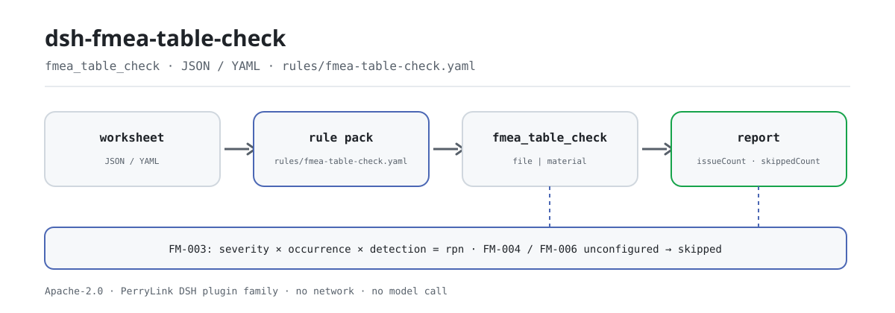

<div align="center">

<picture>
  <source media="(prefers-color-scheme: dark)" srcset="docs/assets/dsh-fmea-table-check-flow-dark.svg">
  
</picture>

# dsh-fmea-table-check

**Convierta una hoja de FMEA en una lista, fila por fila, de qué difiere y dónde — el original no se modifica y la conclusión queda en manos del revisor.**

Un verificador de hojas para DeepSeek Harness pensado para ingenieros de calidad y de proceso: lee una hoja de FMEA con encabezados en chino o inglés, aplica ocho reglas a la cadena de análisis, a la operabilidad de las puntuaciones y a la aritmética del RPN, y solo enumera las diferencias que puede señalar en el material.

[Instalar](#instalación-en-tres-pasos) · [Configuración](#configuración) · [FAQ](#faq) · [简体中文](README.md) · [English](README.en.md) · [Español](README.es.md) · [Português](README.pt.md) · [हिन्दी](README.hi.md)

[](LICENSE)
[](#compatibilidad)
[](https://www.npmjs.com/package/dsh-fmea-table-check)
[](https://github.com/PerryLink/dsh-fmea-table-check/actions/workflows/ci.yml)
[](#compatibilidad)

[](https://github.com/PerryLink/dsh-fmea-table-check/stargazers)
[](https://www.npmjs.com/package/dsh-fmea-table-check)
[](https://dshfind.com/plugins/PerryLink/dsh-fmea-table-check?ref=badge)
[](https://securityscorecards.dev/viewer/?uri=github.com/PerryLink/dsh-fmea-table-check)
[](https://dsh.market/)
[](https://gitee.com/perrylink/dsh-fmea-table-check)

```sh
dsh plugin --profile <name> add dsh-fmea-table-check
```

</div>

<sub>Plugin de la comunidad, no afiliado a DeepSeek. Repositorio canónico: <https://github.com/PerryLink/dsh-fmea-table-check> (Gitee es un espejo).</sub>

## Qué es

`dsh-fmea-table-check` lee una hoja de FMEA —filas indexadas por los propios nombres de columna de la hoja, en chino o en inglés— y comprueba lo que a una hoja se le puede exigir mecánicamente: que la cadena de análisis esté registrada, que severidad, ocurrencia y detección sean números operables, que el número de prioridad de riesgo (RPN) sea igual a su producto, que una fila de riesgo alto lleve una acción con responsable y fecha límite, que los estados de las acciones procedan del vocabulario que usted configure y que no sobreviva ningún marcador de plantilla en la columna del modo de fallo.

Convierte esas comprobaciones en una lista, fila por fila, de qué difiere y dónde, resumida por gravedad; una comprobación que no puede ejecutarse se informa en `skipped` y nunca pasa en silencio.

No juzga si los modos de fallo están completos, si los efectos se analizaron lo suficiente, si las puntuaciones son correctas o si el riesgo es aceptable: esos son los juicios del equipo de estudio, y ahí reside el valor del FMEA.

ESM puro: sin peticiones de red, sin llamadas al modelo, y la hoja original nunca se modifica.

## Instalación en tres pasos

1. **Instale** (elija un canal):

   ```sh
   # canal git (última main)
   dsh plugin --profile web add github:PerryLink/dsh-fmea-table-check
   # canal npm (versiones publicadas)
   dsh plugin --profile web add dsh-fmea-table-check
   # canal tarball: tras pnpm install && pnpm run build && pnpm pack en este repositorio
   dsh plugin --profile web add ./dsh-fmea-table-check-<version>.tgz
   ```

   Los artefactos publicados son `lib/index.mjs` (generado por `pnpm run build`) y el paquete de reglas `rules/`; el paquete npm incluye ambos.

2. **Configuración mínima** (los valores por defecto bastan; inserte una fila en el patch del perfil):

   ```yaml
   - insert:
       - id: dsh-fmea-table-check
         name: dsh-fmea-table-check
   ```

   Sin bloque `config` se aplican los valores por defecto; la ruta del paquete de reglas, el tiempo de espera y los interruptores de reglas están en «Configuración».

3. **Compruebe que se monta**:

   ```sh
   dsh --profile web --dump-config | grep 'dsh-fmea-table-check'
   ```

   Después ejecute una vez la muestra rápida incluida (dentro del checkout; construya antes):

   ```sh
   pnpm run build
   node samples/quickstart/run.mjs
   ```

   ```
   $ node samples/quickstart/run.mjs
   fmea_table_check: 1 issue(s) — error 0, warn 1, info 0
   skipped: 2
   ```

   La entrada de la muestra está en `samples/quickstart/input/` y la salida esperada en `samples/quickstart/expected/result.json`.

**Desinstalar**: `dsh plugin --profile web remove dsh-fmea-table-check` (o elimine la fila del patch del perfil).

<details>
<summary>Uso en WorkBuddy / Coze</summary>

Busque «Professional Document Check Suite» en WorkBuddy / Coze: el conjunto completo, del que esta comprobación es una parte; disponibilidad según el catálogo de la tienda y sin necesidad de línea de comandos.

</details>

## Capacidades clave

El plugin registra exactamente una herramienta, `fmea_table_check`: lee una hoja, aplica un paquete de reglas versionado y devuelve un informe.

- **Ocho reglas, todas basadas en datos.** Cada comprobación vive en `rules/fmea-table-check.yaml`; sustituir el paquete cambia el conjunto de reglas sin tocar TypeScript. El paquete se valida al cargarse, no se da por bueno.
- **Lee los nombres de columna de la propia hoja, en chino o en inglés.** La coincidencia de columnas no distingue mayúsculas y omite espacios, guiones bajos y guiones (`严重度` y `severity` resuelven al mismo campo); el informe conserva el nombre de columna de la hoja, así que cada hallazgo nombra la columna que leyó. Las puntuaciones pueden llegar como cadenas.
- **Una comprobación que no puede ejecutarse va a `skipped`.** Si falta un campo, no se puede analizar o no está configurado, el informe indica el id de la regla y el motivo en lugar de pasar en silencio: una lista de problemas vacía nunca puede leerse como «no hay nada mal».
- **Solo diferencias, sin veredictos.** Cada hallazgo lleva `locator` (fila/columna), `found`, `expected`, `fix` y la cláusula citada; el informe siempre incluye el descargo de responsabilidad, y un guardián de redacción prohíbe las determinaciones de cumplimiento, responsabilidad o corrección.
- **Una superficie de herramienta fija.** Los argumentos son `file` / `material` (uno de los dos), `rulesFile` (sobrescribe la ruta del paquete) y `only` (ejecuta ids de regla concretos); la salida incluye `markdown` y `reportJson`, además de `issueCount` y `skippedCount`.

### Tabla de reglas

| Regla | Comprobación | Gravedad | Tipo de base |
|---|---|---|---|
| `FM-001` | el modo de fallo, el efecto o la causa están registrados | warn | principio |
| `FM-002` | la puntuación de severidad es un número positivo operable | warn | principio |
| `FM-003` | el RPN es igual a severidad × ocurrencia × detección | warn | principio |
| `FM-004` | una fila de riesgo alto lleva una acción recomendada (desactivada por defecto) | info | local |
| `FM-005` | una fila con acción nombra responsable y fecha límite | warn | principio |
| `FM-006` | el estado de la acción procede de su vocabulario (desactivada por defecto) | info | local |
| `FM-007` | la hoja nombra su objeto de análisis | warn | principio |
| `FM-008` | no sobrevive ningún marcador de plantilla en el modo de fallo | warn | principio |

### Ejemplos

El hallazgo siguiente es la salida real del plugin sobre su propio fixture de prueba `FM-003`, no una ilustración. El paquete de reglas no inventa citas, así que cada hallazgo nombra la cláusula aplicada y advierte que su texto no se obtuvo esta vez.

**Herramienta** `fmea_table_check`

**Entrada**

```json
{"rows":[{"失效模式":"密封面泄漏","严重度":"8","频度":"4","探测度":"3","风险优先数":"100"}]}
```

**Salida**

```json
{
  "id": "dsh-fmea-table-check.FM-003.de09b5a6",
  "ruleId": "FM-003",
  "severity": "warn",
  "locator": {
    "field": "rpn",
    "row": 1
  },
  "found": "第 1 行「rpn」填报 100，而 8 × 4 × 3 = 96",
  "expected": "「rpn」应等于 severity × occurrence × detection",
  "fix": "核对是否抄错或漏改；本条只做算术核对，不判断各因子是否正确"
}
```

*Observed from `tests/fixtures/FM-003/FM-003-unsafe.json (cases.json expects FM-003 count 1); run via lib/index.mjs rules/fmea-table-check.yaml`*

### Escenarios habituales de revisión

| Usted pregunta | Qué responde |
|---|---|
| La celda del RPN no coincide con severidad × ocurrencia × detección, ¿se detecta? | Sí. `FM-003` recalcula `rpn` como severidad × ocurrencia × detección con una tolerancia de `0` y señala la fila cuyo valor almacenado difiere. Solo se ejecuta cuando las cuatro celdas contienen números analizables; si la puntuación de ocurrencia no es un número, la regla informa `skipped` en lugar de aprobar. Una hoja puntuada con el manual AIAG-VDA usa AP en vez de RPN: reoriente `resultField` y `factorFields`, o desactive la regla. |
| La celda de severidad contiene `高` en lugar de una puntuación. ¿Qué ocurre? | `FM-002` exige que la severidad sea un número positivo operable e informa de la fila cuando no lo es. Su comprobación apunta solo al campo `severity`, así que ocurrencia y detección requieren la misma regla añadida con otro `field`; no fija rango de valores, de modo que no impone una escala de 1 a 10 ni juzga si la puntuación es adecuada. Una puntuación que no puede analizar también envía `FM-003` a `skipped`, porque el producto no puede recalcularse. |
| Una fila propone una acción, pero el responsable y la fecha límite están vacíos. | `FM-005` se ejecuta en toda fila cuya celda de acción recomendada esté rellena y exige `owner` (responsable) y `dueAt` (fecha límite); informa de la fila a la que le falta uno de los dos. Son los nombres canónicos tras resolver los alias, así que una hoja con otros encabezados necesita el alias en el mapeo de columnas o `requiredFields` ajustado. Comprueba que las dos celdas estén rellenas, no que la fecha sea realista ni que el responsable la haya aceptado. Las filas sin acción son competencia de `FM-004`. |
| Nuestra hoja nunca dice qué producto o proceso analiza. | `FM-007` lee el `item` de la cabecera y lo informa cuando falta el sujeto de análisis: un FMEA se realiza para un producto o proceso concreto y sin él las conclusiones no se pueden rastrear ni asociar a una tabla de puntuación. Es una comprobación de presencia: un sujeto relleno pero equivocado no se informa. Si sus hojas deben indicar también el método empleado, añada `method` a sus `fields`. |
| Algunas filas todavía dicen `待填` o `XXX` en la columna de modo de fallo, y otras no tienen nada. | `FM-008` informa de la fila cuyo modo de fallo aún contiene uno de los términos marcadores del paquete (`【`, `】`, `{{`, `}}`, `XXX`, `xxx`, `待填`, `待补充`, `TBD`, `todo`, `示例`), porque una hoja copiada de una plantilla se lee como análisis terminado; solo lee la columna del modo de fallo, y `terms` se ajusta a su plantilla. `FM-001` informa de la fila en la que modo de fallo, efecto y causa están los tres vacíos, pero solo exige uno de los tres: una celda con `待填` satisface `FM-001` y la detecta `FM-008`. Ninguna de las dos juzga si los modos de fallo están completos o si los efectos se analizaron lo suficiente. |
| El informe muestra `FM-004` y `FM-006` como `skipped`. ¿Hay algún problema? | No. Ambas vienen sin configurar y el paquete lo informa en lugar de aprobar en silencio. El `threshold` de `FM-004` es `0`, que se lee como no configurado, así que ninguna fila cuenta como riesgo alto hasta que fije su criterio de riesgo: por ejemplo `triggerField: severity` con `threshold: 9`, o `triggerField: rpn` con `threshold: 100`. La lista `values` de `FM-006` está vacía, así que el vocabulario de estados no se comprueba hasta que enumere sus propios valores. Una vez configuradas, `FM-004` solo comprueba que la celda de acción de una fila de riesgo alto esté rellena —no que la acción sea eficaz o viable— y `FM-006` solo comprueba que el estado figure en la lista configurada, no que la acción se haya llevado a cabo. |

## Normas que sigue

| Documento | Número | Reglas que lo citan |
|---|---|---|
| Técnicas de análisis de fiabilidad de sistemas — Procedimientos de análisis de modos de fallo y efectos (FMEA) | GB/T 7826 (edición vigente y numeración de cláusulas no verificadas) | FM-001, FM-002, FM-003, FM-004, FM-005, FM-006, FM-007, FM-008 |

**Límite:** este plugin comprueba una **hoja de FMEA** en lo que a una hoja se le puede exigir mecánicamente: que la cadena de análisis esté registrada, que las puntuaciones de severidad / ocurrencia / detección sean números operables, que el número de prioridad de riesgo sea igual a su producto, que una fila de riesgo alto lleve una acción con responsable y fecha límite, que los estados de las acciones procedan de su vocabulario y que no sobreviva ningún marcador de plantilla. **No** juzga si los modos de fallo están completos, si las consecuencias se analizaron lo suficiente, si las puntuaciones son correctas o si el riesgo es aceptable. **Esos son los juicios del equipo de estudio, y ahí reside el valor del FMEA.**

> ### ⚠️ Lea esto antes de fiarse de una cita del informe
>
> **Cada `excerpt` del paquete de reglas de este plugin dice, con todas las letras, que el texto de la cláusula no se obtuvo.** Los hogares del método son **GB/T 7826**, IEC 60812 y el manual automotriz AIAG-VDA FMEA. La pasada de verificación no pudo recuperar el texto literal de las cláusulas, así que en lugar de parafrasear una cita el paquete declara la laguna en el propio campo `excerpt` y pone el razonamiento honesto en `note`. Por eso la base de cada regla es `derived-from-principle` (tope `warn`) o `institutional-configuration` (tope `info`), y un test afirma que ninguna regla reclama una cita que no tiene. **Cuando los textos estén en mano, hay que hacer dos cosas: sustituir cada `excerpt` por la cláusula real y elevar `kind` a `direct`.**
>
> Dos ajustes son suyos. **La aritmética del RPN de FM-003 supone el método S×O×D**; una hoja construida con el manual AIAG-VDA usa **AP (prioridad de acción)**, así que reoriente `resultField` y `factorFields`, o desactive la regla. Y **el threshold de FM-004 viene como `0`, es decir, «no configurado»**: qué cuenta como riesgo alto es su criterio de riesgo, y la regla informa de que no pudo ejecutarse en lugar de inventar un número.

## Formato del material

Se aceptan JSON y YAML:

```yaml
item: 某型阀体加工过程
rows:
  - { 项目: 某型阀体加工过程, 功能: 在规定压力下保持密封, 失效模式: 密封面泄漏,
      失效后果: 介质外泄，影响安全, 严重度: '8', 失效原因: 密封面加工粗糙度超差,
      频度: '4', 探测度: '3', 风险优先数: '96', 建议措施: 增加密封面粗糙度在线检测,
      责任人: 张工, 完成期限: 2026-06-30, 措施状态: 进行中 }
```

Los nombres de columna se comparan sin distinguir mayúsculas y omitiendo espacios, guiones bajos y guiones, de modo que un encabezado chino y `severity` resuelven al mismo campo; se conservan los nombres de columna de la hoja, así que un hallazgo nombra la columna que leyó. Las puntuaciones pueden llegar como cadenas. Los campos son opcionales en la capa de lectura y los valida el motor de comprobación, de modo que una exportación parcial produce hallazgos de «falta» en lugar de un fallo.

## Configuración

Todos los parámetros ajustables son campos `Config` de Schemastery en `src/config.ts`, modificables desde `cordis.yml` o el patch del perfil sin tocar código; los umbrales por regla viven en el paquete de reglas bajo `rules/`. Una sobrescritura dirigida por id reemplaza la fila entera: repita todas las claves que necesite.

| Clave | Tipo | Predeterminado | Descripción |
|---|---|---|---|
| `rulesFile` | string | `rules/fmea-table-check.yaml` | Ruta del paquete de reglas, relativa a la raíz del paquete |
| `disabledRules` | string[] | `[]` | Ids de reglas que se dejan de ejecutar; cada una aparece en `skipped` |
| `onlyRules` | string[] | `[]` | Ejecutar solo estas reglas; vacío ejecuta todas |
| `skipNotes` | string | `""` | Nota añadida a cada motivo de `skipped` |
| `timeoutMs` | number | `120000` | Presupuesto de tiempo de espera cooperativo de la herramienta |

<details>
<summary>Parámetros por regla (se configuran en el paquete, no en el código)</summary>

- `FM-003` `resultField` / `factorFields` / `tolerance` — la aritmética del RPN. Reoriéntela a una columna AP si su hoja sigue el manual AIAG-VDA, o desactive la regla.
- `FM-004` `triggerField` / `threshold` / `requiredField` — su criterio de riesgo alto. Un threshold de `0` significa que la regla no se ejecuta; los ajustes típicos son `severity` en `9`, o `rpn` en `100`.
- `FM-005` `conditionField` / `requiredFields` — qué filas, y qué campos deben llevar.
- `FM-006` `values` — su vocabulario de estados de acción.
- `FM-002` `min` / `max` — límites de puntuación, si su tabla de puntuación los fija. La regla no fija ninguno por defecto, porque las tablas difieren entre manuales y tipos de análisis.

</details>

Ejemplo de sobrescritura en el patch del perfil:

```yaml
- insert:
    - id: dsh-fmea-table-check
      name: dsh-fmea-table-check
      config:
        onlyRules: [FM-001, FM-002, FM-003, FM-005, FM-007, FM-008]
        timeoutMs: 60000
```

## Origen de las reglas

Los datos de las reglas viven en `rules/fmea-table-check.yaml`, separados del código: cada regla lleva documento, número, cláusula en la numeración propia de la fuente, extracto y URL de origen. El guardián de carga exige normalmente que «un extracto sea una cita real de al menos ocho caracteres», pero no distingue una cita de una descripción; por eso este paquete se apoya en la cabecera, en las notas de cada regla y en un test que afirma que cada `excerpt` admite la laguna. Una comprobación basada solo en un principio (`kind: derived-from-principle`, tope `warn`) o en configuración institucional (`kind: institutional-configuration`, tope `info`) no puede marcarse `error`; un paquete que exagere su base falla al cargarse en lugar de producir un informe que parezca sólido.

Los límites confirmados durante la verificación y las conclusiones deliberadamente **no** afirmadas están en `rules/evidence/`, `rules/citations-baseline.json` y `scripts/check-citations.mjs`.

## FAQ

<details>
<summary>¿Se sube o se escribe en disco el contenido de la hoja?</summary>

No. El plugin solo lee el material que usted pasa por `file` o `material`, lo analiza localmente y aplica el paquete de reglas incluido; no hace peticiones de red, no incluye telemetría ni analítica y no llama a ningún modelo. Aparte del resultado de la herramienta y del almacenamiento de sesión/registro del propio host DSH, no escribe nada; ese almacenamiento y su retención son del host, y este paquete no añade una segunda copia. Desinstalar el paquete elimina su código, no los registros de sesión del host ni los documentos que ya haya creado. La declaración completa está en [PRIVACY.md](PRIVACY.md).

</details>

<details>
<summary>¿Una comprobación que no puede ejecutarse pasa en silencio?</summary>

No. Cuando falta un campo, no se puede analizar o no está configurado (por ejemplo el `threshold: 0` de `FM-004` o los `values` vacíos de `FM-006`), el informe indica el id de la regla y el motivo en `skipped`; las reglas desactivadas con `disabledRules` también aparecen ahí. Una lista de problemas vacía nunca puede leerse como «no hay nada mal».

</details>

<details>
<summary>¿Compite con otros plugins por nombres de herramienta, servicios o slots?</summary>

No. Registra exactamente una herramienta mediante `ctx.tools.register` (`fmea_table_check`), no proporciona ninguna clave de servicio, no registra slots de cliente, no registra ningún prefijo `webServer` y no muta globales; el patch del bundle solo `insert`a su propia fila. El registro es un efecto de Cordis, así que descargar o recargar en caliente lo retira.

</details>

<details>
<summary>¿Cuánta sobrecarga de rendimiento supone?</summary>

Puramente local: analiza JSON/YAML y recorre las filas una vez por regla, sin red y sin llamada al modelo. El `timeoutMs` de la herramienta es un presupuesto de tiempo de espera cooperativo (por defecto `120000` ms) que el host aplica al vencer; en hojas grandes manda el número de filas.

</details>

<details>
<summary>¿Puede leer directamente un libro de Excel?</summary>

No. El material debe ser JSON o YAML; convierta Excel a JSON/YAML primero (en el chat, si la plataforma lo permite) y entréguelo después a la herramienta. Los campos son opcionales en la capa de lectura, así que una exportación parcial produce hallazgos de «falta» en lugar de un fallo.

</details>

## Límites de seguridad

- **Material de solo lectura.** La herramienta lee `file` o `material`; nunca modifica el original ni hace una segunda copia del material.
- **Sin red y sin llamada al modelo.** El análisis y la evaluación de reglas son locales; la ruta del paquete de reglas se puede sobrescribir, pero solo se carga desde el sistema de archivos local, nunca de forma remota.
- **Sin citas fabricadas.** Cada `excerpt` dice que el texto de la cláusula no se obtuvo y cada base tiene tope `warn` / `info`; hasta tener los textos, una coincidencia debe leerse como «esta celda está vacía / estos tres números no multiplican / esta acción no tiene responsable», no como «el FMEA no cumple».
- **Sin veredictos fuera de alcance.** El informe solo enumera diferencias que puede señalar en el material; un guardián de redacción prohíbe las determinaciones de cumplimiento, responsabilidad o corrección, y el descargo de responsabilidad siempre acompaña al informe.
- **El fallo es visible.** El paquete se valida al cargarse, así que una regla inválida hace fallar la carga del plugin; una comprobación que no puede ejecutarse va a `skipped` y nunca pasa en silencio.

## Limitaciones conocidas

- **Solo consistencia interna y aritmética.** No juzga si los modos de fallo están completos, si las consecuencias se analizaron lo suficiente, si las puntuaciones de severidad / ocurrencia / detección son adecuadas o si el riesgo es aceptable: esos son los juicios profesionales del equipo de análisis y donde reside el valor del FMEA.
- **Las citas aún no se han obtenido.** Cada `excerpt` de este paquete declara que el texto literal de GB/T 7826 y los demás documentos no se obtuvo esta vez; `kind` es `derived-from-principle` (tope `warn`) o `institutional-configuration` (tope `info`). Cuando los textos estén en mano, sustituya cada `excerpt` y elévelo a `direct`.
- **`FM-004` / `FM-006` vienen sin configurar.** `threshold` es `0` y `values` está vacío, así que ambas informan `skipped`; el criterio de riesgo alto y el vocabulario de estados deben venir de su institución.
- **`FM-002` no fija rango de puntuación.** No se impone ninguna escala de 1 a 10 por defecto y `99` pasa; añada `min` / `max` si su tabla de puntuación fija el rango.
- **`FM-003` supone S×O×D.** Una hoja puntuada con el AP (prioridad de acción) del manual AIAG-VDA necesita reorientar `resultField` / `factorFields`, o desactivar la regla.
- **El material es solo JSON / YAML.** Excel debe convertirse primero; los campos son opcionales en la capa de lectura, así que una exportación parcial produce hallazgos de «falta» en lugar de un fallo.
- **Sin conversión de zona horaria.** Toda la aritmética es de hora local sobre las cadenas de entrada.
- **Sin interfaz.** Herramienta puramente host: no incluye interfaz ni registra slots de cliente.

## Interoperabilidad con otros plugins DSH

El plugin registra exactamente una herramienta, `fmea_table_check`; no proporciona ninguna clave de servicio, no registra slots de cliente, no registra ningún prefijo `webServer` y no muta globales. El patch del bundle solo `insert`a su propia fila y nunca sobrescribe el `config` de una fila incorporada. Estas afirmaciones se pueden comprobar directamente en `dsh.capabilities` de `package.json` (`tools:register`) y en `cordis.patch.yml`.

Tanto el registro de la herramienta como la fila del bundle son efectos de Cordis: detener el plugin o recargarlo en caliente los retira, y no queda nada en el proceso.

## Compatibilidad

| Superficie | Estado |
|---|---|
| Harness | Rango de peers `>=0.1.2-rc.1 <0.2.0 \|\| >=0.2.0-0 <0.3.0` — verificado para aceptar tanto `0.2.0-rc.2` como `0.2.1-rc.2`. `engines.dsh` se declara como `>=0.2.1-0 <0.3.0` y el host lo aplica desde 0.2.1. |
| Node | `^22.19.0 \|\| >=24.0.0` |
| Plataformas | Todas (ESM puro; sin código nativo, sin red, sin llamada al modelo) |
| Modo de herramienta | Funciona en `native` y `ptc`; para revisar varias hojas a la vez, `ptc` paga el coste del esquema una sola vez. |

## Solución de problemas

- **`FM-004` o `FM-006` se informan como `skipped`.** Su configuración está vacía. Ambas dependen de su criterio de riesgo y de su procedimiento de gestión, y el plugin no los adivina.
- **`FM-003` se dispara en todas las filas.** La hoja usa AP en lugar de RPN; reoriente `resultField` y `factorFields`, o desactive la regla.
- **`FM-002` acepta una puntuación de 99.** La regla comprueba que la puntuación sea un número positivo operable y deliberadamente no fija rango; añada `min` y `max` si su tabla de puntuación los fija.
- **`FM-005` se dispara en una acción sin responsable.** Eso es la comprobación: una acción sin responsable ni fecha límite no se puede seguir.
- **El plugin se instala pero la herramienta no aparece.** Compruebe que `main` resuelve a `lib/index.mjs` y que `pnpm run build` lo generó; un `main` equivocado hace que el cargador omita la entrada en silencio.
- **`dsh plugin add` rechaza el paquete por incompatibilidad.** El rango de peers cubre `0.1.x` y `0.2.x`; si su runtime queda fuera, conceda una exención explícita: `dsh plugin --profile <name> allow-version dsh-fmea-table-check@<version> --dsh-version <runtime> --accept-risk`.
- **`check` informa `manifest-peers` como fallo.** El comprobador estático compara con un rango de peers codificado que es anterior a la línea 0.2. El runtime aplica la compatibilidad de peers al instalar, así que el rango declarado es el correcto; es un problema conocido de `dsh-plugin-dev`.

Hay más sobre instalación, resultados vacíos, la laguna de citas y cómo abrir un issue en [TROUBLESHOOTING.md](TROUBLESHOOTING.md).

## Ecosistema y calidad

- [Espejo de Gitee](https://gitee.com/perrylink/dsh-fmea-table-check) (espejo sincronizado; GitHub es el canónico)
- [Página del plugin en dshfind](https://dshfind.com/plugins/PerryLink/dsh-fmea-table-check) (instalaciones y ranking)
- [Informe de OpenSSF Scorecard](https://securityscorecards.dev/viewer/?uri=github.com/PerryLink/dsh-fmea-table-check) (impulsado por [.github/workflows/scorecard.yml](.github/workflows/scorecard.yml))
- [DSH Market](https://dsh.market/) (listado)
- **Canal de la tienda 1024**: `npm i -g dsh1024` una vez y luego `dsh1024 plugin --profile web add dsh-fmea-table-check` (cuenta para el ranking de instalaciones de [deepseek1024.com](https://deepseek1024.com))
- [Elija un verificador por material](https://perrylink.github.io/zh/checkers/choose/)

## Desarrollo

```sh
pnpm install
pnpm run typecheck                 # tsc --noEmit
pnpm test                          # vitest: la suite compartida de tablas más fixtures emparejados por regla
pnpm run build                     # tsdown -> lib/index.mjs + lib/index.d.mts
pnpm run verify:self-contained     # las specs de dependencias se resuelven desde el registry
pnpm run check:lockfile            # deriva del lockfile
pnpm run check:readmes             # consistencia de los README en cinco idiomas
pnpm run check:citations           # verificación de las citas de las reglas
node ../scripts/sync-shared.mjs dsh-fmea-table-check   # refresca src/shared desde ../_shared
pnpm pack
```

El plugin es **basado en datos**: `src/model.ts` declara la forma de la tabla y aporta el lector y el núcleo de comprobación, `src/shared/` es el kit compartido copiado dentro (nunca importado entre paquetes), y `rules/fmea-table-check.yaml` declara cada comprobación. Cambiar una regla no toca código; tras cambiar el kit compartido, vuelva a ejecutar la sincronización.

| Ruta | Contenido |
|---|---|
| `src/` | Entrada del plugin (`index.ts`), configuración Schemastery (`config.ts`), núcleo de comprobación y lector (`model.ts`), vista orientada al modelo (`view.ts`) y el kit `shared/` |
| `rules/` | El paquete de reglas `fmea-table-check.yaml`, la base de citas `citations-baseline.json` y el registro de verificación `evidence/` |
| `tests/` | vitest; `fixtures/FM-00N/` guarda un par de fixtures conforme / infractor por regla |
| `samples/quickstart/` | La muestra de un minuto (entrada, salida esperada y `run.mjs`) |
| `scripts/` | Guardias mecánicas (`check-citations`, `check-lockfile-drift`, `check-readme-sync`, `verify-self-contained`) y el generador de imágenes `gen-readme-assets.py` |
| `docs/assets/` | Imágenes del README; `dsh-fmea-table-check-flow-{light,dark}.svg` lo genera el script de activos |

Las imágenes del README se generan programáticamente con [`scripts/gen-readme-assets.py`](scripts/gen-readme-assets.py) (Python + Pillow) y se pueden reejecutar sin riesgo: `python scripts/gen-readme-assets.py`.

Topics: `dsh`, `dsh-plugin`, `deepseek-harness`, `deepseek`, `cordis`, `fmea`, `table`

## Familia y agradecimientos

Este proyecto forma parte de la familia de plugins de DeepSeek Harness de [PerryLink](https://github.com/PerryLink) (todos Apache-2.0). Si le resulta útil, **una estrella ayuda a que la siguiente persona lo encuentre** — no hay nada bloqueado tras ella.

- [@PerryLink](https://github.com/PerryLink) — creador y mantenedor: el motor de comprobación y el paquete de reglas, el registro de verificación de citas de GB/T 7826 y la documentación en cinco idiomas.

<details>
<summary>Expandir todos los plugins</summary>

| Plugin | Estado |
|---|---|
| **[dsh-aqua-input-check](https://github.com/PerryLink/dsh-aqua-input-check)** |  |
| **[dsh-archive-check](https://github.com/PerryLink/dsh-archive-check)** |  |
| **[dsh-auto-review](https://github.com/PerryLink/dsh-auto-review)** |  |
| **[dsh-autotier](https://github.com/PerryLink/dsh-autotier)** | 🧊 CONGELADO — ver el README del repo |
| **[dsh-bid-ca-precheck](https://github.com/PerryLink/dsh-bid-ca-precheck)** |  |
| **[dsh-bid-qual-check](https://github.com/PerryLink/dsh-bid-qual-check)** |  |
| **[dsh-cert-mcp](https://github.com/PerryLink/dsh-cert-mcp)** | 🧊 CONGELADO — ver el README del repo |
| **[dsh-checkpoint-rewind](https://github.com/PerryLink/dsh-checkpoint-rewind)** |  |
| **[dsh-click](https://github.com/PerryLink/dsh-click)** |  |
| **[dsh-composer-history](https://github.com/PerryLink/dsh-composer-history)** |  |
| **[dsh-contract-stance](https://github.com/PerryLink/dsh-contract-stance)** |  |
| **[dsh-customs-doc-check](https://github.com/PerryLink/dsh-customs-doc-check)** |  |
| **[dsh-data-quality](https://github.com/PerryLink/dsh-data-quality)** |  |
| **[dsh-demurrage-ledger](https://github.com/PerryLink/dsh-demurrage-ledger)** |  |
| **[dsh-doublecheck](https://github.com/PerryLink/dsh-doublecheck)** |  |
| **[dsh-drill-script-check](https://github.com/PerryLink/dsh-drill-script-check)** |  |
| **[dsh-eia-guide-check](https://github.com/PerryLink/dsh-eia-guide-check)** |  |
| **[dsh-emergency-plan](https://github.com/PerryLink/dsh-emergency-plan)** |  |
| **[dsh-essay-rubric-check](https://github.com/PerryLink/dsh-essay-rubric-check)** |  |
| **[dsh-evidence-check](https://github.com/PerryLink/dsh-evidence-check)** |  |
| **[dsh-export-ctl-check](https://github.com/PerryLink/dsh-export-ctl-check)** |  |
| **[dsh-fast](https://github.com/PerryLink/dsh-fast)** |  |
| **[dsh-fmea-table-check](https://github.com/PerryLink/dsh-fmea-table-check)** |  |
| **[dsh-forecast-penalty](https://github.com/PerryLink/dsh-forecast-penalty)** |  |
| **[dsh-fund-research](https://github.com/PerryLink/dsh-fund-research)** |  |
| **[dsh-github](https://github.com/PerryLink/dsh-github)** |  |
| **[dsh-gongwen-flow-check](https://github.com/PerryLink/dsh-gongwen-flow-check)** |  |
| **[dsh-gongwen-word-check](https://github.com/PerryLink/dsh-gongwen-word-check)** |  |
| **[dsh-guard-plan-qc](https://github.com/PerryLink/dsh-guard-plan-qc)** |  |
| **[dsh-hazchem-check](https://github.com/PerryLink/dsh-hazchem-check)** |  |
| **[dsh-hazplan-check](https://github.com/PerryLink/dsh-hazplan-check)** |  |
| **[dsh-hidden-risk-map](https://github.com/PerryLink/dsh-hidden-risk-map)** |  |
| **[dsh-hs-classify](https://github.com/PerryLink/dsh-hs-classify)** |  |
| **[dsh-icd-rule-check](https://github.com/PerryLink/dsh-icd-rule-check)** |  |
| **[dsh-industry-research](https://github.com/PerryLink/dsh-industry-research)** |  |
| **[dsh-lawcite-adapter](https://github.com/PerryLink/dsh-lawcite-adapter)** |  |
| **[dsh-laya](https://github.com/PerryLink/dsh-laya)** |  |
| **[dsh-lc-doc-check](https://github.com/PerryLink/dsh-lc-doc-check)** |  |
| **[dsh-learning-gap-check](https://github.com/PerryLink/dsh-learning-gap-check)** |  |
| **[dsh-library](https://github.com/PerryLink/dsh-library)** |  |
| **[dsh-local-ai](https://github.com/PerryLink/dsh-local-ai)** |  |
| **[dsh-lsp-actions](https://github.com/PerryLink/dsh-lsp-actions)** |  |
| **[dsh-mask](https://github.com/PerryLink/dsh-mask)** |  |
| **[dsh-mcp-panel](https://github.com/PerryLink/dsh-mcp-panel)** |  |
| **[dsh-medrec-qc](https://github.com/PerryLink/dsh-medrec-qc)** |  |
| **[dsh-memento](https://github.com/PerryLink/dsh-memento)** |  |
| **[dsh-nsfc-form-check](https://github.com/PerryLink/dsh-nsfc-form-check)** |  |
| **[dsh-nurse-record-check](https://github.com/PerryLink/dsh-nurse-record-check)** |  |
| **[dsh-observe](https://github.com/PerryLink/dsh-observe)** |  |
| **[dsh-origin-rvc-check](https://github.com/PerryLink/dsh-origin-rvc-check)** |  |
| **[dsh-ota-review-check](https://github.com/PerryLink/dsh-ota-review-check)** |  |
| **[dsh-output-styles](https://github.com/PerryLink/dsh-output-styles)** |  |
| **[dsh-paper-doc-adapter](https://github.com/PerryLink/dsh-paper-doc-adapter)** |  |
| **[dsh-permission-rules](https://github.com/PerryLink/dsh-permission-rules)** |  |
| **[dsh-permit-report-check](https://github.com/PerryLink/dsh-permit-report-check)** |  |
| **[dsh-pipeline-check](https://github.com/PerryLink/dsh-pipeline-check)** |  |
| **[dsh-pleading-draft](https://github.com/PerryLink/dsh-pleading-draft)** |  |
| **[dsh-plugin-doctor](https://github.com/PerryLink/dsh-plugin-doctor)** | 🚫 RETIRADO (repo archivado) |
| **[dsh-plugin-guide](https://github.com/PerryLink/dsh-plugin-guide)** |  |
| **[dsh-plugin-kit](https://github.com/PerryLink/dsh-plugin-kit)** | 🚫 RETIRADO (repo archivado) |
| **[dsh-plugin-upgrade](https://github.com/PerryLink/dsh-plugin-upgrade)** | 🚫 RETIRADO (repo archivado) |
| **[dsh-policy-brief-draft](https://github.com/PerryLink/dsh-policy-brief-draft)** |  |
| **[dsh-power-loss-split](https://github.com/PerryLink/dsh-power-loss-split)** |  |
| **[dsh-power-ticket-check](https://github.com/PerryLink/dsh-power-ticket-check)** |  |
| **[dsh-ppap-check](https://github.com/PerryLink/dsh-ppap-check)** |  |
| **[dsh-protest-deadline](https://github.com/PerryLink/dsh-protest-deadline)** |  |
| **[dsh-railway-window](https://github.com/PerryLink/dsh-railway-window)** |  |
| **[dsh-repair-order-qc](https://github.com/PerryLink/dsh-repair-order-qc)** |  |
| **[dsh-research-report](https://github.com/PerryLink/dsh-research-report)** |  |
| **[dsh-review-reply-check](https://github.com/PerryLink/dsh-review-reply-check)** |  |
| **[dsh-rulefile-check](https://github.com/PerryLink/dsh-rulefile-check)** |  |
| **[dsh-safety-brief-check](https://github.com/PerryLink/dsh-safety-brief-check)** |  |
| **[dsh-score](https://github.com/PerryLink/dsh-score)** |  |
| **[dsh-session-sync](https://github.com/PerryLink/dsh-session-sync)** |  |
| **[dsh-site-log-check](https://github.com/PerryLink/dsh-site-log-check)** |  |
| **[dsh-skill-pack-security](https://github.com/PerryLink/dsh-skill-pack-security)** |  |
| **[dsh-soe-decision-check](https://github.com/PerryLink/dsh-soe-decision-check)** |  |
| **[dsh-soilwater-check](https://github.com/PerryLink/dsh-soilwater-check)** |  |
| **[dsh-sop-sync-check](https://github.com/PerryLink/dsh-sop-sync-check)** |  |
| **[dsh-spc-gbt-adapter](https://github.com/PerryLink/dsh-spc-gbt-adapter)** |  |
| **[dsh-talk](https://github.com/PerryLink/dsh-talk)** |  |
| **[dsh-tender-extract](https://github.com/PerryLink/dsh-tender-extract)** |  |
| **[dsh-tender-matrix](https://github.com/PerryLink/dsh-tender-matrix)** |  |
| **[dsh-test-drive](https://github.com/PerryLink/dsh-test-drive)** |  |
| **[dsh-ticktick](https://github.com/PerryLink/dsh-ticktick)** | 🚫 RETIRADO (repo archivado) |
| **[dsh-translate](https://github.com/PerryLink/dsh-translate)** |  |
| **[dsh-warranty-calc](https://github.com/PerryLink/dsh-warranty-calc)** |  |
| **[dsh-budget](https://github.com/PerryLink/dsh-budget)** | 🧊 CONGELADO — ver el README del repo |
| **[dsh-claude-move](https://github.com/PerryLink/dsh-claude-move)** | 🧊 CONGELADO — ver el README del repo |
| **[dsh-defend](https://github.com/PerryLink/dsh-defend)** | 🧊 CONGELADO — ver el README del repo |
| **[dsh-draw](https://github.com/PerryLink/dsh-draw)** | 🧊 CONGELADO — ver el README del repo |
| **[dsh-reach](https://github.com/PerryLink/dsh-reach)** | 🧊 CONGELADO — ver el README del repo |
| **[dsh-background-agents](https://github.com/PerryLink/dsh-background-agents)** | 🚫 RETIRADO (repo archivado) |
| **[dsh-session-pin](https://github.com/PerryLink/dsh-session-pin)** | 🚫 RETIRADO (repo archivado) |
| **[dsh-team-rooms](https://github.com/PerryLink/dsh-team-rooms)** | 🚫 RETIRADO (repo archivado) |

</details>

## Licencia

[LICENSE](LICENSE) (Apache License 2.0) © 2026 dsh-fmea-table-check contributors

<p align="center"><sub>Apache-2.0 · Plugin de la comunidad, no afiliado a DeepSeek.</sub></p>
