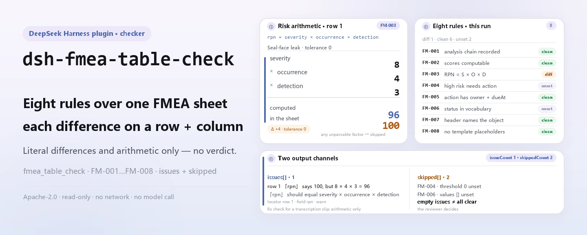

<div align="center">

<picture>
  <source media="(prefers-color-scheme: dark)" srcset="docs/assets/dsh-fmea-table-check-hero-en-dark.webp">
  
</picture>

# dsh-fmea-table-check

**FMEA कार्यपत्रक को पंक्ति-दर-पंक्ति उस सूची में बदलें जिसमें लिखा हो कि क्या अलग है और कहाँ — मूल फ़ाइल कभी नहीं बदलती, और निष्कर्ष समीक्षक के पास रहता है।**

गुणवत्ता और प्रक्रिया इंजीनियरों के लिए DeepSeek Harness का कार्यपत्रक जाँचक: चीनी या अंग्रेज़ी शीर्षकों वाला एक FMEA कार्यपत्रक पढ़ता है, विश्लेषण-शृंखला, अंकों की संक्रियात्मकता और RPN अंकगणित पर आठ नियम लगाता है, और केवल वही अंतर सूचीबद्ध करता है जिन्हें सामग्री में इंगित किया जा सके।

[इंस्टॉल](#तीन-चरणों-में-शुरुआत) · [कॉन्फ़िगरेशन](#कॉन्फ़िगरेशन) · [FAQ](#faq) · [简体中文](README.md) · [English](README.en.md) · [Español](README.es.md) · [Português](README.pt.md) · [हिन्दी](README.hi.md)

[](LICENSE)
[](#संगतता)
[](https://www.npmjs.com/package/dsh-fmea-table-check)
[](https://github.com/PerryLink/dsh-fmea-table-check/actions/workflows/ci.yml)
[](#संगतता)

[](https://github.com/PerryLink/dsh-fmea-table-check/stargazers)
[](https://www.npmjs.com/package/dsh-fmea-table-check)
[](https://dshfind.com/plugins/PerryLink/dsh-fmea-table-check?ref=badge)
[](https://securityscorecards.dev/viewer/?uri=github.com/PerryLink/dsh-fmea-table-check)
[](https://dsh.market/)
[](https://gitee.com/perrylink/dsh-fmea-table-check)

```sh
dsh plugin --profile <name> add dsh-fmea-table-check
```

</div>

<sub>सामुदायिक प्लगइन, DeepSeek से असंबद्ध। कैनोनिकल रिपॉज़िटरी: <https://github.com/PerryLink/dsh-fmea-table-check> (Gitee एक मिरर है)।</sub>

## यह क्या है

`dsh-fmea-table-check` एक FMEA कार्यपत्रक पढ़ता है — पंक्तियाँ शीट के अपने स्तंभ-नामों से जुड़ी, चीनी या अंग्रेज़ी में — और उसमें वह जाँचता है जो एक शीट से यांत्रिक रूप से अपेक्षित किया जा सकता है: क्या विश्लेषण-शृंखला दर्ज है, क्या `severity`, `occurrence` और `detection` संक्रियात्मक संख्याएँ हैं, क्या जोखिम प्राथमिकता संख्या (RPN) उनके गुणनफल के बराबर है, क्या ऊँचे जोखिम वाली पंक्ति में ज़िम्मेदार और समय-सीमा सहित सुझाई गई कार्रवाई है, क्या कार्रवाई की स्थितियाँ आपकी कॉन्फ़िगर की गई शब्दावली से आती हैं, और क्या विफलता-प्रकार स्तंभ में कोई टेम्पलेट प्लेसहोल्डर शेष नहीं है।

यह इन जाँचों को पंक्ति-दर-पंक्ति उस सूची में बदलता है जिसमें लिखा होता है कि क्या अलग है और कहाँ, गंभीरता के अनुसार सारांशित; जो जाँच नहीं चल सकती वह `skipped` में बताई जाती है और कभी चुपचाप पास नहीं होती।

<picture>
  <source media="(prefers-color-scheme: dark)" srcset="docs/assets/dsh-fmea-table-check-flow-v5-dark.svg">
  
</picture>

यह नहीं आँकता कि विफलता-प्रकार पूरे हैं या नहीं, परिणाम पर्याप्त विश्लेषित हैं या नहीं, अंक सही हैं या नहीं, या जोखिम स्वीकार्य है या नहीं — वे अध्ययन दल के निर्णय हैं, और FMEA का मूल्य वहीं है।

पूरी तरह ESM: कोई नेटवर्क अनुरोध नहीं, कोई मॉडल कॉल नहीं, और मूल कार्यपत्रक कभी नहीं बदलता।

## तीन चरणों में शुरुआत

1. **इंस्टॉल करें** (एक चैनल चुनें):

   ```sh
   # git चैनल (नवीनतम main)
   dsh plugin --profile web add github:PerryLink/dsh-fmea-table-check
   # npm चैनल (प्रकाशित रिलीज़)
   dsh plugin --profile web add dsh-fmea-table-check
   # tarball चैनल: इस रेपो में pnpm install && pnpm run build && pnpm pack के बाद
   dsh plugin --profile web add ./dsh-fmea-table-check-<version>.tgz
   ```

   भेजे गए आर्टिफ़ैक्ट `lib/index.mjs` (`pnpm run build` से बनता है) और `rules/` नियम-पैक हैं; npm पैकेज दोनों लेकर आता है।

2. **न्यूनतम कॉन्फ़िग** (डिफ़ॉल्ट से ही चलता है; प्रोफ़ाइल पैच में एक पंक्ति डालें):

   ```yaml
   - insert:
       - id: dsh-fmea-table-check
         name: dsh-fmea-table-check
   ```

   `config` ब्लॉक न हो तो डिफ़ॉल्ट लागू होते हैं; नियम-पैक पथ, समय-सीमा और नियम स्विच «कॉन्फ़िगरेशन» में हैं।

3. **जाँचें कि माउंट हुआ**:

   ```sh
   dsh --profile web --dump-config | grep 'dsh-fmea-table-check'
   ```

   फिर साथ आई क्विकस्टार्ट नमूना एक बार चलाएँ (checkout के अंदर; पहले बिल्ड करें):

   ```sh
   pnpm run build
   node samples/quickstart/run.mjs
   ```

   ```
   $ node samples/quickstart/run.mjs
   fmea_table_check: 1 issue(s) — error 0, warn 1, info 0
   skipped: 2
   ```

   नमूना इनपुट `samples/quickstart/input/` में और अपेक्षित आउटपुट `samples/quickstart/expected/result.json` में है।

**अनइंस्टॉल**: `dsh plugin --profile web remove dsh-fmea-table-check` (या प्रोफ़ाइल पैच से वह पंक्ति हटाएँ)।

<details>
<summary>WorkBuddy / Coze में उपयोग</summary>

WorkBuddy / Coze में «Professional Document Check Suite» खोजें — पूरा सेट, जिसका यह जाँच एक हिस्सा है; उपलब्धता स्टोर की सूची के अनुसार, और कमांड लाइन की ज़रूरत नहीं।

</details>

## मुख्य क्षमताएँ

प्लगइन ठीक एक टूल पंजीकृत करता है, `fmea_table_check`: एक कार्यपत्रक पढ़ता है, संस्करणित नियम-पैक लगाता है, और एक रिपोर्ट लौटाता है।

- **आठ नियम, सभी डेटा-चालित।** हर जाँच `rules/fmea-table-check.yaml` में रहती है; नियम-पैक बदलने से TypeScript छुए बिना नियम-समुच्चय बदल जाता है। पैक लोड होते समय सत्यापित होता है, अंधविश्वास से नहीं लिया जाता।
- **शीट के अपने स्तंभ-नाम पढ़ता है, चीनी या अंग्रेज़ी में।** स्तंभ-मिलान केस-असंवेदी है और रिक्त स्थान, अंडरस्कोर व हाइफ़न छोड़ देता है (`严重度` और `severity` एक ही फ़ील्ड पर जाते हैं); रिपोर्ट शीट का ही स्तंभ-नाम रखती है, इसलिए हर निष्कर्ष उसी स्तंभ का नाम लेता है जिसे पढ़ा गया। अंक स्ट्रिंग के रूप में भी आ सकते हैं।
- **जो जाँच नहीं चल सकती वह `skipped` में जाती है।** आवश्यक फ़ील्ड अनुपस्थित, अपठनीय या अकॉन्फ़िगर होने पर रिपोर्ट नियम id और कारण बताती है, चुपचाप पास नहीं होती — खाली समस्या-सूची को कभी «कुछ गड़बड़ नहीं» नहीं पढ़ा जा सकता।
- **केवल अंतर, कोई निर्णय नहीं।** हर निष्कर्ष में `locator` (पंक्ति/स्तंभ), `found`, `expected`, `fix` और उद्धृत धारा होती है; रिपोर्ट में हमेशा अस्वीकृति-सूचना रहती है, और एक शब्दावली-गार्ड अनुपालन, दायित्व या शुद्धता के निर्णयों को रोकता है।
- **एक स्थिर टूल-सतह।** आर्ग्युमेंट हैं `file` / `material` (दोनों में से एक), `rulesFile` (पैक पथ बदलें) और `only` (चुने नियम id चलाएँ); आउटपुट में `markdown` और `reportJson`, साथ ही `issueCount` और `skippedCount` होते हैं।

### नियम तालिका

| नियम | जाँच | गंभीरता | आधार प्रकार |
|---|---|---|---|
| `FM-001` | विफलता-प्रकार, परिणाम या कारण दर्ज है | warn | सिद्धांत |
| `FM-002` | severity अंक एक संक्रियात्मक धनात्मक संख्या है | warn | सिद्धांत |
| `FM-003` | RPN = severity × occurrence × detection | warn | सिद्धांत |
| `FM-004` | ऊँचे जोखिम वाली पंक्ति में सुझाई गई कार्रवाई है (डिफ़ॉल्ट रूप से बंद) | info | स्थानीय |
| `FM-005` | कार्रवाई वाली पंक्ति में ज़िम्मेदार और समय-सीमा है | warn | सिद्धांत |
| `FM-006` | कार्रवाई की स्थिति आपकी शब्दावली से आती है (डिफ़ॉल्ट रूप से बंद) | info | स्थानीय |
| `FM-007` | शीट अपने विश्लेषण-विषय का नाम बताती है | warn | सिद्धांत |
| `FM-008` | विफलता-प्रकार में कोई टेम्पलेट प्लेसहोल्डर शेष नहीं | warn | सिद्धांत |

### उदाहरण

नीचे दिया गया निष्कर्ष प्लगइन का अपने ही `FM-003` टेस्ट फ़िक्स्चर पर वास्तविक आउटपुट है, कोई नकली चित्र नहीं। नियम-पैक उद्धरण नहीं गढ़ता, इसलिए हर निष्कर्ष लागू किए गए खंड का नाम और यह भी बताता है कि उसका मूल पाठ इस बार प्राप्त नहीं हुआ।

**उपकरण** `fmea_table_check`

**इनपुट**

```json
{"rows":[{"失效模式":"密封面泄漏","严重度":"8","频度":"4","探测度":"3","风险优先数":"100"}]}
```

**आउटपुट**

```json
{
  "id": "dsh-fmea-table-check.FM-003.de09b5a6",
  "ruleId": "FM-003",
  "severity": "warn",
  "locator": {
    "field": "rpn",
    "row": 1
  },
  "found": "第 1 行「rpn」填报 100，而 8 × 4 × 3 = 96",
  "expected": "「rpn」应等于 severity × occurrence × detection",
  "fix": "核对是否抄错或漏改；本条只做算术核对，不判断各因子是否正确"
}
```

*Observed from `tests/fixtures/FM-003/FM-003-unsafe.json (cases.json expects FM-003 count 1); run via lib/index.mjs rules/fmea-table-check.yaml`*

### सामान्य समीक्षा परिदृश्य

| आपका सवाल | इसका जवाब |
|---|---|
| `rpn` का मान severity × occurrence × detection के बराबर नहीं है — क्या यह पकड़ में आता है? | हाँ। `FM-003` severity × occurrence × detection से `rpn` दोबारा निकालता है, सहनशीलता `0`, और जिस पंक्ति का दर्ज मान उससे भिन्न हो उसे दर्ज करता है। यह तभी चलता है जब चारों खानों में पढ़ने योग्य संख्याएँ हों; occurrence का अंक संख्या न हो तो यह नियम पास होने के बजाय `skipped` बताता है। AIAG-VDA पुस्तिका पर बनी शीट RPN के बजाय AP से अंक देती है: `resultField` और `factorFields` बदलें, या यह नियम बंद कर दें। |
| severity के खाने में अंक के बजाय `高` लिखा है। क्या होगा? | `FM-002` अपेक्षा करता है कि severity एक संक्रियात्मक धनात्मक संख्या हो, और ऐसा न होने पर उस पंक्ति को दर्ज करता है। इसकी जाँच केवल `severity` क्षेत्र को देखती है, इसलिए occurrence और detection के लिए वही नियम दूसरे `field` के साथ जोड़ना पड़ेगा; यह कोई अंक-सीमा तय नहीं करता, इसलिए 1 से 10 का पैमाना लागू नहीं करता और अंक उचित है या नहीं यह नहीं आँकता। जो अंक पढ़ा न जा सके वह `FM-003` को भी `skipped` में भेजता है, क्योंकि गुणनफल दोबारा नहीं निकाला जा सकता। |
| एक पंक्ति में कार्रवाई सुझाई गई है, पर ज़िम्मेदार और समय-सीमा खाली हैं। | `FM-005` हर उस पंक्ति पर चलता है जिसमें सुझाई गई कार्रवाई का खाना भरा है, और `owner` तथा `dueAt` दोनों की अपेक्षा करता है; जिस पंक्ति में एक भी न हो उसे दर्ज करता है। ये alias हल होने के बाद के मानक नाम हैं, इसलिए दूसरे शीर्षकों वाली शीट के लिए alias स्तंभ-मानचित्रण में जोड़ें या `requiredFields` बदलें। यह देखता है कि दोनों खाने भरे हैं — यह नहीं कि समय-सीमा व्यावहारिक है या ज़िम्मेदार ने उसे स्वीकार किया है। कार्रवाई खाली वाली पंक्तियाँ `FM-004` के दायरे में हैं। |
| हमारी शीट में कहीं नहीं लिखा कि यह किस उत्पाद या प्रक्रिया का विश्लेषण है। | `FM-007` शीट-शीर्ष के `item` को पढ़ता है और विश्लेषण-विषय न होने पर उसे दर्ज करता है: FMEA किसी विशिष्ट उत्पाद या प्रक्रिया के लिए किया जाता है, और उसके बिना निष्कर्ष न पीछे तक जोड़े जा सकते हैं न किसी अंकन-तालिका से मिलाए जा सकते हैं। यह उपस्थिति की जाँच है: भरा हुआ पर गलत विषय दर्ज नहीं होता। यदि आपकी शीट में प्रयुक्त विधि भी लिखनी हो, तो उसके `fields` में `method` जोड़ें। |
| कुछ पंक्तियों के विफलता-प्रकार खाने में अब भी `待填` या `XXX` लिखा है, और कुछ में कुछ भी नहीं। | `FM-008` उस पंक्ति को दर्ज करता है जिसके विफलता-प्रकार खाने में अब भी इस नियम-संग्रह के प्लेसहोल्डर शब्दों में से कोई है (`【`, `】`, `{{`, `}}`, `XXX`, `xxx`, `待填`, `待补充`, `TBD`, `todo`, `示例`), क्योंकि टेम्पलेट से उतारी गई शीट पूरी हो चुकी जाँच जैसी पढ़ी जाती है; यह केवल विफलता-प्रकार स्तंभ देखता है, और `terms` आपके टेम्पलेट के अनुसार बदले जा सकते हैं। `FM-001` उस पंक्ति को दर्ज करता है जिसमें विफलता-प्रकार, परिणाम और कारण तीनों खाली हैं, पर वह तीनों में से एक भरे होने की ही अपेक्षा करता है — `待填` लिखा खाना `FM-001` पास कर देता है और `FM-008` उसे पकड़ता है। दोनों में से कोई यह नहीं आँकता कि विफलता-प्रकार पूरे हैं या परिणाम पर्याप्त विश्लेषित हैं। |
| रिपोर्ट में `FM-004` और `FM-006` `skipped` दिख रहे हैं। क्या कुछ गड़बड़ है? | नहीं। दोनों बिना कॉन्फ़िगर के आते हैं और नियम-संग्रह चुपचाप पास होने के बजाय यही बताता है। `FM-004` का `threshold` `0` है, जिसका अर्थ अकॉन्फ़िगर है, इसलिए जब तक आप अपना जोखिम-मानदंड तय न करें कोई पंक्ति ऊँचे जोखिम में नहीं गिनी जाती — उदाहरण `triggerField: severity` के साथ `threshold: 9`, या `triggerField: rpn` के साथ `threshold: 100`। `FM-006` की `values` सूची खाली है, इसलिए अपनी शब्दावली दर्ज करने तक कार्रवाई-स्थिति के मान जाँचे नहीं जाते। कॉन्फ़िगर होने पर `FM-004` केवल यह देखता है कि ऊँचे जोखिम वाली पंक्ति का कार्रवाई-खाना भरा है — यह नहीं कि कार्रवाई प्रभावी या व्यवहार्य है — और `FM-006` केवल यह देखता है कि स्थिति दर्ज सूची में है, यह नहीं कि कार्रवाई वास्तव में लागू हुई। |

## यह किन मानकों पर आधारित है

| दस्तावेज़ | संख्यांक | इन्हें उद्धृत करने वाले नियम |
|---|---|---|
| सिस्टम विश्वसनीयता विश्लेषण तकनीकें — विफलता मोड और प्रभाव विश्लेषण (FMEA) प्रक्रियाएँ | GB/T 7826 (वर्तमान संस्करण और धारा-संख्या सत्यापित नहीं) | FM-001, FM-002, FM-003, FM-004, FM-005, FM-006, FM-007, FM-008 |

**सीमा:** यह प्लगइन एक **FMEA कार्यपत्रक** में वह जाँचता है जो एक शीट से यांत्रिक रूप से अपेक्षित किया जा सकता है: विश्लेषण-शृंखला दर्ज है, severity / occurrence / detection के अंक संक्रियात्मक संख्याएँ हैं, जोखिम प्राथमिकता संख्या उनके गुणनफल के बराबर है, ऊँचे जोखिम वाली पंक्ति में ज़िम्मेदार और समय-सीमा सहित कार्रवाई है, कार्रवाई की स्थितियाँ आपकी शब्दावली से आती हैं, और कोई टेम्पलेट प्लेसहोल्डर शेष नहीं है। यह **नहीं** आँकता कि विफलता-प्रकार पूरे हैं, परिणाम पर्याप्त विश्लेषित हैं, अंक सही हैं, या जोखिम स्वीकार्य है। **वे अध्ययन दल के निर्णय हैं, और FMEA का मूल्य वहीं है।**

> ### ⚠️ रिपोर्ट के किसी उद्धरण पर भरोसा करने से पहले यह पढ़ें
>
> **इस प्लगइन के नियम-पैक का हर `excerpt` स्पष्ट शब्दों में कहता है कि धारा का मूल पाठ प्राप्त नहीं हुआ।** इस विधि के घर **GB/T 7826**, IEC 60812 और ऑटोमोटिव AIAG-VDA FMEA पुस्तिका हैं। सत्यापन-चरण उनसे शब्दशः धारा-पाठ नहीं ला सका, इसलिए उद्धरण का पैराफ़्रेज़ करने के बजाय पैक स्वयं `excerpt` फ़ील्ड में यह अंतर बताता है और ईमानदार तर्क `note` में रखता है। इसलिए हर नियम का आधार `derived-from-principle` (अधिकतम `warn`) या `institutional-configuration` (अधिकतम `info`) है, और एक टेस्ट प्रमाणित करता है कि कोई नियम ऐसा उद्धरण नहीं माँगता जो उसके पास नहीं है। **जब पाठ हाथ में हों, दो काम करने हैं: हर `excerpt` को वास्तविक धारा से बदलें और `kind` को `direct` करें।**
>
> दो सेटिंग्स आपकी हैं। **FM-003 का RPN अंकगणित S×O×D विधि मानता है**; AIAG-VDA पुस्तिका पर बनी शीट **AP (कार्रवाई प्राथमिकता)** का उपयोग करती है, इसलिए `resultField` और `factorFields` बदलें — या नियम बंद कर दें। और **FM-004 का threshold `0` के रूप में आता है, अर्थात «अकॉन्फ़िगर»**: कितना ऊँचा जोखिम है यह आपका जोखिम-मानदंड है, और नियम संख्या गढ़ने के बजाय बताता है कि वह नहीं चल सका।

## सामग्री का प्रारूप

JSON और YAML स्वीकार्य हैं:

```yaml
item: 某型阀体加工过程
rows:
  - { 项目: 某型阀体加工过程, 功能: 在规定压力下保持密封, 失效模式: 密封面泄漏,
      失效后果: 介质外泄，影响安全, 严重度: '8', 失效原因: 密封面加工粗糙度超差,
      频度: '4', 探测度: '3', 风险优先数: '96', 建议措施: 增加密封面粗糙度在线检测,
      责任人: 张工, 完成期限: 2026-06-30, 措施状态: 进行中 }
```

स्तंभ-नाम केस-असंवेदी रूप से और रिक्त स्थान, अंडरस्कोर व हाइफ़न छोड़कर मिलाए जाते हैं, इसलिए चीनी शीर्षक और `severity` एक ही फ़ील्ड पर जाते हैं; शीट के अपने स्तंभ-नाम रखे जाते हैं, इसलिए हर निष्कर्ष उसी स्तंभ का नाम लेता है जिसे पढ़ा गया। अंक स्ट्रिंग के रूप में भी आ सकते हैं। फ़ील्ड पढ़ने की परत में वैकल्पिक हैं और जाँच इंजन उन्हें सत्यापित करता है, इसलिए आंशिक निर्यात क्रैश के बजाय «अनुपस्थित» श्रेणी के निष्कर्ष देता है।

## कॉन्फ़िगरेशन

सभी समायोज्य पैरामीटर `src/config.ts` की Schemastery `Config` फ़ील्ड हैं, जिन्हें `cordis.yml` या प्रोफ़ाइल पैच से कोड बदले बिना बदला जा सकता है; प्रति-नियम सीमाएँ `rules/` के नियम-पैक में हैं। id-लक्षित ओवरराइड पूरी पंक्ति बदल देता है — जिन कुंजियों की ज़रूरत हो उन सबको दोहराएँ।

| कुंजी | प्रकार | डिफ़ॉल्ट | विवरण |
|---|---|---|---|
| `rulesFile` | string | `rules/fmea-table-check.yaml` | नियम-पैक का पथ, पैकेज रूट के सापेक्ष |
| `disabledRules` | string[] | `[]` | बंद करने वाले नियम id; प्रत्येक `skipped` में दिखता है |
| `onlyRules` | string[] | `[]` | केवल ये नियम चलाएँ; खाली होने पर सभी नियम चलते हैं |
| `skipNotes` | string | `""` | हर `skipped` कारण के आगे जोड़ी जाने वाली टिप्पणी |
| `timeoutMs` | number | `120000` | उपकरण का सहकारी समय-सीमा बजट |

<details>
<summary>नियम-स्तरीय पैरामीटर (पैक में कॉन्फ़िगर होते हैं, कोड में नहीं)</summary>

- `FM-003` `resultField` / `factorFields` / `tolerance` — RPN अंकगणित। यदि आपकी शीट AIAG-VDA पुस्तिका का पालन करती है तो इसे AP स्तंभ पर ले जाएँ, या नियम बंद करें।
- `FM-004` `triggerField` / `threshold` / `requiredField` — आपका ऊँचे-जोखिम का मानदंड। `0` threshold का अर्थ है नियम नहीं चलता; सामान्य सेटिंग `severity` पर `9`, या `rpn` पर `100` है।
- `FM-005` `conditionField` / `requiredFields` — कौन-सी पंक्तियाँ, और उनमें कौन-से फ़ील्ड होने चाहिए।
- `FM-006` `values` — आपकी कार्रवाई-स्थिति शब्दावली।
- `FM-002` `min` / `max` — अंक-सीमाएँ, यदि आपकी अंकन-तालिका उन्हें तय करती है। नियम डिफ़ॉल्ट रूप से कोई सीमा नहीं रखता, क्योंकि पुस्तिकाओं और विश्लेषण-प्रकारों में तालिकाएँ भिन्न हैं।

</details>

प्रोफ़ाइल पैच में ओवरराइड का उदाहरण:

```yaml
- insert:
    - id: dsh-fmea-table-check
      name: dsh-fmea-table-check
      config:
        onlyRules: [FM-001, FM-002, FM-003, FM-005, FM-007, FM-008]
        timeoutMs: 60000
```

## नियमों के स्रोत

नियम-डेटा `rules/fmea-table-check.yaml` में, कोड से अलग रहता है: हर नियम में दस्तावेज़, संख्या, स्रोत की अपनी क्रमांकन-प्रणाली के अनुसार धारा, उद्धरण और स्रोत URL होता है। लोड-समय गार्ड सामान्यतः माँगता है कि «उद्धरण कम से कम आठ अक्षरों का वास्तविक उद्धरण हो», पर वह उद्धरण और विवरण में अंतर नहीं कर सकता — इसलिए यह पैक हेडर, प्रति-नियम नोट और एक टेस्ट पर टिका है जो प्रमाणित करता है कि हर `excerpt` इस अंतर को स्वीकार करता है। केवल सिद्धांत (`kind: derived-from-principle`, अधिकतम `warn`) या संस्थागत कॉन्फ़िगरेशन (`kind: institutional-configuration`, अधिकतम `info`) पर आधारित जाँच को `error` नहीं चिह्नित किया जा सकता; अपने आधार को बढ़ा-चढ़ाकर बताने वाला पैक लोड होते ही विफल होता है, भरोसेमंद दिखने वाली रिपोर्ट नहीं बनाता।

सत्यापन के दौरान पुष्ट सीमाएँ और जान-बूझकर **न** कहे गए निष्कर्ष `rules/evidence/`, `rules/citations-baseline.json` और `scripts/check-citations.mjs` में हैं।

## FAQ

<details>
<summary>कार्यपत्रक की सामग्री अपलोड या डिस्क पर लिखी जाती है?</summary>

नहीं। प्लगइन केवल वह सामग्री पढ़ता है जो आप `file` या `material` से देते हैं, उसे स्थानीय रूप से पढ़ता है और साथ आए नियम-पैक को लागू करता है; कोई नेटवर्क अनुरोध नहीं करता, कोई टेलीमेट्री या एनालिटिक्स नहीं भेजता, और किसी मॉडल को नहीं बुलाता। टूल-परिणाम और स्वयं DSH होस्ट के सत्र/लॉग स्टोरेज के अलावा वह कुछ नहीं लिखता; वह स्टोरेज और उसका प्रतिधारण होस्ट का है, और यह पैकेज दूसरी प्रति नहीं जोड़ता। पैकेज हटाने से उसका कोड हटता है, होस्ट के सत्र-लॉग या आपके बनाए दस्तावेज़ नहीं। पूरी घोषणा [PRIVACY.md](PRIVACY.md) में है।

</details>

<details>
<summary>जो जाँच नहीं चल सकती वह चुपचाप पास हो जाती है?</summary>

नहीं। आवश्यक फ़ील्ड अनुपस्थित, अपठनीय या अकॉन्फ़िगर होने पर (उदाहरण `FM-004` का `threshold: 0` या `FM-006` की खाली `values`), रिपोर्ट `skipped` में नियम id और कारण बताती है; `disabledRules` से बंद नियम भी वहीं दिखते हैं। खाली समस्या-सूची को कभी «कुछ गड़बड़ नहीं» नहीं पढ़ा जा सकता।

</details>

<details>
<summary>क्या यह दूसरे प्लगइनों से टूल-नाम, सेवा या slot के लिए टकराता है?</summary>

नहीं। यह `ctx.tools.register` के ज़रिए ठीक एक टूल (`fmea_table_check`) पंजीकृत करता है, कोई service key नहीं देता, कोई client slot पंजीकृत नहीं करता, कोई `webServer` उपसर्ग पंजीकृत नहीं करता और globals नहीं बदलता; bundle patch केवल अपनी पंक्ति `insert` करता है। पंजीकरण Cordis effect है, इसलिए अनलोड या हॉट-रीलोड पर हट जाता है।

</details>

<details>
<summary>प्रदर्शन-भार कितना है?</summary>

पूरी तरह स्थानीय: JSON/YAML पढ़कर प्रति नियम पंक्तियों को एक बार स्कैन करता है, कोई नेटवर्क नहीं और कोई मॉडल कॉल नहीं। टूल का `timeoutMs` सहकारी समय-सीमा बजट है (डिफ़ॉल्ट `120000` ms), जिसे समाप्त होने पर होस्ट लागू करता है; बड़ी शीटों में पंक्ति-संख्या निर्णायक होती है।

</details>

<details>
<summary>क्या यह सीधे Excel वर्कबुक पढ़ सकता है?</summary>

नहीं। सामग्री JSON या YAML ही होनी चाहिए; Excel को पहले JSON/YAML में बदलें (चैट में भी, यदि प्लेटफ़ॉर्म समर्थन देता है), फिर टूल को दें। फ़ील्ड पढ़ने की परत में वैकल्पिक हैं, इसलिए आंशिक निर्यात «अनुपस्थित» श्रेणी के निष्कर्ष देता है, क्रैश नहीं।

</details>

## सुरक्षा सीमाएँ

- **केवल-पढ़ने वाली सामग्री।** टूल `file` या `material` पढ़ता है; मूल को कभी नहीं बदलता और सामग्री की दूसरी प्रति नहीं बनाता।
- **कोई नेटवर्क नहीं, कोई मॉडल कॉल नहीं।** पार्सिंग और नियम-मूल्यांकन स्थानीय हैं; नियम-पैक का पथ बदला जा सकता है, पर वह केवल स्थानीय फ़ाइल-सिस्टम से लोड होता है, कभी दूर से नहीं।
- **कोई गढ़ा हुआ उद्धरण नहीं।** हर `excerpt` कहता है कि धारा-पाठ प्राप्त नहीं हुआ और हर आधार `warn` / `info` पर सीमित है; पाठ हाथ में आने तक किसी हिट को «यह खाना खाली है / ये तीन संख्याएँ गुणा नहीं करतीं / इस कार्रवाई का कोई ज़िम्मेदार नहीं» के रूप में पढ़ें, «FMEA अनुपालन नहीं करता» के रूप में नहीं।
- **दायरे से बाहर के निर्णय नहीं।** रिपोर्ट केवल वही अंतर सूचीबद्ध करती है जिन्हें सामग्री में इंगित किया जा सके; एक शब्दावली-गार्ड अनुपालन, दायित्व या शुद्धता के निर्णयों को रोकता है, और अस्वीकृति-सूचना हमेशा रिपोर्ट के साथ आती है।
- **विफलता दिखती है।** पैक लोड होते समय सत्यापित होता है, इसलिए अमान्य नियम प्लगइन लोड ही विफल कर देता है; जो जाँच नहीं चल सकती वह `skipped` में जाती है और कभी चुपचाप पास नहीं होती।

## ज्ञात सीमाएँ

- **केवल शीट-आंतरिक संगति और अंकगणित।** यह नहीं आँकता कि विफलता-प्रकार पूरे हैं, परिणाम पर्याप्त विश्लेषित हैं, severity / occurrence / detection के अंक उपयुक्त हैं, या जोखिम स्वीकार्य है — वे विश्लेषण दल के पेशेवर निर्णय हैं और FMEA का मूल्य वहीं है।
- **उद्धरण अभी प्राप्त नहीं हुए।** इस पैक का हर `excerpt` कहता है कि GB/T 7826 और अन्य दस्तावेज़ों का शब्दशः पाठ इस बार प्राप्त नहीं हुआ; `kind` `derived-from-principle` (अधिकतम `warn`) या `institutional-configuration` (अधिकतम `info`) है। पाठ हाथ में आने पर हर `excerpt` बदलें और उसे `direct` करें।
- **`FM-004` / `FM-006` बिना कॉन्फ़िगर आते हैं।** `threshold` `0` है और `values` खाली, इसलिए दोनों `skipped` बताते हैं; ऊँचे-जोखिम का मानदंड और कार्रवाई-स्थिति की शब्दावली आपकी संस्था से आनी चाहिए।
- **`FM-002` कोई अंक-सीमा नहीं रखता।** डिफ़ॉल्ट रूप से 1–10 का पैमाना लागू नहीं होता और `99` पास हो जाता है; यदि आपकी अंकन-तालिका सीमा तय करती है तो `min` / `max` जोड़ें।
- **`FM-003` S×O×D मानता है।** AIAG-VDA पुस्तिका के AP (कार्रवाई प्राथमिकता) से अंकित शीट के लिए `resultField` / `factorFields` बदलें, या नियम बंद करें।
- **सामग्री केवल JSON / YAML।** Excel पहले बदलना होगा; फ़ील्ड पढ़ने की परत में वैकल्पिक हैं, इसलिए आंशिक निर्यात «अनुपस्थित» श्रेणी के निष्कर्ष देता है, क्रैश नहीं।
- **कोई समय-क्षेत्र रूपांतरण नहीं।** सारा अंकगणित इनपुट स्ट्रिंग्स पर वॉल-क्लॉक है।
- **कोई UI नहीं।** शुद्ध host टूल: कोई इंटरफ़ेस नहीं देता और कोई client slot पंजीकृत नहीं करता।

## अन्य DSH प्लगइनों के साथ इंटरऑपरेबिलिटी

प्लगइन ठीक एक टूल, `fmea_table_check`, पंजीकृत करता है; कोई service key नहीं देता, कोई client slot पंजीकृत नहीं करता, कोई `webServer` उपसर्ग पंजीकृत नहीं करता और globals नहीं बदलता। bundle patch केवल अपनी पंक्ति `insert` करता है और कभी किसी अंतर्निहित पंक्ति का `config` नहीं बदलता। इन दावों को सीधे `package.json` के `dsh.capabilities` (`tools:register`) और `cordis.patch.yml` में जाँचा जा सकता है।

टूल-पंजीकरण और bundle पंक्ति दोनों Cordis effect हैं: प्लगइन रोकने या हॉट-रीलोड करने पर हट जाते हैं, और प्रोसेस में कुछ नहीं छूटता।

## संगतता

| सतह | स्थिति |
|---|---|
| Harness | peer रेंज `>=0.1.2-rc.1 <0.2.0 \|\| >=0.2.0-0 <0.3.0` — `0.2.0-rc.2` और `0.2.1-rc.2` दोनों को स्वीकार करने के लिए सत्यापित। `engines.dsh` `>=0.2.1-0 <0.3.0` के रूप में घोषित है और 0.2.1 से होस्ट इसे लागू करता है। |
| Node | `^22.19.0 \|\| >=24.0.0` |
| प्लेटफ़ॉर्म | सभी (शुद्ध ESM; कोई नेटिव कोड नहीं, कोई नेटवर्क नहीं, कोई मॉडल कॉल नहीं) |
| टूल मोड | `native` और `ptc` में काम करता है; एक साथ कई कार्यपत्रक जाँचने के लिए `ptc` स्कीमा लागत एक ही बार देता है। |

## समस्या-निवारण

- **`FM-004` या `FM-006` स्वयं को `skipped` बताते हैं।** उनका कॉन्फ़िग खाली है। दोनों आपके जोखिम-मानदंड और प्रबंधन-प्रक्रिया पर निर्भर हैं, और प्लगइन उन्हें अनुमान से नहीं भरता।
- **`FM-003` हर पंक्ति पर चलता है।** शीट RPN के बजाय AP का उपयोग करती है; `resultField` और `factorFields` बदलें, या नियम बंद करें।
- **`FM-002` 99 का अंक स्वीकार करता है।** नियम जाँचता है कि अंक संक्रियात्मक धनात्मक संख्या है और जान-बूझकर कोई सीमा नहीं रखता; यदि आपकी अंकन-तालिका सीमा तय करती है तो `min` और `max` जोड़ें।
- **`FM-005` बिना ज़िम्मेदार वाली कार्रवाई पर चलता है।** यही जाँच है: ज़िम्मेदार और समय-सीमा के बिना कार्रवाई को ट्रैक नहीं किया जा सकता।
- **प्लगइन इंस्टॉल हो गया पर टूल दिखता नहीं।** जाँचें कि `main` `lib/index.mjs` पर जाता है और `pnpm run build` ने उसे बनाया है; गलत `main` लोडर को प्रविष्टि चुपचाप छोड़ने देता है।
- **`dsh plugin add` असंगत बताकर मना करता है।** peer रेंज `0.1.x` और `0.2.x` दोनों को कवर करती है; यदि आपका रनटाइम इससे बाहर है तो स्पष्ट छूट दें: `dsh plugin --profile <name> allow-version dsh-fmea-table-check@<version> --dsh-version <runtime> --accept-risk`।
- **`check` में `manifest-peers` विफल दिखता है।** स्टैटिक चेकर 0.2 लाइन से पहले के हार्डकोडेड peer रेंज से तुलना करता है। रनटाइम इंस्टॉल के समय peer अनुकूलता लागू करता है, इसलिए घोषित रेंज सही है; यह `dsh-plugin-dev` की ज्ञात अपस्ट्रीम समस्या है।

इंस्टॉलेशन, खाली परिणाम, उद्धरण-अंतर और issue दर्ज करने के बारे में अधिक [TROUBLESHOOTING.md](TROUBLESHOOTING.md) में है।

## इकोसिस्टम और गुणवत्ता

- [Gitee मिरर](https://gitee.com/perrylink/dsh-fmea-table-check) (सिंक मिरर; GitHub कैनोनिकल है)
- [dshfind प्लगइन पेज](https://dshfind.com/plugins/PerryLink/dsh-fmea-table-check) (इंस्टॉल और रैंकिंग)
- [OpenSSF Scorecard रिपोर्ट](https://securityscorecards.dev/viewer/?uri=github.com/PerryLink/dsh-fmea-table-check) ([.github/workflows/scorecard.yml](.github/workflows/scorecard.yml) द्वारा संचालित)
- [DSH Market](https://dsh.market/) (सूचीबद्ध)
- **1024 स्टोर चैनल**: एक बार `npm i -g dsh1024`, फिर `dsh1024 plugin --profile web add dsh-fmea-table-check` ([deepseek1024.com](https://deepseek1024.com) इंस्टॉल रैंकिंग में गिना जाता है)
- [सामग्री के अनुसार जाँचक चुनें](https://perrylink.github.io/zh/checkers/choose/)

## डेवलपमेंट

```sh
pnpm install
pnpm run typecheck                 # tsc --noEmit
pnpm test                          # vitest: साझा टेबल सूट और प्रति नियम जोड़ीदार फ़िक्स्चर
pnpm run build                     # tsdown -> lib/index.mjs + lib/index.d.mts
pnpm run verify:self-contained     # निर्भरता स्पेक registry से हल होती हैं
pnpm run check:lockfile            # lockfile ड्रिफ़्ट
pnpm run check:readmes             # पाँच-भाषा README संगति
pnpm run check:citations           # नियम-उद्धरण सत्यापन
node ../scripts/sync-shared.mjs dsh-fmea-table-check   # ../_shared से src/shared ताज़ा करें
pnpm pack
```

प्लगइन **डेटा-चालित** है: `src/model.ts` तालिका का आकार घोषित करता है और पाठक तथा जाँच-कोर देता है, `src/shared/` अंदर कॉपी किया गया साझा किट है (पैकेजों के बीच import नहीं), और `rules/fmea-table-check.yaml` हर जाँच घोषित करता है। नियम बदलने से कोड नहीं छूता; साझा किट बदलने के बाद सिंक कमांड दोबारा चलाएँ।

| पथ | सामग्री |
|---|---|
| `src/` | प्लगइन प्रवेश (`index.ts`), Schemastery कॉन्फ़िग (`config.ts`), शुद्ध जाँच-कोर और पाठक (`model.ts`), मॉडल-उन्मुख दृश्य (`view.ts`) और `shared/` किट |
| `rules/` | नियम-पैक `fmea-table-check.yaml`, उद्धरण-आधार `citations-baseline.json` और `evidence/` सत्यापन-रिकॉर्ड |
| `tests/` | vitest; `fixtures/FM-00N/` में प्रति नियम अनुरूप / उल्लंघनकारी फ़िक्स्चर जोड़ी |
| `samples/quickstart/` | एक-मिनट का नमूना (इनपुट, अपेक्षित आउटपुट और `run.mjs`) |
| `scripts/` | यांत्रिक गेट (`check-citations`, `check-lockfile-drift`, `check-readme-sync`, `verify-self-contained`) और छवि जनरेटर `gen-readme-assets.py` |
| `docs/assets/` | README छवियाँ; `dsh-fmea-table-check-hero-{zh,en}-{light,dark}.webp` और `dsh-fmea-table-check-flow-v5-{light,dark}.svg` एसेट स्क्रिप्ट से बनती हैं |

README की छवियाँ [`scripts/gen-readme-assets.py`](scripts/gen-readme-assets.py) (स्थानीयकृत हीरो के लिए Pillow, संरचना-आरेख के लिए हाथ से लिखा SVG) से प्रोग्रामेटिक रूप में बनती हैं और सुरक्षित रूप से दोबारा चलाई जा सकती हैं: `python scripts/gen-readme-assets.py`.

Topics: `dsh`, `dsh-plugin`, `deepseek-harness`, `deepseek`, `cordis`, `fmea`, `table`

## परिवार और आभार

यह प्रोजेक्ट [PerryLink](https://github.com/PerryLink) के DeepSeek Harness प्लगइन परिवार का हिस्सा है (सभी Apache-2.0)। अगर यह उपयोगी लगे, तो **एक स्टार अगले व्यक्ति को इसे खोजने में मदद करता है** — इसके पीछे कुछ भी लॉक नहीं है।

- [@PerryLink](https://github.com/PerryLink) — निर्माता और रखरखावकर्ता: जाँच-इंजन और नियम-पैक, GB/T 7826 उद्धरण-सत्यापन रिकॉर्ड, और पाँच-भाषा दस्तावेज़।

<details>
<summary>सभी प्लगइन खोलें</summary>

| प्लगइन | स्थिति |
|---|---|
| **[dsh-aqua-input-check](https://github.com/PerryLink/dsh-aqua-input-check)** |  |
| **[dsh-archive-check](https://github.com/PerryLink/dsh-archive-check)** |  |
| **[dsh-auto-review](https://github.com/PerryLink/dsh-auto-review)** |  |
| **[dsh-autotier](https://github.com/PerryLink/dsh-autotier)** | 🧊 फ़्रोज़न — रेपो README देखें |
| **[dsh-bid-ca-precheck](https://github.com/PerryLink/dsh-bid-ca-precheck)** |  |
| **[dsh-bid-qual-check](https://github.com/PerryLink/dsh-bid-qual-check)** |  |
| **[dsh-cert-mcp](https://github.com/PerryLink/dsh-cert-mcp)** | 🧊 फ़्रोज़न — रेपो README देखें |
| **[dsh-checkpoint-rewind](https://github.com/PerryLink/dsh-checkpoint-rewind)** |  |
| **[dsh-click](https://github.com/PerryLink/dsh-click)** |  |
| **[dsh-composer-history](https://github.com/PerryLink/dsh-composer-history)** |  |
| **[dsh-contract-stance](https://github.com/PerryLink/dsh-contract-stance)** |  |
| **[dsh-customs-doc-check](https://github.com/PerryLink/dsh-customs-doc-check)** |  |
| **[dsh-data-quality](https://github.com/PerryLink/dsh-data-quality)** |  |
| **[dsh-demurrage-ledger](https://github.com/PerryLink/dsh-demurrage-ledger)** |  |
| **[dsh-doublecheck](https://github.com/PerryLink/dsh-doublecheck)** |  |
| **[dsh-drill-script-check](https://github.com/PerryLink/dsh-drill-script-check)** |  |
| **[dsh-eia-guide-check](https://github.com/PerryLink/dsh-eia-guide-check)** |  |
| **[dsh-emergency-plan](https://github.com/PerryLink/dsh-emergency-plan)** |  |
| **[dsh-essay-rubric-check](https://github.com/PerryLink/dsh-essay-rubric-check)** |  |
| **[dsh-evidence-check](https://github.com/PerryLink/dsh-evidence-check)** |  |
| **[dsh-export-ctl-check](https://github.com/PerryLink/dsh-export-ctl-check)** |  |
| **[dsh-fast](https://github.com/PerryLink/dsh-fast)** |  |
| **[dsh-fmea-table-check](https://github.com/PerryLink/dsh-fmea-table-check)** |  |
| **[dsh-forecast-penalty](https://github.com/PerryLink/dsh-forecast-penalty)** |  |
| **[dsh-fund-research](https://github.com/PerryLink/dsh-fund-research)** |  |
| **[dsh-github](https://github.com/PerryLink/dsh-github)** |  |
| **[dsh-gongwen-flow-check](https://github.com/PerryLink/dsh-gongwen-flow-check)** |  |
| **[dsh-gongwen-word-check](https://github.com/PerryLink/dsh-gongwen-word-check)** |  |
| **[dsh-guard-plan-qc](https://github.com/PerryLink/dsh-guard-plan-qc)** |  |
| **[dsh-hazchem-check](https://github.com/PerryLink/dsh-hazchem-check)** |  |
| **[dsh-hazplan-check](https://github.com/PerryLink/dsh-hazplan-check)** |  |
| **[dsh-hidden-risk-map](https://github.com/PerryLink/dsh-hidden-risk-map)** |  |
| **[dsh-hs-classify](https://github.com/PerryLink/dsh-hs-classify)** |  |
| **[dsh-icd-rule-check](https://github.com/PerryLink/dsh-icd-rule-check)** |  |
| **[dsh-industry-research](https://github.com/PerryLink/dsh-industry-research)** |  |
| **[dsh-lawcite-adapter](https://github.com/PerryLink/dsh-lawcite-adapter)** |  |
| **[dsh-laya](https://github.com/PerryLink/dsh-laya)** |  |
| **[dsh-lc-doc-check](https://github.com/PerryLink/dsh-lc-doc-check)** |  |
| **[dsh-learning-gap-check](https://github.com/PerryLink/dsh-learning-gap-check)** |  |
| **[dsh-library](https://github.com/PerryLink/dsh-library)** |  |
| **[dsh-local-ai](https://github.com/PerryLink/dsh-local-ai)** |  |
| **[dsh-lsp-actions](https://github.com/PerryLink/dsh-lsp-actions)** |  |
| **[dsh-mask](https://github.com/PerryLink/dsh-mask)** |  |
| **[dsh-mcp-panel](https://github.com/PerryLink/dsh-mcp-panel)** |  |
| **[dsh-medrec-qc](https://github.com/PerryLink/dsh-medrec-qc)** |  |
| **[dsh-memento](https://github.com/PerryLink/dsh-memento)** |  |
| **[dsh-nsfc-form-check](https://github.com/PerryLink/dsh-nsfc-form-check)** |  |
| **[dsh-nurse-record-check](https://github.com/PerryLink/dsh-nurse-record-check)** |  |
| **[dsh-observe](https://github.com/PerryLink/dsh-observe)** |  |
| **[dsh-origin-rvc-check](https://github.com/PerryLink/dsh-origin-rvc-check)** |  |
| **[dsh-ota-review-check](https://github.com/PerryLink/dsh-ota-review-check)** |  |
| **[dsh-output-styles](https://github.com/PerryLink/dsh-output-styles)** |  |
| **[dsh-paper-doc-adapter](https://github.com/PerryLink/dsh-paper-doc-adapter)** |  |
| **[dsh-permission-rules](https://github.com/PerryLink/dsh-permission-rules)** |  |
| **[dsh-permit-report-check](https://github.com/PerryLink/dsh-permit-report-check)** |  |
| **[dsh-pipeline-check](https://github.com/PerryLink/dsh-pipeline-check)** |  |
| **[dsh-pleading-draft](https://github.com/PerryLink/dsh-pleading-draft)** |  |
| **[dsh-plugin-doctor](https://github.com/PerryLink/dsh-plugin-doctor)** | 🚫 रिटायर्ड (रेपो संग्रहीत) |
| **[dsh-plugin-guide](https://github.com/PerryLink/dsh-plugin-guide)** |  |
| **[dsh-plugin-kit](https://github.com/PerryLink/dsh-plugin-kit)** | 🚫 रिटायर्ड (रेपो संग्रहीत) |
| **[dsh-plugin-upgrade](https://github.com/PerryLink/dsh-plugin-upgrade)** | 🚫 रिटायर्ड (रेपो संग्रहीत) |
| **[dsh-policy-brief-draft](https://github.com/PerryLink/dsh-policy-brief-draft)** |  |
| **[dsh-power-loss-split](https://github.com/PerryLink/dsh-power-loss-split)** |  |
| **[dsh-power-ticket-check](https://github.com/PerryLink/dsh-power-ticket-check)** |  |
| **[dsh-ppap-check](https://github.com/PerryLink/dsh-ppap-check)** |  |
| **[dsh-protest-deadline](https://github.com/PerryLink/dsh-protest-deadline)** |  |
| **[dsh-railway-window](https://github.com/PerryLink/dsh-railway-window)** |  |
| **[dsh-repair-order-qc](https://github.com/PerryLink/dsh-repair-order-qc)** |  |
| **[dsh-research-report](https://github.com/PerryLink/dsh-research-report)** |  |
| **[dsh-review-reply-check](https://github.com/PerryLink/dsh-review-reply-check)** |  |
| **[dsh-rulefile-check](https://github.com/PerryLink/dsh-rulefile-check)** |  |
| **[dsh-safety-brief-check](https://github.com/PerryLink/dsh-safety-brief-check)** |  |
| **[dsh-score](https://github.com/PerryLink/dsh-score)** |  |
| **[dsh-session-sync](https://github.com/PerryLink/dsh-session-sync)** |  |
| **[dsh-site-log-check](https://github.com/PerryLink/dsh-site-log-check)** |  |
| **[dsh-skill-pack-security](https://github.com/PerryLink/dsh-skill-pack-security)** |  |
| **[dsh-soe-decision-check](https://github.com/PerryLink/dsh-soe-decision-check)** |  |
| **[dsh-soilwater-check](https://github.com/PerryLink/dsh-soilwater-check)** |  |
| **[dsh-sop-sync-check](https://github.com/PerryLink/dsh-sop-sync-check)** |  |
| **[dsh-spc-gbt-adapter](https://github.com/PerryLink/dsh-spc-gbt-adapter)** |  |
| **[dsh-talk](https://github.com/PerryLink/dsh-talk)** |  |
| **[dsh-tender-extract](https://github.com/PerryLink/dsh-tender-extract)** |  |
| **[dsh-tender-matrix](https://github.com/PerryLink/dsh-tender-matrix)** |  |
| **[dsh-test-drive](https://github.com/PerryLink/dsh-test-drive)** |  |
| **[dsh-ticktick](https://github.com/PerryLink/dsh-ticktick)** | 🚫 रिटायर्ड (रेपो संग्रहीत) |
| **[dsh-translate](https://github.com/PerryLink/dsh-translate)** |  |
| **[dsh-warranty-calc](https://github.com/PerryLink/dsh-warranty-calc)** |  |
| **[dsh-budget](https://github.com/PerryLink/dsh-budget)** | 🧊 फ़्रोज़न — रेपो README देखें |
| **[dsh-claude-move](https://github.com/PerryLink/dsh-claude-move)** | 🧊 फ़्रोज़न — रेपो README देखें |
| **[dsh-defend](https://github.com/PerryLink/dsh-defend)** | 🧊 फ़्रोज़न — रेपो README देखें |
| **[dsh-draw](https://github.com/PerryLink/dsh-draw)** | 🧊 फ़्रोज़न — रेपो README देखें |
| **[dsh-reach](https://github.com/PerryLink/dsh-reach)** | 🧊 फ़्रोज़न — रेपो README देखें |
| **[dsh-background-agents](https://github.com/PerryLink/dsh-background-agents)** | 🚫 रिटायर्ड (रेपो संग्रहीत) |
| **[dsh-session-pin](https://github.com/PerryLink/dsh-session-pin)** | 🚫 रिटायर्ड (रेपो संग्रहीत) |
| **[dsh-team-rooms](https://github.com/PerryLink/dsh-team-rooms)** | 🚫 रिटायर्ड (रेपो संग्रहीत) |

</details>

## लाइसेंस

[LICENSE](LICENSE) (Apache License 2.0) © 2026 dsh-fmea-table-check contributors

<p align="center"><sub>Apache-2.0 · सामुदायिक प्लगइन, DeepSeek से असंबद्ध।</sub></p>
