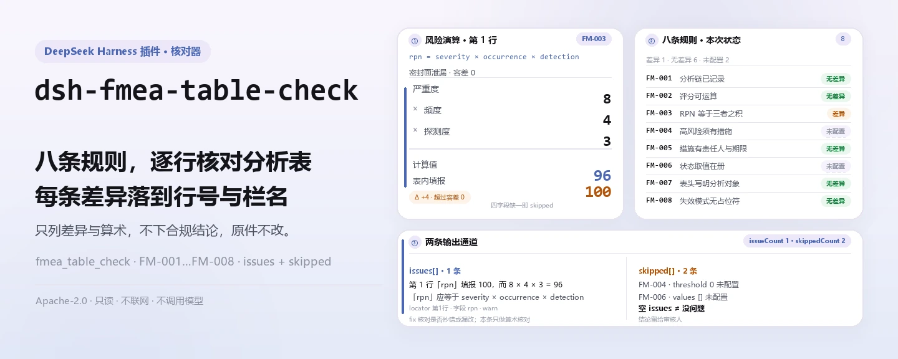
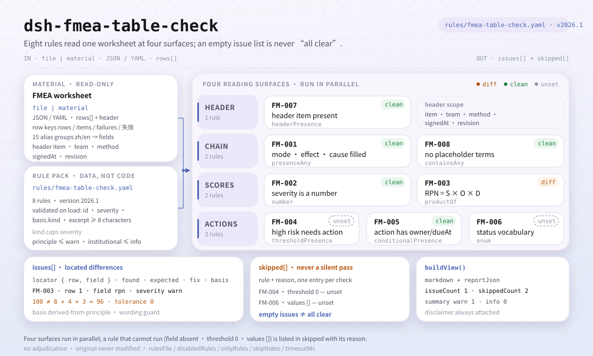

<div align="center">

<picture>
  <source media="(prefers-color-scheme: dark)" srcset="docs/assets/dsh-fmea-table-check-hero-zh-dark.webp">
  
</picture>

# dsh-fmea-table-check

**把一张 FMEA 分析表逐行核成一份「哪一行、哪一栏、差什么」的清单——原件不改，结论留给审核人。**

面向质量与工艺工程师的 DeepSeek Harness 表格核查插件：读入一份中英文表头的 FMEA 工作表，按 8 条规则核对分析链、评分可运算性与 RPN 乘积，只列材料内部能逐条指认的差异。

[安装](#三步上手) · [配置](#配置) · [FAQ](#faq) · [简体中文](README.md) · [English](README.en.md) · [Español](README.es.md) · [Português](README.pt.md) · [हिन्दी](README.hi.md)

[](LICENSE)
[](#兼容性)
[](https://www.npmjs.com/package/dsh-fmea-table-check)
[](https://github.com/PerryLink/dsh-fmea-table-check/actions/workflows/ci.yml)
[](#兼容性)

[](https://github.com/PerryLink/dsh-fmea-table-check/stargazers)
[](https://www.npmjs.com/package/dsh-fmea-table-check)
[](https://dshfind.com/plugins/PerryLink/dsh-fmea-table-check?ref=badge)
[](https://securityscorecards.dev/viewer/?uri=github.com/PerryLink/dsh-fmea-table-check)
[](https://dsh.market/)
[](https://gitee.com/perrylink/dsh-fmea-table-check)

```sh
dsh plugin --profile <name> add dsh-fmea-table-check
```

</div>

<sub>社区插件，与 DeepSeek 官方无关。唯一仓库：<https://github.com/PerryLink/dsh-fmea-table-check>（Gitee 为镜像）。</sub>

## 它是什么

`dsh-fmea-table-check` 读取一份 FMEA 分析表——行以表自身的列名为键，中文或英文均可——核对一张表在机械层面能够被要求的东西：基本分析链是否记录在案、严重度/频度/探测度是否为可运算的数值、风险顺序数（RPN）是否等于三者之积、高风险条目是否带有含责任人与完成期限的建议措施、措施状态是否取自你配置的口径、失效模式栏是否残留模板占位符。

它把这些逐条变成「哪一行、哪一栏、差什么」的差异清单，并按严重级汇总；算不出来的检查写进 `skipped`，绝不静默通过。

<picture>
  <source media="(prefers-color-scheme: dark)" srcset="docs/assets/dsh-fmea-table-check-flow-v5-dark.svg">
  
</picture>

它不判断失效模式是否找全、后果是否分析到位、打分是否恰当、风险是否可接受——那些是分析小组的判断，也正是 FMEA 的价值所在。

全程纯 ESM、无网络请求、不调用模型，原始表格不会被改写。

## 三步上手

1. **安装**（三选一）：

   ```sh
   # git 通道（最新 main）
   dsh plugin --profile web add github:PerryLink/dsh-fmea-table-check
   # npm 通道（已发布版本）
   dsh plugin --profile web add dsh-fmea-table-check
   # tarball 通道：本仓库 pnpm install && pnpm run build && pnpm pack 后
   dsh plugin --profile web add ./dsh-fmea-table-check-<version>.tgz
   ```

   发布产物是 `lib/index.mjs`（由 `pnpm run build` 生成）与 `rules/` 规则包；npm 包两者都带。

2. **最小配置**（默认即可用；在 profile patch 里插入一行）：

   ```yaml
   - insert:
       - id: dsh-fmea-table-check
         name: dsh-fmea-table-check
   ```

   不写 `config` 就用默认值；规则包路径、超时与规则开关见「配置」。

3. **验证已生效**：

   ```sh
   dsh --profile web --dump-config | grep 'dsh-fmea-table-check'
   ```

   再跑一遍仓库自带的快速样例（在仓库检出目录内，先构建）：

   ```sh
   pnpm run build
   node samples/quickstart/run.mjs
   ```

   ```
   $ node samples/quickstart/run.mjs
   fmea_table_check: 1 issue(s) — error 0, warn 1, info 0
   skipped: 2
   ```

   样例输入在 `samples/quickstart/input/`，期望输出在 `samples/quickstart/expected/result.json`。

**卸载**：`dsh plugin --profile web remove dsh-fmea-table-check`（或从 profile patch 删掉该行）。

<details>
<summary>在 WorkBuddy / 扣子中使用</summary>

在 WorkBuddy / 扣子搜「职业文档核对全集」——总包，本检查是其中一项；上架以商城为准，无需命令行。

</details>

## 核心能力

插件只注册一个工具 `fmea_table_check`：读一份工作表，套用版本化规则包，返回一份报告。

- **8 条规则，全部数据驱动。** 每条检查都写在 `rules/fmea-table-check.yaml`；替换规则包即可切换规则集，无需改 TypeScript。规则包在加载期校验，不信任其内容。
- **按表自身的列名读，中英文都认。** 列名匹配不区分大小写，并忽略空格、下划线与连字符（`严重度` 与 `severity` 指向同一字段）；报告沿用表内列名，指出它读的是哪一栏。分数可以是字符串。
- **算不出的检查进 `skipped`。** 所需字段缺失、无法解析或未配置时，报告写明规则 id 与原因，而不是静默通过——空的问题列表不能被读成「没有问题」。
- **只列差异，不下结论。** 每条发现带 `locator`（行/栏）、`found`、`expected`、`fix` 与所引条款；报告始终带免责声明，措辞守卫禁止合规、责任或正确性判定。
- **调用面固定。** 工具参数为 `file` / `material`（二选一）、`rulesFile`（覆盖规则包路径）与 `only`（只跑指定规则 id）；输出 `markdown` 与 `reportJson`，并给出 `issueCount` 与 `skippedCount`。

### 规则表

| 规则 | 核对内容 | 严重级 | 依据类型 |
|---|---|---|---|
| `FM-001` | 失效模式、后果或原因已记录 | warn | 原则 |
| `FM-002` | 严重度是可运算的正数 | warn | 原则 |
| `FM-003` | RPN 等于严重度 × 频度 × 探测度 | warn | 原则 |
| `FM-004` | 高风险条目带有建议措施（默认未启用） | info | 本机构 |
| `FM-005` | 有措施的行写明责任人与完成期限 | warn | 原则 |
| `FM-006` | 措施状态取自你的取值口径（默认未启用） | info | 本机构 |
| `FM-007` | 表头写明分析对象 | warn | 原则 |
| `FM-008` | 失效模式栏不残留模板占位符 | warn | 原则 |

### 示例

下面这条是插件在自身 `FM-003` 测试夹具上的真实输出，不是示意图。规则库不伪造引文，因此每条发现都会写明所引条款，以及该条款原文本次未取得。

**工具** `fmea_table_check`

**输入**

```json
{"rows":[{"失效模式":"密封面泄漏","严重度":"8","频度":"4","探测度":"3","风险优先数":"100"}]}
```

**输出**

```json
{
  "id": "dsh-fmea-table-check.FM-003.de09b5a6",
  "ruleId": "FM-003",
  "severity": "warn",
  "locator": {
    "field": "rpn",
    "row": 1
  },
  "found": "第 1 行「rpn」填报 100，而 8 × 4 × 3 = 96",
  "expected": "「rpn」应等于 severity × occurrence × detection",
  "fix": "核对是否抄错或漏改；本条只做算术核对，不判断各因子是否正确"
}
```

*Observed from `tests/fixtures/FM-003/FM-003-unsafe.json (cases.json expects FM-003 count 1); run via lib/index.mjs rules/fmea-table-check.yaml`*

### 常见核对场景

| 你会问 | 它怎么答 |
|---|---|
| RPN 栏跟严重度 × 频度 × 探测度对不上，能查出来吗？ | 能。`FM-003` 用严重度 × 频度 × 探测度重算 `rpn`，容差为 `0`，逐行报出与表内所填不一致的条目。它只在四个字段都能解析为数值时执行；频度填的不是数字时，本条报 `skipped` 而不是通过。按 AIAG-VDA 手册打分的表用 AP 而非 RPN，请改 `resultField` 与 `factorFields`，或停用本条。 |
| 严重度栏填的是「高」而不是分数，会怎样？ | `FM-002` 要求严重度为可运算的正数，填不出来即报出该行。它的核对只指向 `severity` 一个字段，频度与探测度要另加一条换 `field` 的规则；它不设分值范围，既不强制 1～10 的口径，也不判断打分是否恰当。分数解析不出来时 `FM-003` 同样进 `skipped`，因为乘不出来。 |
| 某行提了建议措施，但责任人与完成期限都是空的。 | `FM-005` 在凡是填了建议措施的行上执行，要求同时有 `owner`（责任人）与 `dueAt`（完成期限），缺其一即报出该行。字段名是别名解析后的规范名，本机构表式栏名不同时，请把别名加进列映射或调整 `requiredFields`。它只核对这两栏是否填写，不判断期限是否现实、责任人是否认可。措施栏为空的行由 `FM-004` 负责。 |
| 分析表里根本没写分析的是哪个产品或过程。 | `FM-007` 读表头的 `item`，分析对象缺失即报出：FMEA 是针对特定产品或过程开展的，没有它结论无法追溯，也无法判断该用哪一套评分表。这是存在性核对，填了但填错不报。若本机构还要求写明所用分析方法，把 `method` 加进它的 `fields`。 |
| 有些行的失效模式栏还写着「待填」或 `XXX`，另一些行干脆什么都没填。 | `FM-008` 报出失效模式栏仍含本规则库占位符词条（`【`、`】`、`{{`、`}}`、`XXX`、`xxx`、`待填`、`待补充`、`TBD`、`todo`、`示例`）的行，因为照模板抄来的表看上去像是分析已完成；它只看失效模式栏，词条可随本机构模板调整。`FM-001` 报出失效模式、后果与原因三项全空的行，但它只要求三者填了至少一项——填着「待填」的行能通过 `FM-001`，由 `FM-008` 报出。两条都不判断失效模式是否找全、后果是否分析到位。 |
| 报告里 `FM-004` 与 `FM-006` 显示为 `skipped`，是出问题了吗？ | 不是。这两条出厂都未配置，规则库如实报出未能执行，而不是静默通过。`FM-004` 的 `threshold` 为 `0`，即未配置，未设本机构风险准则前没有任何行算高风险——例如配 `triggerField: severity` 加 `threshold: 9`，或 `triggerField: rpn` 加 `threshold: 100`。`FM-006` 的 `values` 为空，未列本机构口径前不核对措施状态取值。配置之后，`FM-004` 只核对高风险行的建议措施栏是否填写，不判断措施是否有效、是否可行；`FM-006` 只核对状态值是否在册，不判断措施是否真的落实。 |

## 依据的标准

| 文件 | 文号 | 引用它的规则 |
|---|---|---|
| 《系统可靠性分析技术 失效模式和影响分析（FMEA）程序》 | GB/T 7826（现行版本号与条号本次未核实） | FM-001, FM-002, FM-003, FM-004, FM-005, FM-006, FM-007, FM-008 |

**边界：** 本插件核对一份 **FMEA 分析表** 在表格层面可以机械要求到的事项——分析链是否记录在案，严重度 / 频度 / 探测度是否为可运算的数值，风险顺序数是否等于三者之积，高风险条目是否带有含责任人与完成期限的建议措施，措施状态是否取自你配置的取值口径，以及是否残留模板占位符。它**不**判定失效模式是否完整、后果分析是否足够深入、评分是否正确，也不判定风险是否可以接受。**那些是研究团队的判断，也正是 FMEA 的价值所在。**

> ### ⚠️ 在采信报告中的引文之前，请先读这一段
>
> **本规则库的每条 `excerpt` 都逐字写明「该条文本次未取得」。** 方法载体包括 **GB/T 7826《系统可靠性分析技术 失效模式和影响分析（FMEA）程序》**、IEC 60812，以及汽车行业的 AIAG-VDA FMEA 手册。本次核验未能取得这些文件的逐字条文，因此规则包不在 `excerpt` 里概述或改写引文，而是把缺口写在该字段本身，把推理写进 `note`。据此，所有规则的依据类型只能是 `derived-from-principle`（封顶 `warn`）或 `institutional-configuration`（封顶 `info`）；并有测试断言：没有任何规则声称拥有它并不拥有的引文。**取得条文后必须做两件事：把 `excerpt` 换成真实条款，并把 `kind` 升为 `direct`。**
>
> 有两处设置属于本机构。**`FM-003` 的 RPN 算术假定 S×O×D 方法**；按 AIAG-VDA 手册打分的表改用 **AP（措施优先级）**，请把 `resultField` 与 `factorFields` 改指向 AP 栏，或停用本条。**`FM-004` 的 `threshold` 出厂为 `0`，即「未配置」**：多高算高风险是本机构的风险准则，规则会报告自己未能执行，而不是替你编一个阈值。

## 材料格式

支持 JSON 与 YAML：

```yaml
item: 某型阀体加工过程
rows:
  - { 项目: 某型阀体加工过程, 功能: 在规定压力下保持密封, 失效模式: 密封面泄漏,
      失效后果: 介质外泄，影响安全, 严重度: '8', 失效原因: 密封面加工粗糙度超差,
      频度: '4', 探测度: '3', 风险优先数: '96', 建议措施: 增加密封面粗糙度在线检测,
      责任人: 张工, 完成期限: 2026-06-30, 措施状态: 进行中 }
```

列名匹配不区分大小写并忽略空格、下划线、连字符，因此 `严重度` 与 `severity` 解析到同一字段；报告沿用表内列名，发现会指出它读的是哪一栏。分数可以字符串形式传入。字段在读取层是可选的，由检查引擎校验，因此部分导出的材料会产生「缺项」类差异，而不是让程序崩溃。

## 配置

全部可调参数都在 `src/config.ts` 的 Schemastery schema 中，改 `cordis.yml` 或 profile patch 即可生效，无需改代码；逐条阈值在 `rules/` 下的规则库文件里。按 id 覆盖会替换整行——请重述所有需要的键。

| 键 | 类型 | 默认值 | 说明 |
|---|---|---|---|
| `rulesFile` | string | `rules/fmea-table-check.yaml` | 规则库文件路径，相对插件包根目录 |
| `disabledRules` | string[] | `[]` | 要停用的规则 id 列表；每条都会出现在 `skipped` 中 |
| `onlyRules` | string[] | `[]` | 只执行这些规则 id；留空表示执行全部规则 |
| `skipNotes` | string | `""` | 附加到每条 `skipped` 说明后的备注 |
| `timeoutMs` | number | `120000` | 工具协作式超时预算（毫秒） |

<details>
<summary>规则级参数（按需配置，改规则库而非代码）</summary>

- `FM-003` 的 `resultField` / `factorFields` / `tolerance` —— RPN 算术。按 AIAG-VDA 手册打分的表用 AP 而非 RPN 时，改指向 AP 栏，或停用本条。
- `FM-004` 的 `triggerField` / `threshold` / `requiredField` —— 本机构的高风险准则。`threshold` 为 `0` 表示未配置；常见设置是 `severity` 取 `9`，或 `rpn` 取 `100`。
- `FM-005` 的 `conditionField` / `requiredFields` —— 哪些行、必须带哪些字段。
- `FM-006` 的 `values` —— 本机构的措施状态取值口径。
- `FM-002` 的 `min` / `max` —— 评分范围（若本机构评分表有固定范围）。默认不设，因为不同手册与分析类型的评分表不同。

</details>

profile patch 覆盖示例：

```yaml
- insert:
    - id: dsh-fmea-table-check
      name: dsh-fmea-table-check
      config:
        onlyRules: [FM-001, FM-002, FM-003, FM-005, FM-007, FM-008]
        timeoutMs: 60000
```

## 规则来源

规则数据与代码分离：每条规则都带文件名、文号、按原文自身编号体系的条款号、摘录与来源地址。加载期守卫通常要求「摘录必须是真实引文且不少于八个字符」，但它分不清引文与描述——因此本规则包在头部、每条 `note`，以及一个断言「每条 `excerpt` 都承认引文缺口」的测试里交代这件事。依据仅为原则性条款（`kind: derived-from-principle`，严重级上限 `warn`）或本机构配置（`kind: institutional-configuration`，上限 `info`）的检查不得标为 `error`；夸大依据的规则库会在加载期失败，而不会产出一份看起来很有底气的报告。

核验中确认的边界与「刻意没有作出的结论」见 `rules/evidence/`、`rules/citations-baseline.json` 与 `scripts/check-citations.mjs`。

## FAQ

<details>
<summary>表格内容会被上传或写盘吗？</summary>

不会。插件只读取你通过 `file` 或 `material` 传入的材料，在本地解析并用随包的规则包计算；不发网络请求、不带遥测或统计、不调用模型。除工具结果与 DSH 宿主自己的会话日志外，它不写任何数据；那份存储与保留期由宿主控制，本包不另存副本。卸载包只删除代码，不会删除宿主会话日志或你已有的文档。完整声明见 [PRIVACY.md](PRIVACY.md)。

</details>

<details>
<summary>规则算不出来时会静默通过吗？</summary>

不会。所需字段缺失、无法解析或未配置（例如 `FM-004` 的 `threshold: 0`、`FM-006` 的空 `values`）时，报告在 `skipped` 中写明规则 id 与原因；被 `disabledRules` 停用的规则同样出现在 `skipped`。空的问题列表不能被读成「没有问题」。

</details>

<details>
<summary>会和其他插件抢工具名、服务或 slot 吗？</summary>

不会。它只通过 `ctx.tools.register` 注册一个工具 `fmea_table_check`，不提供 service key、不注册客户端 slot、不注册 `webServer` 前缀、不改写全局对象；bundle patch 只 `insert` 自己一行。注册是 Cordis effect，卸载或热重载即撤销。

</details>

<details>
<summary>性能开销多大？</summary>

纯本地：解析 JSON/YAML 后逐条规则扫描，无网络、无模型调用。工具的 `timeoutMs` 是协作式超时预算（默认 `120000` 毫秒），由宿主在到点时中止；大表主要受行数影响。

</details>

<details>
<summary>Excel 表格能直接用吗？</summary>

不能。材料只接受 JSON 或 YAML；Excel 请先转换为 JSON/YAML（在对话里也可以先代转），再交给工具。字段在读取层可选，缺项会产生「缺项」类差异，而不是让程序崩溃。

</details>

## 安全边界

- **只读材料。** 工具读取 `file` 或 `material`，从不改写原件，也不产生第二份材料副本。
- **无网络、无模型调用。** 解析与规则计算全在本地；规则包路径可覆盖，但只从本地文件系统加载，不拉取远程规则。
- **不伪造引文。** 规则包的每条 `excerpt` 都写明「本条文本次未取得」，依据类型封顶 `warn` / `info`；取得条文前，命中只应读作「这一栏没填 / 这三个数算不出来 / 措施没人负责」，而不是「FMEA 不符合标准」。
- **不越权下结论。** 报告只列材料内部可逐条指认的差异，措辞守卫禁止合规、责任或正确性判定，报告始终带免责声明。
- **失败可见。** 规则包在加载期校验，非法规则使插件加载失败；无法执行的检查进 `skipped`，不静默通过。

## 已知限制

- **只做表内自洽与算术。** 不判断失效模式是否找全、后果是否分析到位、严重度 / 频度 / 探测度的打分是否恰当、风险是否可接受——那些是分析小组的专业判断，也是 FMEA 的价值所在。
- **引文尚未取得。** 本规则库所有 `excerpt` 均写明本次未取得 GB/T 7826 等文件的逐字条文，`kind` 为 `derived-from-principle`（封顶 `warn`）或 `institutional-configuration`（封顶 `info`）。取得条文后须替换 `excerpt` 并升为 `direct`。
- **`FM-004` / `FM-006` 出厂未配置。** `threshold` 为 `0`、`values` 为空，未配置即进 `skipped`；高风险准则与措施状态口径必须由本机构给出。
- **`FM-002` 不设分值范围。** 默认不强制 1～10 的口径，`99` 也能通过；按本机构评分表补 `min` / `max`。
- **`FM-003` 假定 S×O×D。** 按 AIAG-VDA 手册打分、使用 AP（措施优先级）的表，需改 `resultField` / `factorFields` 或停用本条。
- **材料仅 JSON / YAML。** Excel 需先转换；字段在读取层可选，部分导出产生「缺项」类差异而非崩溃。
- **时间不做时区换算。** 所有计算都是对输入字符串做墙上时钟运算。
- **无 UI。** 纯 host 工具，不提供界面，也不注册客户端 slot。

## 与其他 DSH 插件的互操作性

本插件只注册一个工具 `fmea_table_check`，不提供 service key、不注册客户端 slot、不注册 `webServer` 前缀、不改写全局对象；bundle patch 只 `insert` 自己一行，从不覆写内置行的 `config`。这些结论可以直接从 `package.json` 的 `dsh.capabilities`（`tools:register`）与 `cordis.patch.yml` 核验。

工具注册与 bundle 行都是 Cordis effect：插件停止或热重载时撤销，不留在进程里。

## 兼容性

| 项目 | 状态 |
|---|---|
| Harness | 对等版本范围 `>=0.1.2-rc.1 <0.2.0 \|\| >=0.2.0-0 <0.3.0` —— 已实测同时接受 `0.2.0-rc.2` 与 `0.2.1-rc.2`。`engines.dsh` 声明为 `>=0.2.1-0 <0.3.0`，0.2.1 起由宿主单独裁决。 |
| Node | `^22.19.0 \|\| >=24.0.0` |
| 平台 | 全平台（纯 ESM；无原生代码、无联网、不调用模型） |
| 工具模式 | `native` 与 `ptc` 均可；一次核对多张工作表时建议 `ptc`，schema 成本只付一次。 |

## 故障排查

- **`FM-004` 或 `FM-006` 自己报 `skipped`。** 它们的配置是空的。两条都取决于你的风险准则与管理规程，插件不会替你猜。
- **`FM-003` 在每一行都命中。** 工作表用的是 AP 而不是 RPN；改 `resultField` 与 `factorFields`，或停用该规则。
- **`FM-002` 接受 99 分。** 该规则只核对分值是可运算的正数，刻意不设范围；本机构评分表有固定范围时，补 `min` 与 `max`。
- **`FM-005` 在没有责任人的措施上命中。** 这正是它要查的：没有责任人与完成期限的措施无法跟踪。
- **插件装上了但工具不出现。** 确认 `main` 指向 `lib/index.mjs`，且 `pnpm run build` 已生成该文件；`main` 写错会让加载器静默跳过该条目。
- **`dsh plugin add` 报版本不兼容。** peer 范围覆盖 `0.1.x` 与 `0.2.x`；运行时在其之外时，显式豁免：`dsh plugin --profile <name> allow-version dsh-fmea-table-check@<version> --dsh-version <runtime> --accept-risk`。
- **`check` 报 `manifest-peers` 失败。** 静态检查器比对的是一份早于 0.2 世代的硬编码 peer 范围；安装期的 peer 校验以运行时为准。这是 `dsh-plugin-dev` 的已知上游问题。

更多安装、空结果、引文缺口与提 issue 的说明见 [TROUBLESHOOTING.md](TROUBLESHOOTING.md)。

## 生态与质量

- [Gitee 镜像](https://gitee.com/perrylink/dsh-fmea-table-check)（同步镜像，以 GitHub 为准）
- [dshfind 插件页](https://dshfind.com/plugins/PerryLink/dsh-fmea-table-check)（安装量与排名）
- [OpenSSF Scorecard 报告](https://securityscorecards.dev/viewer/?uri=github.com/PerryLink/dsh-fmea-table-check)（由 [.github/workflows/scorecard.yml](.github/workflows/scorecard.yml) 驱动）
- [DSH Market](https://dsh.market/)（已上架）
- **1024 商店渠道**：先 `npm i -g dsh1024`，再 `dsh1024 plugin --profile web add dsh-fmea-table-check`（计入 [deepseek1024.com](https://deepseek1024.com) 安装排行）
- 按材料选核查器：[perrylink.github.io/zh/checkers/choose](https://perrylink.github.io/zh/checkers/choose/)

## 开发

```sh
pnpm install
pnpm run typecheck                 # tsc --noEmit
pnpm test                          # vitest：共享表格套件 + 每条规则成对夹具
pnpm run build                     # tsdown -> lib/index.mjs + lib/index.d.mts
pnpm run verify:self-contained     # 依赖 spec 均来自 registry
pnpm run check:lockfile            # lockfile 漂移
pnpm run check:readmes             # 五语 README 一致性
pnpm run check:citations           # 规则引文核验
node ../scripts/sync-shared.mjs dsh-fmea-table-check   # 从 ../_shared 刷新 src/shared
pnpm pack
```

插件是**数据驱动**形态：`src/model.ts` 声明表形状并提供读取器与检查核心，`src/shared/` 是复制进来的共享件（不靠跨包 import），`rules/fmea-table-check.yaml` 声明每一条检查。改规则不必改代码；改共享件后要重跑同步命令。

| 路径 | 内容 |
|---|---|
| `src/` | 插件入口（`index.ts`）、Schemastery 配置（`config.ts`）、纯检查核心与读取器（`model.ts`）、面向模型的视图（`view.ts`）与 `shared/` 共享件 |
| `rules/` | 规则包 `fmea-table-check.yaml`、引文基线 `citations-baseline.json` 与 `evidence/` 核验记录 |
| `tests/` | vitest；`fixtures/FM-00N/` 为每条规则的合规 / 违规成对夹具 |
| `samples/quickstart/` | 1 分钟试跑样例（输入、期望输出与 `run.mjs`） |
| `scripts/` | 机械门禁（`check-citations`、`check-lockfile-drift`、`check-readme-sync`、`verify-self-contained`）与配图脚本 `gen-readme-assets.py` |
| `docs/assets/` | README 配图；`dsh-fmea-table-check-hero-{zh,en}-{light,dark}.webp` 与 `dsh-fmea-table-check-flow-v5-{light,dark}.svg` 由配图脚本生成 |

配图由 [`scripts/gen-readme-assets.py`](scripts/gen-readme-assets.py) 程序化生成（Pillow 画本地化 hero、手写 SVG 画结构图），可重复执行：`python scripts/gen-readme-assets.py`。

Topics：`dsh`, `dsh-plugin`, `deepseek-harness`, `deepseek`, `cordis`, `fmea`, `table`

## 家族与致谢

本项目是 [PerryLink](https://github.com/PerryLink) 维护的 DeepSeek Harness 插件家族成员（全部 Apache-2.0）。如果这个插件帮到了你，**给个 star**——它不解锁任何功能，但会让下一个人更容易找到它。

- [@PerryLink](https://github.com/PerryLink) —— 创建者与维护者：检查引擎与规则包、GB/T 7826 引文核验记录、五语文档。

<details>
<summary>展开全部插件</summary>

| 插件 | 状态 |
|---|---|
| **[dsh-aqua-input-check](https://github.com/PerryLink/dsh-aqua-input-check)** |  |
| **[dsh-archive-check](https://github.com/PerryLink/dsh-archive-check)** |  |
| **[dsh-auto-review](https://github.com/PerryLink/dsh-auto-review)** |  |
| **[dsh-autotier](https://github.com/PerryLink/dsh-autotier)** | 🧊 已冻结 — 见仓库 README |
| **[dsh-bid-ca-precheck](https://github.com/PerryLink/dsh-bid-ca-precheck)** |  |
| **[dsh-bid-qual-check](https://github.com/PerryLink/dsh-bid-qual-check)** |  |
| **[dsh-cert-mcp](https://github.com/PerryLink/dsh-cert-mcp)** | 🧊 已冻结 — 见仓库 README |
| **[dsh-checkpoint-rewind](https://github.com/PerryLink/dsh-checkpoint-rewind)** |  |
| **[dsh-click](https://github.com/PerryLink/dsh-click)** |  |
| **[dsh-composer-history](https://github.com/PerryLink/dsh-composer-history)** |  |
| **[dsh-contract-stance](https://github.com/PerryLink/dsh-contract-stance)** |  |
| **[dsh-customs-doc-check](https://github.com/PerryLink/dsh-customs-doc-check)** |  |
| **[dsh-data-quality](https://github.com/PerryLink/dsh-data-quality)** |  |
| **[dsh-demurrage-ledger](https://github.com/PerryLink/dsh-demurrage-ledger)** |  |
| **[dsh-doublecheck](https://github.com/PerryLink/dsh-doublecheck)** |  |
| **[dsh-drill-script-check](https://github.com/PerryLink/dsh-drill-script-check)** |  |
| **[dsh-eia-guide-check](https://github.com/PerryLink/dsh-eia-guide-check)** |  |
| **[dsh-emergency-plan](https://github.com/PerryLink/dsh-emergency-plan)** |  |
| **[dsh-essay-rubric-check](https://github.com/PerryLink/dsh-essay-rubric-check)** |  |
| **[dsh-evidence-check](https://github.com/PerryLink/dsh-evidence-check)** |  |
| **[dsh-export-ctl-check](https://github.com/PerryLink/dsh-export-ctl-check)** |  |
| **[dsh-fast](https://github.com/PerryLink/dsh-fast)** |  |
| **[dsh-fmea-table-check](https://github.com/PerryLink/dsh-fmea-table-check)** |  |
| **[dsh-forecast-penalty](https://github.com/PerryLink/dsh-forecast-penalty)** |  |
| **[dsh-fund-research](https://github.com/PerryLink/dsh-fund-research)** |  |
| **[dsh-github](https://github.com/PerryLink/dsh-github)** |  |
| **[dsh-gongwen-flow-check](https://github.com/PerryLink/dsh-gongwen-flow-check)** |  |
| **[dsh-gongwen-word-check](https://github.com/PerryLink/dsh-gongwen-word-check)** |  |
| **[dsh-guard-plan-qc](https://github.com/PerryLink/dsh-guard-plan-qc)** |  |
| **[dsh-hazchem-check](https://github.com/PerryLink/dsh-hazchem-check)** |  |
| **[dsh-hazplan-check](https://github.com/PerryLink/dsh-hazplan-check)** |  |
| **[dsh-hidden-risk-map](https://github.com/PerryLink/dsh-hidden-risk-map)** |  |
| **[dsh-hs-classify](https://github.com/PerryLink/dsh-hs-classify)** |  |
| **[dsh-icd-rule-check](https://github.com/PerryLink/dsh-icd-rule-check)** |  |
| **[dsh-industry-research](https://github.com/PerryLink/dsh-industry-research)** |  |
| **[dsh-lawcite-adapter](https://github.com/PerryLink/dsh-lawcite-adapter)** |  |
| **[dsh-laya](https://github.com/PerryLink/dsh-laya)** |  |
| **[dsh-lc-doc-check](https://github.com/PerryLink/dsh-lc-doc-check)** |  |
| **[dsh-learning-gap-check](https://github.com/PerryLink/dsh-learning-gap-check)** |  |
| **[dsh-library](https://github.com/PerryLink/dsh-library)** |  |
| **[dsh-local-ai](https://github.com/PerryLink/dsh-local-ai)** |  |
| **[dsh-lsp-actions](https://github.com/PerryLink/dsh-lsp-actions)** |  |
| **[dsh-mask](https://github.com/PerryLink/dsh-mask)** |  |
| **[dsh-mcp-panel](https://github.com/PerryLink/dsh-mcp-panel)** |  |
| **[dsh-medrec-qc](https://github.com/PerryLink/dsh-medrec-qc)** |  |
| **[dsh-memento](https://github.com/PerryLink/dsh-memento)** |  |
| **[dsh-nsfc-form-check](https://github.com/PerryLink/dsh-nsfc-form-check)** |  |
| **[dsh-nurse-record-check](https://github.com/PerryLink/dsh-nurse-record-check)** |  |
| **[dsh-observe](https://github.com/PerryLink/dsh-observe)** |  |
| **[dsh-origin-rvc-check](https://github.com/PerryLink/dsh-origin-rvc-check)** |  |
| **[dsh-ota-review-check](https://github.com/PerryLink/dsh-ota-review-check)** |  |
| **[dsh-output-styles](https://github.com/PerryLink/dsh-output-styles)** |  |
| **[dsh-paper-doc-adapter](https://github.com/PerryLink/dsh-paper-doc-adapter)** |  |
| **[dsh-permission-rules](https://github.com/PerryLink/dsh-permission-rules)** |  |
| **[dsh-permit-report-check](https://github.com/PerryLink/dsh-permit-report-check)** |  |
| **[dsh-pipeline-check](https://github.com/PerryLink/dsh-pipeline-check)** |  |
| **[dsh-pleading-draft](https://github.com/PerryLink/dsh-pleading-draft)** |  |
| **[dsh-plugin-doctor](https://github.com/PerryLink/dsh-plugin-doctor)** | 🚫 已退役（仓库已归档） |
| **[dsh-plugin-guide](https://github.com/PerryLink/dsh-plugin-guide)** |  |
| **[dsh-plugin-kit](https://github.com/PerryLink/dsh-plugin-kit)** | 🚫 已退役（仓库已归档） |
| **[dsh-plugin-upgrade](https://github.com/PerryLink/dsh-plugin-upgrade)** | 🚫 已退役（仓库已归档） |
| **[dsh-policy-brief-draft](https://github.com/PerryLink/dsh-policy-brief-draft)** |  |
| **[dsh-power-loss-split](https://github.com/PerryLink/dsh-power-loss-split)** |  |
| **[dsh-power-ticket-check](https://github.com/PerryLink/dsh-power-ticket-check)** |  |
| **[dsh-ppap-check](https://github.com/PerryLink/dsh-ppap-check)** |  |
| **[dsh-protest-deadline](https://github.com/PerryLink/dsh-protest-deadline)** |  |
| **[dsh-railway-window](https://github.com/PerryLink/dsh-railway-window)** |  |
| **[dsh-repair-order-qc](https://github.com/PerryLink/dsh-repair-order-qc)** |  |
| **[dsh-research-report](https://github.com/PerryLink/dsh-research-report)** |  |
| **[dsh-review-reply-check](https://github.com/PerryLink/dsh-review-reply-check)** |  |
| **[dsh-rulefile-check](https://github.com/PerryLink/dsh-rulefile-check)** |  |
| **[dsh-safety-brief-check](https://github.com/PerryLink/dsh-safety-brief-check)** |  |
| **[dsh-score](https://github.com/PerryLink/dsh-score)** |  |
| **[dsh-session-sync](https://github.com/PerryLink/dsh-session-sync)** |  |
| **[dsh-site-log-check](https://github.com/PerryLink/dsh-site-log-check)** |  |
| **[dsh-skill-pack-security](https://github.com/PerryLink/dsh-skill-pack-security)** |  |
| **[dsh-soe-decision-check](https://github.com/PerryLink/dsh-soe-decision-check)** |  |
| **[dsh-soilwater-check](https://github.com/PerryLink/dsh-soilwater-check)** |  |
| **[dsh-sop-sync-check](https://github.com/PerryLink/dsh-sop-sync-check)** |  |
| **[dsh-spc-gbt-adapter](https://github.com/PerryLink/dsh-spc-gbt-adapter)** |  |
| **[dsh-talk](https://github.com/PerryLink/dsh-talk)** |  |
| **[dsh-tender-extract](https://github.com/PerryLink/dsh-tender-extract)** |  |
| **[dsh-tender-matrix](https://github.com/PerryLink/dsh-tender-matrix)** |  |
| **[dsh-test-drive](https://github.com/PerryLink/dsh-test-drive)** |  |
| **[dsh-ticktick](https://github.com/PerryLink/dsh-ticktick)** | 🚫 已退役（仓库已归档） |
| **[dsh-translate](https://github.com/PerryLink/dsh-translate)** |  |
| **[dsh-warranty-calc](https://github.com/PerryLink/dsh-warranty-calc)** |  |
| **[dsh-budget](https://github.com/PerryLink/dsh-budget)** | 🧊 已冻结 — 见仓库 README |
| **[dsh-claude-move](https://github.com/PerryLink/dsh-claude-move)** | 🧊 已冻结 — 见仓库 README |
| **[dsh-defend](https://github.com/PerryLink/dsh-defend)** | 🧊 已冻结 — 见仓库 README |
| **[dsh-draw](https://github.com/PerryLink/dsh-draw)** | 🧊 已冻结 — 见仓库 README |
| **[dsh-reach](https://github.com/PerryLink/dsh-reach)** | 🧊 已冻结 — 见仓库 README |
| **[dsh-background-agents](https://github.com/PerryLink/dsh-background-agents)** | 🚫 已退役（仓库已归档） |
| **[dsh-session-pin](https://github.com/PerryLink/dsh-session-pin)** | 🚫 已退役（仓库已归档） |
| **[dsh-team-rooms](https://github.com/PerryLink/dsh-team-rooms)** | 🚫 已退役（仓库已归档） |

</details>

## License

[LICENSE](LICENSE)（Apache License 2.0）© 2026 dsh-fmea-table-check contributors

<p align="center"><sub>Apache-2.0 · 社区插件，与 DeepSeek 无关。</sub></p>
