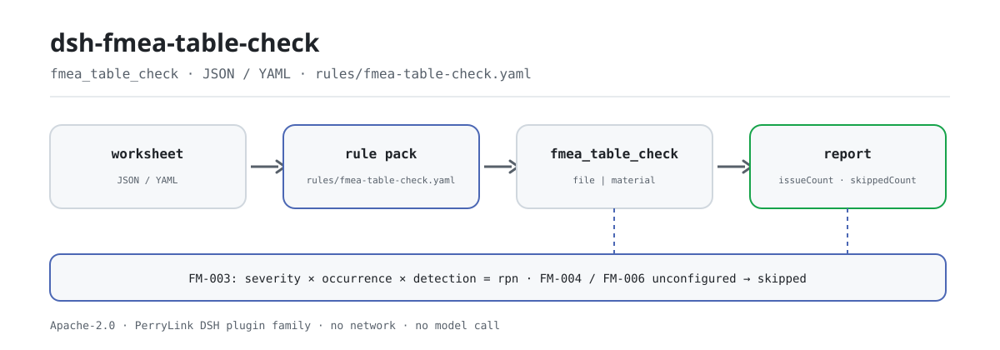

<div align="center">

<picture>
  <source media="(prefers-color-scheme: dark)" srcset="docs/assets/dsh-fmea-table-check-flow-dark.svg">
  
</picture>

# dsh-fmea-table-check

**Transforme uma folha de FMEA numa lista, linha a linha, do que difere e onde — o original nunca é alterado e a conclusão fica com o revisor.**

Um verificador de folhas para o DeepSeek Harness feito para engenheiros de qualidade e de processo: lê uma folha de FMEA com cabeçalhos em chinês ou inglês, aplica oito regras à cadeia de análise, à operabilidade das pontuações e à aritmética do RPN, e lista apenas as diferenças que consegue apontar no material.

[Instalar](#instalação-em-três-passos) · [Configuração](#configuração) · [FAQ](#faq) · [简体中文](README.md) · [English](README.en.md) · [Español](README.es.md) · [Português](README.pt.md) · [हिन्दी](README.hi.md)

[](LICENSE)
[](#compatibilidade)
[](https://www.npmjs.com/package/dsh-fmea-table-check)
[](https://github.com/PerryLink/dsh-fmea-table-check/actions/workflows/ci.yml)
[](#compatibilidade)

[](https://github.com/PerryLink/dsh-fmea-table-check/stargazers)
[](https://www.npmjs.com/package/dsh-fmea-table-check)
[](https://dshfind.com/plugins/PerryLink/dsh-fmea-table-check?ref=badge)
[](https://securityscorecards.dev/viewer/?uri=github.com/PerryLink/dsh-fmea-table-check)
[](https://dsh.market/)
[](https://gitee.com/perrylink/dsh-fmea-table-check)

```sh
dsh plugin --profile <name> add dsh-fmea-table-check
```

</div>

<sub>Plugin da comunidade, sem afiliação com a DeepSeek. Repositório canônico: <https://github.com/PerryLink/dsh-fmea-table-check> (o Gitee é um espelho).</sub>

## O que é

`dsh-fmea-table-check` lê uma folha de FMEA —linhas indexadas pelos próprios nomes de coluna da folha, em chinês ou em inglês— e verifica o que a uma folha se pode exigir mecanicamente: que a cadeia de análise esteja registada, que severidade, ocorrência e deteção sejam números operáveis, que o número de prioridade de risco (RPN) seja igual ao seu produto, que uma linha de risco elevado traga uma ação com responsável e prazo, que os estados das ações venham do vocabulário que configurar e que não sobreviva nenhum marcador de modelo na coluna do modo de falha.

Converte essas verificações numa lista, linha a linha, do que difere e onde, resumida por gravidade; uma verificação que não pode ser executada é reportada em `skipped` e nunca passa em silêncio.

Não julga se os modos de falha estão completos, se os efeitos foram analisados o suficiente, se as pontuações estão corretas ou se o risco é aceitável: esses são os juízos da equipa de estudo, e é aí que reside o valor do FMEA.

ESM puro: sem pedidos de rede, sem chamadas ao modelo, e a folha original nunca é alterada.

## Instalação em três passos

1. **Instale** (escolha um canal):

   ```sh
   # canal git (última main)
   dsh plugin --profile web add github:PerryLink/dsh-fmea-table-check
   # canal npm (versões publicadas)
   dsh plugin --profile web add dsh-fmea-table-check
   # canal tarball: após pnpm install && pnpm run build && pnpm pack neste repositório
   dsh plugin --profile web add ./dsh-fmea-table-check-<version>.tgz
   ```

   Os artefactos publicados são `lib/index.mjs` (gerado por `pnpm run build`) e o pacote de regras `rules/`; o pacote npm inclui ambos.

2. **Configuração mínima** (os valores por omissão bastam; insira uma linha no patch do perfil):

   ```yaml
   - insert:
       - id: dsh-fmea-table-check
         name: dsh-fmea-table-check
   ```

   Sem bloco `config` aplicam-se os valores por omissão; o caminho do pacote de regras, o tempo limite e os interruptores de regras estão em «Configuração».

3. **Confirme que monta**:

   ```sh
   dsh --profile web --dump-config | grep 'dsh-fmea-table-check'
   ```

   Depois execute uma vez a amostra rápida incluída (dentro do checkout; construa primeiro):

   ```sh
   pnpm run build
   node samples/quickstart/run.mjs
   ```

   ```
   $ node samples/quickstart/run.mjs
   fmea_table_check: 1 issue(s) — error 0, warn 1, info 0
   skipped: 2
   ```

   A entrada da amostra está em `samples/quickstart/input/` e a saída esperada em `samples/quickstart/expected/result.json`.

**Desinstalar**: `dsh plugin --profile web remove dsh-fmea-table-check` (ou remova a linha do patch do perfil).

<details>
<summary>Uso no WorkBuddy / Coze</summary>

Procure «Professional Document Check Suite» no WorkBuddy / Coze: o conjunto completo, do qual esta verificação é uma parte; disponibilidade conforme o catálogo da loja e sem necessidade de linha de comandos.

</details>

## Capacidades principais

O plugin regista exatamente uma ferramenta, `fmea_table_check`: lê uma folha, aplica um pacote de regras versionado e devolve um relatório.

- **Oito regras, todas baseadas em dados.** Cada verificação vive em `rules/fmea-table-check.yaml`; substituir o pacote muda o conjunto de regras sem tocar em TypeScript. O pacote é validado ao carregar, não é aceito às cegas.
- **Lê os nomes de coluna da própria folha, em chinês ou inglês.** A correspondência de colunas não distingue maiúsculas e ignora espaços, underscores e hífenes (`严重度` e `severity` resolvem para o mesmo campo); o relatório conserva o nome de coluna da folha, por isso cada achado nomeia a coluna que leu. As pontuações podem chegar como cadeias.
- **Uma verificação que não pode ser executada vai para `skipped`.** Se faltar um campo, não for analisável ou não estiver configurado, o relatório indica o id da regra e o motivo em vez de passar em silêncio: uma lista de problemas vazia nunca pode ser lida como «não há nada de errado».
- **Só diferenças, sem veredictos.** Cada achado traz `locator` (linha/coluna), `found`, `expected`, `fix` e a cláusula citada; o relatório inclui sempre o aviso legal, e um guardião de redação proíbe determinações de conformidade, responsabilidade ou correção.
- **Uma superfície de ferramenta fixa.** Os argumentos são `file` / `material` (um dos dois), `rulesFile` (substitui o caminho do pacote) e `only` (executa ids de regra concretos); a saída inclui `markdown` e `reportJson`, além de `issueCount` e `skippedCount`.

### Tabela de regras

| Regra | Verificação | Gravidade | Tipo de base |
|---|---|---|---|
| `FM-001` | o modo de falha, o efeito ou a causa estão registados | warn | princípio |
| `FM-002` | a pontuação de severidade é um número positivo operável | warn | princípio |
| `FM-003` | o RPN é igual a severidade × ocorrência × deteção | warn | princípio |
| `FM-004` | uma linha de risco elevado traz uma ação recomendada (desativada por omissão) | info | local |
| `FM-005` | uma linha com ação nomeia responsável e prazo | warn | princípio |
| `FM-006` | o estado da ação vem do seu vocabulário (desativada por omissão) | info | local |
| `FM-007` | a folha nomeia o seu objeto de análise | warn | princípio |
| `FM-008` | não sobrevive nenhum marcador de modelo no modo de falha | warn | princípio |

### Exemplos

O achado abaixo é a saída real do plugin sobre o seu próprio fixture de teste `FM-003`, não uma ilustração. O pacote de regras não inventa citações, por isso cada achado nomeia a cláusula aplicada e avisa que o seu texto não foi obtido desta vez.

**Ferramenta** `fmea_table_check`

**Entrada**

```json
{"rows":[{"失效模式":"密封面泄漏","严重度":"8","频度":"4","探测度":"3","风险优先数":"100"}]}
```

**Saída**

```json
{
  "id": "dsh-fmea-table-check.FM-003.de09b5a6",
  "ruleId": "FM-003",
  "severity": "warn",
  "locator": {
    "field": "rpn",
    "row": 1
  },
  "found": "第 1 行「rpn」填报 100，而 8 × 4 × 3 = 96",
  "expected": "「rpn」应等于 severity × occurrence × detection",
  "fix": "核对是否抄错或漏改；本条只做算术核对，不判断各因子是否正确"
}
```

*Observed from `tests/fixtures/FM-003/FM-003-unsafe.json (cases.json expects FM-003 count 1); run via lib/index.mjs rules/fmea-table-check.yaml`*

### Cenários habituais de revisão

| Você pergunta | O que ele responde |
|---|---|
| A célula do RPN não coincide com severidade × ocorrência × deteção — isso é detetado? | Sim. `FM-003` recalcula `rpn` como severidade × ocorrência × deteção com tolerância `0` e assinala a linha cujo valor registado difere. Só é executada quando as quatro células têm números analisáveis; se a pontuação de ocorrência não for um número, a regra reporta `skipped` em vez de passar. Uma folha pontuada pelo manual AIAG-VDA usa AP em vez de RPN: reaponte `resultField` e `factorFields`, ou desative a regra. |
| A célula da severidade traz `高` em vez de uma pontuação. O que acontece? | `FM-002` exige que a severidade seja um número positivo operável e reporta a linha quando não é. A sua verificação aponta apenas ao campo `severity`, pelo que ocorrência e deteção exigem a mesma regra acrescentada com outro `field`; não fixa intervalo de valores, portanto não impõe uma escala de 1 a 10 nem julga se a pontuação é adequada. Uma pontuação que não consegue analisar também envia `FM-003` para `skipped`, porque o produto não pode ser recalculado. |
| Uma linha propõe uma ação, mas o responsável e o prazo estão em branco. | `FM-005` é executada em todas as linhas cuja célula de ação recomendada esteja preenchida e exige `owner` (responsável) e `dueAt` (prazo); reporta a linha à qual falta um deles. São os nomes canónicos após a resolução de alias, pelo que uma folha com outros cabeçalhos precisa do alias no mapeamento de colunas ou de `requiredFields` ajustado. Verifica que as duas células estão preenchidas — não que o prazo seja realista nem que o responsável o tenha aceitado. As linhas sem ação são da competência de `FM-004`. |
| A nossa folha nunca diz que produto ou processo analisa. | `FM-007` lê o `item` do cabeçalho e reporta-o quando falta o objeto de análise: um FMEA é realizado para um produto ou processo específico e sem isso as conclusões não se podem rastrear nem associar a uma tabela de pontuação. É uma verificação de presença: um objeto preenchido mas errado não é reportado. Se as suas folhas tiverem de indicar também o método usado, acrescente `method` aos seus `fields`. |
| Algumas linhas ainda dizem `待填` ou `XXX` na coluna do modo de falha, e outras não têm nada. | `FM-008` reporta a linha cujo modo de falha ainda contém um dos termos marcadores do pacote (`【`, `】`, `{{`, `}}`, `XXX`, `xxx`, `待填`, `待补充`, `TBD`, `todo`, `示例`), porque uma folha copiada de um modelo lê-se como análise concluída; lê apenas a coluna do modo de falha, e `terms` ajusta-se ao seu modelo. `FM-001` reporta a linha em que modo de falha, efeito e causa estão os três vazios, mas exige apenas um dos três: uma célula com `待填` satisfaz `FM-001` e é apanhada por `FM-008`. Nenhuma das duas julga se os modos de falha estão completos ou se os efeitos foram analisados o suficiente. |
| O relatório mostra `FM-004` e `FM-006` como `skipped`. Há algum problema? | Não. Ambas vêm por configurar e o pacote reporta isso em vez de passar em silêncio. O `threshold` de `FM-004` é `0`, lido como não configurado, pelo que nenhuma linha conta como risco elevado até definir o seu critério de risco: por exemplo `triggerField: severity` com `threshold: 9`, ou `triggerField: rpn` com `threshold: 100`. A lista `values` de `FM-006` está vazia, pelo que o vocabulário de estados não é verificado até enumerar os seus próprios valores. Depois de configuradas, `FM-004` verifica apenas que a célula de ação de uma linha de risco elevado está preenchida — não que a ação seja eficaz ou viável — e `FM-006` verifica apenas que o estado consta da lista configurada, não que a ação tenha sido executada. |

## Normas que segue

| Documento | Número | Regras que o citam |
|---|---|---|
| Técnicas de análise de fiabilidade de sistemas — Procedimentos de análise de modos de falha e efeitos (FMEA) | GB/T 7826 (edição em vigor e numeração de cláusulas não verificadas) | FM-001, FM-002, FM-003, FM-004, FM-005, FM-006, FM-007, FM-008 |

**Limite:** este plugin verifica uma **folha de FMEA** no que a uma folha se pode exigir mecanicamente: que a cadeia de análise esteja registada, que as pontuações de severidade / ocorrência / deteção sejam números operáveis, que o número de prioridade de risco seja igual ao seu produto, que uma linha de risco elevado traga uma ação com responsável e prazo, que os estados das ações venham do seu vocabulário e que não sobreviva nenhum marcador de modelo. **Não** julga se os modos de falha estão completos, se as consequências foram analisadas o suficiente, se as pontuações estão corretas ou se o risco é aceitável. **Esses são os juízos da equipa de estudo, e é aí que reside o valor do FMEA.**

> ### ⚠️ Leia isto antes de confiar numa citação do relatório
>
> **Cada `excerpt` do pacote de regras deste plugin diz, por palavras expressas, que o texto da cláusula não foi obtido.** As casas do método são **GB/T 7826**, IEC 60812 e o manual automóvel AIAG-VDA FMEA. A passagem de verificação não conseguiu recuperar o texto literal das cláusulas, por isso, em vez de parafrasear uma citação, o pacote declara a lacuna no próprio campo `excerpt` e põe o raciocínio honesto em `note`. Por isso a base de cada regra é `derived-from-principle` (teto `warn`) ou `institutional-configuration` (teto `info`), e um teste afirma que nenhuma regra reivindica uma citação que não tem. **Quando os textos estiverem em mãos, há duas coisas a fazer: substituir cada `excerpt` pela cláusula real e elevar `kind` para `direct`.**
>
> Dois ajustes são seus. **A aritmética do RPN de FM-003 pressupõe o método S×O×D**; uma folha construída com o manual AIAG-VDA usa **AP (prioridade de ação)**, por isso reaponte `resultField` e `factorFields`, ou desative a regra. E **o threshold de FM-004 vem como `0`, ou seja, «não configurado»**: o que conta como risco elevado é o seu critério de risco, e a regra reporta que não pôde ser executada em vez de inventar um número.

## Formato do material

Aceita JSON e YAML:

```yaml
item: 某型阀体加工过程
rows:
  - { 项目: 某型阀体加工过程, 功能: 在规定压力下保持密封, 失效模式: 密封面泄漏,
      失效后果: 介质外泄，影响安全, 严重度: '8', 失效原因: 密封面加工粗糙度超差,
      频度: '4', 探测度: '3', 风险优先数: '96', 建议措施: 增加密封面粗糙度在线检测,
      责任人: 张工, 完成期限: 2026-06-30, 措施状态: 进行中 }
```

Os nomes de coluna são comparados sem distinguir maiúsculas e ignorando espaços, underscores e hífenes, pelo que um cabeçalho chinês e `severity` resolvem para o mesmo campo; conservam-se os nomes de coluna da folha, por isso um achado nomeia a coluna que leu. As pontuações podem chegar como cadeias. Os campos são opcionais na camada de leitura e validados pelo motor de verificação, pelo que uma exportação parcial produz achados de «falta» em vez de falhar.

## Configuração

Todos os parâmetros ajustáveis são campos `Config` de Schemastery em `src/config.ts`, alteráveis a partir de `cordis.yml` ou do patch do perfil sem tocar em código; os limites por regra vivem no pacote de regras em `rules/`. Uma substituição dirigida por id substitui a linha inteira: repita todas as chaves de que precisa.

| Chave | Tipo | Padrão | Descrição |
|---|---|---|---|
| `rulesFile` | string | `rules/fmea-table-check.yaml` | Caminho do pacote de regras, relativo à raiz do pacote |
| `disabledRules` | string[] | `[]` | Ids de regras a desativar; cada uma aparece em `skipped` |
| `onlyRules` | string[] | `[]` | Executar apenas estas regras; vazio executa todas |
| `skipNotes` | string | `""` | Nota acrescentada a cada motivo de `skipped` |
| `timeoutMs` | number | `120000` | Orçamento de tempo limite cooperativo da ferramenta |

<details>
<summary>Parâmetros por regra (configurados no pacote, não no código)</summary>

- `FM-003` `resultField` / `factorFields` / `tolerance` — a aritmética do RPN. Reaponte-a para uma coluna AP se a sua folha seguir o manual AIAG-VDA, ou desative a regra.
- `FM-004` `triggerField` / `threshold` / `requiredField` — o seu critério de risco elevado. Um threshold de `0` significa que a regra não corre; os ajustes típicos são `severity` em `9`, ou `rpn` em `100`.
- `FM-005` `conditionField` / `requiredFields` — que linhas, e que campos têm de trazer.
- `FM-006` `values` — o seu vocabulário de estados de ação.
- `FM-002` `min` / `max` — limites de pontuação, se a sua tabela de pontuação os fixar. A regra não fixa nenhum por omissão, porque as tabelas diferem entre manuais e tipos de análise.

</details>

Exemplo de substituição no patch do perfil:

```yaml
- insert:
    - id: dsh-fmea-table-check
      name: dsh-fmea-table-check
      config:
        onlyRules: [FM-001, FM-002, FM-003, FM-005, FM-007, FM-008]
        timeoutMs: 60000
```

## Fontes das regras

Os dados das regras vivem em `rules/fmea-table-check.yaml`, separados do código: cada regra traz documento, número, cláusula na numeração própria da fonte, extrato e URL de origem. O guardião de carregamento exige normalmente que «um extrato seja uma citação real de pelo menos oito caracteres», mas não distingue uma citação de uma descrição; por isso este pacote apoia-se no cabeçalho, nas notas de cada regra e num teste que afirma que cada `excerpt` admite a lacuna. Uma verificação baseada apenas num princípio (`kind: derived-from-principle`, teto `warn`) ou em configuração institucional (`kind: institutional-configuration`, teto `info`) não pode ser marcada `error`; um pacote que exagere a sua base falha ao carregar em vez de produzir um relatório que pareça sólido.

Os limites confirmados durante a verificação e as conclusões deliberadamente **não** afirmadas estão em `rules/evidence/`, `rules/citations-baseline.json` e `scripts/check-citations.mjs`.

## FAQ

<details>
<summary>O conteúdo da folha é enviado ou escrito em disco?</summary>

Não. O plugin lê apenas o material que passa por `file` ou `material`, analisa-o localmente e aplica o pacote de regras incluído; não faz pedidos de rede, não inclui telemetria nem analítica e não chama nenhum modelo. Além do resultado da ferramenta e do armazenamento de sessão/registo do próprio host DSH, não escreve nada; esse armazenamento e a sua retenção são do host, e este pacote não acrescenta uma segunda cópia. Desinstalar o pacote remove o seu código, não os registos de sessão do host nem os documentos que já criou. A declaração completa está em [PRIVACY.md](PRIVACY.md).

</details>

<details>
<summary>Uma verificação que não pode ser executada passa em silêncio?</summary>

Não. Quando falta um campo, não é analisável ou não está configurado (por exemplo o `threshold: 0` de `FM-004` ou os `values` vazios de `FM-006`), o relatório indica o id da regra e o motivo em `skipped`; as regras desativadas com `disabledRules` também aparecem aí. Uma lista de problemas vazia nunca pode ser lida como «não há nada de errado».

</details>

<details>
<summary>Compete com outros plugins por nomes de ferramenta, serviços ou slots?</summary>

Não. Regista exatamente uma ferramenta através de `ctx.tools.register` (`fmea_table_check`), não fornece nenhuma chave de serviço, não regista slots de cliente, não regista nenhum prefixo `webServer` e não muta globais; o patch do bundle apenas `insert`a a sua própria linha. O registo é um efeito de Cordis, por isso descarregar ou recarregar a quente retira-o.

</details>

<details>
<summary>Quanta sobrecarga de desempenho representa?</summary>

Puramente local: analisa JSON/YAML e percorre as linhas uma vez por regra, sem rede e sem chamada ao modelo. O `timeoutMs` da ferramenta é um orçamento de tempo limite cooperativo (por omissão `120000` ms) aplicado pelo host quando expira; em folhas grandes manda o número de linhas.

</details>

<details>
<summary>Consegue ler diretamente um livro de Excel?</summary>

Não. O material tem de ser JSON ou YAML; converta o Excel para JSON/YAML primeiro (no chat, se a plataforma o permitir) e entregue-o depois à ferramenta. Os campos são opcionais na camada de leitura, por isso uma exportação parcial produz achados de «falta» em vez de falhar.

</details>

## Limites de segurança

- **Material só de leitura.** A ferramenta lê `file` ou `material`; nunca altera o original nem faz uma segunda cópia do material.
- **Sem rede e sem chamada ao modelo.** A análise e a avaliação de regras são locais; o caminho do pacote de regras pode ser substituído, mas só é carregado do sistema de ficheiros local, nunca remotamente.
- **Sem citações fabricadas.** Cada `excerpt` diz que o texto da cláusula não foi obtido e cada base tem teto `warn` / `info`; até ter os textos, uma correspondência deve ser lida como «esta célula está vazia / estes três números não multiplicam / esta ação não tem responsável», não como «o FMEA não cumpre».
- **Sem veredictos fora de alcance.** O relatório lista apenas diferenças que consegue apontar no material; um guardião de redação proíbe determinações de conformidade, responsabilidade ou correção, e o aviso legal acompanha sempre o relatório.
- **A falha é visível.** O pacote é validado ao carregar, por isso uma regra inválida faz falhar o carregamento do plugin; uma verificação que não pode ser executada vai para `skipped` e nunca passa em silêncio.

## Limitações conhecidas

- **Apenas consistência interna e aritmética.** Não julga se os modos de falha estão completos, se as consequências foram analisadas o suficiente, se as pontuações de severidade / ocorrência / deteção são adequadas ou se o risco é aceitável: esses são os juízos profissionais da equipa de análise e é aí que reside o valor do FMEA.
- **As citações ainda não foram obtidas.** Cada `excerpt` deste pacote declara que o texto literal de GB/T 7826 e dos restantes documentos não foi obtido desta vez; `kind` é `derived-from-principle` (teto `warn`) ou `institutional-configuration` (teto `info`). Quando os textos estiverem em mãos, substitua cada `excerpt` e eleve-o para `direct`.
- **`FM-004` / `FM-006` vêm por configurar.** `threshold` é `0` e `values` está vazio, por isso ambas reportam `skipped`; o critério de risco elevado e o vocabulário de estados têm de vir da sua instituição.
- **`FM-002` não fixa intervalo de pontuação.** Não se impõe nenhuma escala de 1 a 10 por omissão e `99` passa; acrescente `min` / `max` se a sua tabela de pontuação fixar o intervalo.
- **`FM-003` pressupõe S×O×D.** Uma folha pontuada com o AP (prioridade de ação) do manual AIAG-VDA exige reapontear `resultField` / `factorFields`, ou desativar a regra.
- **O material é apenas JSON / YAML.** O Excel tem de ser convertido primeiro; os campos são opcionais na camada de leitura, por isso uma exportação parcial produz achados de «falta» em vez de falhar.
- **Sem conversão de fuso horário.** Toda a aritmética é de hora local sobre as cadeias de entrada.
- **Sem interface.** Ferramenta puramente host: não inclui interface nem regista slots de cliente.

## Interoperabilidade com outros plugins DSH

O plugin regista exatamente uma ferramenta, `fmea_table_check`; não fornece nenhuma chave de serviço, não regista slots de cliente, não regista nenhum prefixo `webServer` e não muta globais. O patch do bundle apenas `insert`a a sua própria linha e nunca substitui o `config` de uma linha incorporada. Estas afirmações podem ser verificadas diretamente em `dsh.capabilities` do `package.json` (`tools:register`) e em `cordis.patch.yml`.

Tanto o registo da ferramenta como a linha do bundle são efeitos de Cordis: parar o plugin ou recarregá-lo a quente retira-os, e não fica nada no processo.

## Compatibilidade

| Superfície | Estado |
|---|---|
| Harness | Intervalo de peers `>=0.1.2-rc.1 <0.2.0 \|\| >=0.2.0-0 <0.3.0` — verificado para aceitar tanto `0.2.0-rc.2` quanto `0.2.1-rc.2`. `engines.dsh` é declarado como `>=0.2.1-0 <0.3.0` e o host aplica-o desde 0.2.1. |
| Node | `^22.19.0 \|\| >=24.0.0` |
| Plataformas | Todas (ESM puro; sem código nativo, sem rede, sem chamada ao modelo) |
| Modo de ferramenta | Funciona em `native` e `ptc`; para rever várias folhas de uma vez, `ptc` paga o custo do esquema uma só vez. |

## Solução de problemas

- **`FM-004` ou `FM-006` reportam-se como `skipped`.** A configuração está vazia. Ambas dependem do seu critério de risco e do seu procedimento de gestão, e o plugin não os adivinha.
- **`FM-003` dispara em todas as linhas.** A folha usa AP em vez de RPN; reaponte `resultField` e `factorFields`, ou desative a regra.
- **`FM-002` aceita uma pontuação de 99.** A regra verifica que a pontuação é um número positivo operável e deliberadamente não fixa intervalo; acrescente `min` e `max` se a sua tabela de pontuação os fixar.
- **`FM-005` dispara numa ação sem responsável.** É essa a verificação: uma ação sem responsável e prazo não pode ser acompanhada.
- **O plugin instala mas a ferramenta não aparece.** Confirme que `main` resolve para `lib/index.mjs` e que `pnpm run build` o gerou; um `main` errado faz o carregador omitir a entrada em silêncio.
- **`dsh plugin add` recusa o pacote por incompatibilidade.** O intervalo de peers cobre `0.1.x` e `0.2.x`; se o seu runtime ficar fora, conceda uma isenção explícita: `dsh plugin --profile <name> allow-version dsh-fmea-table-check@<version> --dsh-version <runtime> --accept-risk`.
- **`check` informa `manifest-peers` como falha.** O verificador estático compara com um intervalo de peers codificado anterior à linha 0.2. O runtime aplica a compatibilidade de peers na instalação, por isso o intervalo declarado é o correto; é um problema conhecido do `dsh-plugin-dev`.

Há mais sobre instalação, resultados vazios, a lacuna de citações e como abrir um issue em [TROUBLESHOOTING.md](TROUBLESHOOTING.md).

## Ecossistema e qualidade

- [Espelho Gitee](https://gitee.com/perrylink/dsh-fmea-table-check) (espelho de sincronização; o GitHub é o canônico)
- [Página do plugin no dshfind](https://dshfind.com/plugins/PerryLink/dsh-fmea-table-check) (instalações e ranking)
- [Relatório OpenSSF Scorecard](https://securityscorecards.dev/viewer/?uri=github.com/PerryLink/dsh-fmea-table-check) (alimentado por [.github/workflows/scorecard.yml](.github/workflows/scorecard.yml))
- [DSH Market](https://dsh.market/) (listado)
- **Canal 1024 store**: `npm i -g dsh1024` uma vez, depois `dsh1024 plugin --profile web add dsh-fmea-table-check` (conta para o ranking de instalações do [deepseek1024.com](https://deepseek1024.com))
- [Escolha um verificador por material](https://perrylink.github.io/zh/checkers/choose/)

## Desenvolvimento

```sh
pnpm install
pnpm run typecheck                 # tsc --noEmit
pnpm test                          # vitest: a suite partilhada de tabelas mais fixtures emparelhados por regra
pnpm run build                     # tsdown -> lib/index.mjs + lib/index.d.mts
pnpm run verify:self-contained     # as specs de dependências resolvem-se a partir do registry
pnpm run check:lockfile            # deriva do lockfile
pnpm run check:readmes             # consistência dos README em cinco idiomas
pnpm run check:citations           # verificação das citações das regras
node ../scripts/sync-shared.mjs dsh-fmea-table-check   # atualiza src/shared a partir de ../_shared
pnpm pack
```

O plugin é **baseado em dados**: `src/model.ts` declara a forma da tabela e fornece o leitor e o núcleo de verificação, `src/shared/` é o kit partilhado copiado para dentro (nunca importado entre pacotes), e `rules/fmea-table-check.yaml` declara cada verificação. Alterar uma regra não mexe no código; depois de alterar o kit partilhado, volte a executar a sincronização.

| Caminho | Conteúdo |
|---|---|
| `src/` | Entrada do plugin (`index.ts`), configuração Schemastery (`config.ts`), núcleo de verificação e leitor (`model.ts`), vista orientada ao modelo (`view.ts`) e o kit `shared/` |
| `rules/` | O pacote de regras `fmea-table-check.yaml`, a base de citações `citations-baseline.json` e o registo de verificação `evidence/` |
| `tests/` | vitest; `fixtures/FM-00N/` guarda um par de fixtures conforme / infrator por regra |
| `samples/quickstart/` | A amostra de um minuto (entrada, saída esperada e `run.mjs`) |
| `scripts/` | Guardas mecânicas (`check-citations`, `check-lockfile-drift`, `check-readme-sync`, `verify-self-contained`) e o gerador de imagens `gen-readme-assets.py` |
| `docs/assets/` | Imagens do README; `dsh-fmea-table-check-flow-{light,dark}.svg` é gerado pelo script de ativos |

As imagens do README são geradas programaticamente por [`scripts/gen-readme-assets.py`](scripts/gen-readme-assets.py) (Python + Pillow) e podem ser reexecutadas com segurança: `python scripts/gen-readme-assets.py`.

Topics: `dsh`, `dsh-plugin`, `deepseek-harness`, `deepseek`, `cordis`, `fmea`, `table`

## Família e agradecimentos

Este projeto faz parte da família de plugins do DeepSeek Harness da [PerryLink](https://github.com/PerryLink) (todos Apache-2.0). Se for útil, **uma estrela ajuda a próxima pessoa a encontrá-lo** — nada fica bloqueado atrás dela.

- [@PerryLink](https://github.com/PerryLink) — criador e mantenedor: o motor de verificação e o pacote de regras, o registo de verificação de citações de GB/T 7826 e a documentação em cinco idiomas.

<details>
<summary>Expandir todos os plugins</summary>

| Plugin | Status |
|---|---|
| **[dsh-aqua-input-check](https://github.com/PerryLink/dsh-aqua-input-check)** |  |
| **[dsh-archive-check](https://github.com/PerryLink/dsh-archive-check)** |  |
| **[dsh-auto-review](https://github.com/PerryLink/dsh-auto-review)** |  |
| **[dsh-autotier](https://github.com/PerryLink/dsh-autotier)** | 🧊 CONGELADO — ver o README do repo |
| **[dsh-bid-ca-precheck](https://github.com/PerryLink/dsh-bid-ca-precheck)** |  |
| **[dsh-bid-qual-check](https://github.com/PerryLink/dsh-bid-qual-check)** |  |
| **[dsh-cert-mcp](https://github.com/PerryLink/dsh-cert-mcp)** | 🧊 CONGELADO — ver o README do repo |
| **[dsh-checkpoint-rewind](https://github.com/PerryLink/dsh-checkpoint-rewind)** |  |
| **[dsh-click](https://github.com/PerryLink/dsh-click)** |  |
| **[dsh-composer-history](https://github.com/PerryLink/dsh-composer-history)** |  |
| **[dsh-contract-stance](https://github.com/PerryLink/dsh-contract-stance)** |  |
| **[dsh-customs-doc-check](https://github.com/PerryLink/dsh-customs-doc-check)** |  |
| **[dsh-data-quality](https://github.com/PerryLink/dsh-data-quality)** |  |
| **[dsh-demurrage-ledger](https://github.com/PerryLink/dsh-demurrage-ledger)** |  |
| **[dsh-doublecheck](https://github.com/PerryLink/dsh-doublecheck)** |  |
| **[dsh-drill-script-check](https://github.com/PerryLink/dsh-drill-script-check)** |  |
| **[dsh-eia-guide-check](https://github.com/PerryLink/dsh-eia-guide-check)** |  |
| **[dsh-emergency-plan](https://github.com/PerryLink/dsh-emergency-plan)** |  |
| **[dsh-essay-rubric-check](https://github.com/PerryLink/dsh-essay-rubric-check)** |  |
| **[dsh-evidence-check](https://github.com/PerryLink/dsh-evidence-check)** |  |
| **[dsh-export-ctl-check](https://github.com/PerryLink/dsh-export-ctl-check)** |  |
| **[dsh-fast](https://github.com/PerryLink/dsh-fast)** |  |
| **[dsh-fmea-table-check](https://github.com/PerryLink/dsh-fmea-table-check)** |  |
| **[dsh-forecast-penalty](https://github.com/PerryLink/dsh-forecast-penalty)** |  |
| **[dsh-fund-research](https://github.com/PerryLink/dsh-fund-research)** |  |
| **[dsh-github](https://github.com/PerryLink/dsh-github)** |  |
| **[dsh-gongwen-flow-check](https://github.com/PerryLink/dsh-gongwen-flow-check)** |  |
| **[dsh-gongwen-word-check](https://github.com/PerryLink/dsh-gongwen-word-check)** |  |
| **[dsh-guard-plan-qc](https://github.com/PerryLink/dsh-guard-plan-qc)** |  |
| **[dsh-hazchem-check](https://github.com/PerryLink/dsh-hazchem-check)** |  |
| **[dsh-hazplan-check](https://github.com/PerryLink/dsh-hazplan-check)** |  |
| **[dsh-hidden-risk-map](https://github.com/PerryLink/dsh-hidden-risk-map)** |  |
| **[dsh-hs-classify](https://github.com/PerryLink/dsh-hs-classify)** |  |
| **[dsh-icd-rule-check](https://github.com/PerryLink/dsh-icd-rule-check)** |  |
| **[dsh-industry-research](https://github.com/PerryLink/dsh-industry-research)** |  |
| **[dsh-lawcite-adapter](https://github.com/PerryLink/dsh-lawcite-adapter)** |  |
| **[dsh-laya](https://github.com/PerryLink/dsh-laya)** |  |
| **[dsh-lc-doc-check](https://github.com/PerryLink/dsh-lc-doc-check)** |  |
| **[dsh-learning-gap-check](https://github.com/PerryLink/dsh-learning-gap-check)** |  |
| **[dsh-library](https://github.com/PerryLink/dsh-library)** |  |
| **[dsh-local-ai](https://github.com/PerryLink/dsh-local-ai)** |  |
| **[dsh-lsp-actions](https://github.com/PerryLink/dsh-lsp-actions)** |  |
| **[dsh-mask](https://github.com/PerryLink/dsh-mask)** |  |
| **[dsh-mcp-panel](https://github.com/PerryLink/dsh-mcp-panel)** |  |
| **[dsh-medrec-qc](https://github.com/PerryLink/dsh-medrec-qc)** |  |
| **[dsh-memento](https://github.com/PerryLink/dsh-memento)** |  |
| **[dsh-nsfc-form-check](https://github.com/PerryLink/dsh-nsfc-form-check)** |  |
| **[dsh-nurse-record-check](https://github.com/PerryLink/dsh-nurse-record-check)** |  |
| **[dsh-observe](https://github.com/PerryLink/dsh-observe)** |  |
| **[dsh-origin-rvc-check](https://github.com/PerryLink/dsh-origin-rvc-check)** |  |
| **[dsh-ota-review-check](https://github.com/PerryLink/dsh-ota-review-check)** |  |
| **[dsh-output-styles](https://github.com/PerryLink/dsh-output-styles)** |  |
| **[dsh-paper-doc-adapter](https://github.com/PerryLink/dsh-paper-doc-adapter)** |  |
| **[dsh-permission-rules](https://github.com/PerryLink/dsh-permission-rules)** |  |
| **[dsh-permit-report-check](https://github.com/PerryLink/dsh-permit-report-check)** |  |
| **[dsh-pipeline-check](https://github.com/PerryLink/dsh-pipeline-check)** |  |
| **[dsh-pleading-draft](https://github.com/PerryLink/dsh-pleading-draft)** |  |
| **[dsh-plugin-doctor](https://github.com/PerryLink/dsh-plugin-doctor)** | 🚫 APOSENTADO (repo arquivado) |
| **[dsh-plugin-guide](https://github.com/PerryLink/dsh-plugin-guide)** |  |
| **[dsh-plugin-kit](https://github.com/PerryLink/dsh-plugin-kit)** | 🚫 APOSENTADO (repo arquivado) |
| **[dsh-plugin-upgrade](https://github.com/PerryLink/dsh-plugin-upgrade)** | 🚫 APOSENTADO (repo arquivado) |
| **[dsh-policy-brief-draft](https://github.com/PerryLink/dsh-policy-brief-draft)** |  |
| **[dsh-power-loss-split](https://github.com/PerryLink/dsh-power-loss-split)** |  |
| **[dsh-power-ticket-check](https://github.com/PerryLink/dsh-power-ticket-check)** |  |
| **[dsh-ppap-check](https://github.com/PerryLink/dsh-ppap-check)** |  |
| **[dsh-protest-deadline](https://github.com/PerryLink/dsh-protest-deadline)** |  |
| **[dsh-railway-window](https://github.com/PerryLink/dsh-railway-window)** |  |
| **[dsh-repair-order-qc](https://github.com/PerryLink/dsh-repair-order-qc)** |  |
| **[dsh-research-report](https://github.com/PerryLink/dsh-research-report)** |  |
| **[dsh-review-reply-check](https://github.com/PerryLink/dsh-review-reply-check)** |  |
| **[dsh-rulefile-check](https://github.com/PerryLink/dsh-rulefile-check)** |  |
| **[dsh-safety-brief-check](https://github.com/PerryLink/dsh-safety-brief-check)** |  |
| **[dsh-score](https://github.com/PerryLink/dsh-score)** |  |
| **[dsh-session-sync](https://github.com/PerryLink/dsh-session-sync)** |  |
| **[dsh-site-log-check](https://github.com/PerryLink/dsh-site-log-check)** |  |
| **[dsh-skill-pack-security](https://github.com/PerryLink/dsh-skill-pack-security)** |  |
| **[dsh-soe-decision-check](https://github.com/PerryLink/dsh-soe-decision-check)** |  |
| **[dsh-soilwater-check](https://github.com/PerryLink/dsh-soilwater-check)** |  |
| **[dsh-sop-sync-check](https://github.com/PerryLink/dsh-sop-sync-check)** |  |
| **[dsh-spc-gbt-adapter](https://github.com/PerryLink/dsh-spc-gbt-adapter)** |  |
| **[dsh-talk](https://github.com/PerryLink/dsh-talk)** |  |
| **[dsh-tender-extract](https://github.com/PerryLink/dsh-tender-extract)** |  |
| **[dsh-tender-matrix](https://github.com/PerryLink/dsh-tender-matrix)** |  |
| **[dsh-test-drive](https://github.com/PerryLink/dsh-test-drive)** |  |
| **[dsh-ticktick](https://github.com/PerryLink/dsh-ticktick)** | 🚫 APOSENTADO (repo arquivado) |
| **[dsh-translate](https://github.com/PerryLink/dsh-translate)** |  |
| **[dsh-warranty-calc](https://github.com/PerryLink/dsh-warranty-calc)** |  |
| **[dsh-budget](https://github.com/PerryLink/dsh-budget)** | 🧊 CONGELADO — ver o README do repo |
| **[dsh-claude-move](https://github.com/PerryLink/dsh-claude-move)** | 🧊 CONGELADO — ver o README do repo |
| **[dsh-defend](https://github.com/PerryLink/dsh-defend)** | 🧊 CONGELADO — ver o README do repo |
| **[dsh-draw](https://github.com/PerryLink/dsh-draw)** | 🧊 CONGELADO — ver o README do repo |
| **[dsh-reach](https://github.com/PerryLink/dsh-reach)** | 🧊 CONGELADO — ver o README do repo |
| **[dsh-background-agents](https://github.com/PerryLink/dsh-background-agents)** | 🚫 APOSENTADO (repo arquivado) |
| **[dsh-session-pin](https://github.com/PerryLink/dsh-session-pin)** | 🚫 APOSENTADO (repo arquivado) |
| **[dsh-team-rooms](https://github.com/PerryLink/dsh-team-rooms)** | 🚫 APOSENTADO (repo arquivado) |

</details>

## Licença

[LICENSE](LICENSE) (Apache License 2.0) © 2026 dsh-fmea-table-check contributors

<p align="center"><sub>Apache-2.0 · Plugin da comunidade, sem afiliação com a DeepSeek.</sub></p>
